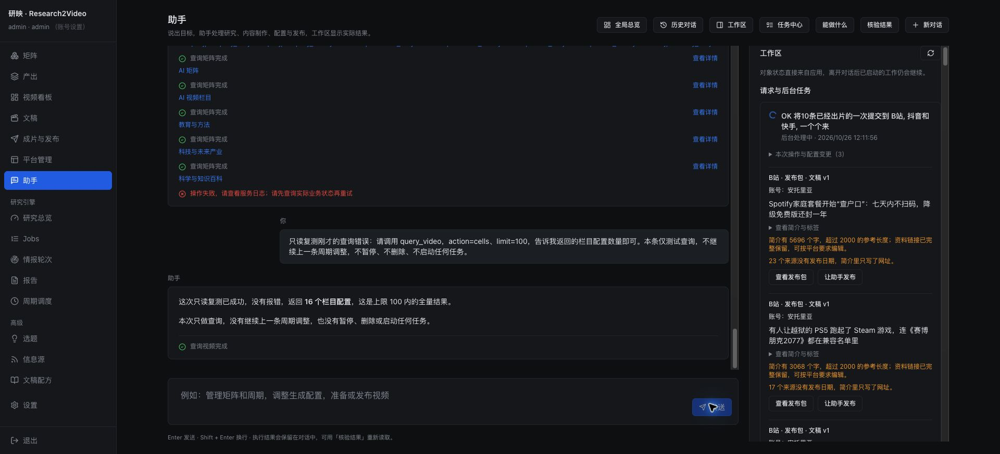

# 助手栏目查询异常修复 · 2026-10-26

截图中的失败操作是 `query_video(action="cells", limit=100)`。16:13:37 的日志记录 `AttributeError: 'list' object has no attribute 'get'`：原生 `/api/video/cells` 返回列表，助手运行时要求对象，读取 `authentication_required` 时崩溃。该请求的八个操作均为查询，没有暂停或删除周期任务。

助手适配层现在返回 `{"cells": [...]}`，原生前端接口继续返回列表。新增回归覆盖空列表和非空列表，验证模型能继续读取结果、成功回执持久化、工作区正常加载。修复前两例均复现同一异常，修复后通过。真实本地配置的 16 个栏目与原生目录逐项一致。

后台已重启加载修复，进程 69870；索引 503 篇报告后恢复访问，已有的一条视频渲染已由原恢复机制接续。历史失败回执保留，不自动重放原周期调整请求。

## 页面复测发现的会话冲突

两个标签页的旧 access token 同时失效时，日志先记录 `/api/auth/refresh` 200，随后另一个刷新返回 403，旧客户端立即调用 logout。服务端刷新会轮换 CSRF cookie，第二个标签页可能仍使用旧请求头；403 是 CSRF 校验拒绝，不能据此认定 refresh token 已失效。

客户端现在遇到刷新 403 时重新读取当前 CSRF cookie，只重试一次；连续拒绝返回暂时不可用，不发送 logout。刷新 401 仍按会话失效处理。没有放宽服务端认证或 CSRF 校验。新增回归验证 cookie 轮换后的重试和连续拒绝的次数上限。前端已构建，页面重新加载后生效。

首次页面只读查询复测遇到上述旧会话退出，请求没有进入助手执行。用户重新登录后，在原失败对话现场复测同一查询成功：返回 16 个栏目配置，成功回执已保存，未暂停、删除或启动任何任务。未读取或重设用户密码。



## 验证

- 后台：86 项通过，包括新故障复现、助手 API、工作区和矩阵管理回归。
- 前端：36 项通过，包括刷新冲突及助手对话恢复。
- `npm run build`、`npm run lint`、`git diff --check` 通过。

```bash
# AI_research/Base_CodingCLi
../.AI_research/bin/python -m pytest tests/test_assistant_video_queries.py tests/test_application_assistant.py tests/test_assistant_api.py tests/test_assistant_workspace.py tests/test_assistant_management.py -q
# ui
npm test -- src/api/client.test.ts src/pages/Ask.test.tsx
npm run build
npm run lint
```
