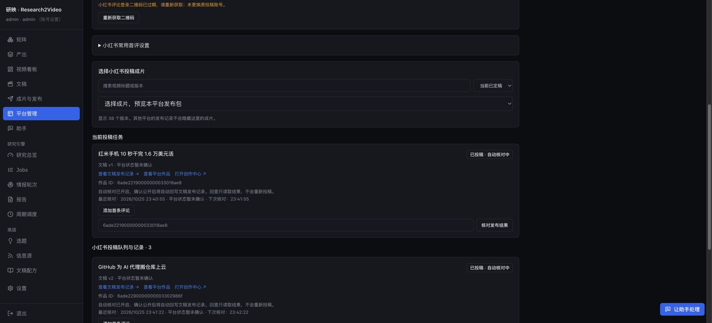

# 助手现有矩阵运营验收

日期：2026-10-25。使用现有「软件与数字工具」矩阵（software），检查管理、研究、写稿、出片、发布准备和异常恢复。业务操作从真实浏览器助手发起，未手动编辑报告或文稿正文。公开投稿单独确认具体内容、平台和账号。

## 发现与修复

- 运营检查原先分散在多个工具中，首轮诊断执行 19 项操作。新增 `inspect_matrix_operations`，按准确矩阵聚合任务、来源、周期、配方、继承、平台账号与候选；来源历史只读取本矩阵的任务。平台近期投稿明确限定最近至多 10 条，不冒充全量队列，也不误称都属于这个矩阵。
- 同日研究会更新同一个报告文件，旧稿使后续生产被误判为已完成。批次核对本次报告指纹；需要重写时调用原生生产接口保存新版本，原稿、成片、记录均保留。已有新版本按版本创建时间识别，不再用文稿对象的初次创建时间；进行中重写按历史最大版本锁定目标。
- 整份报告的生产列表与写稿入口计入了已归档稿件，导致「没有可见稿件，却提示已写过」。现与原 workflow 保持一致，归档稿件不占用待制作来源，避免为了继续生产而强行恢复归档。
- 小红书标题超长时，助手只给未保存的建议；新增 `save_publishing_draft`，按平台、账号和准确 render 保存指定字段，保留其他字段，随后重新读取原生校验。社交平台预览同步按实际保存的草稿计算校验。
- 助手健康检查绕过了原生详细健康接口，缺少托管周期状态。现统一读取该接口；只有两个旧轮次 agent 均有删除备份、未安装且未加载时，历史心跳才标为退役，不再误报当前调度故障。仍运行的旧 agent 或故障的托管周期继续正常报错。
- 原生视频 workflow ID 被误写为应用批次链接。仅对真实回执验证过的 ID 修正入口，保留应用批次及未知 ID 的独立身份。

## 真实研究与生产

- 初始会话：`0e25b9ffe48f451189449a07128235bf`。从新对话恢复的会话：`764d5d65ca69455bb87f7b128bce477b`。
- 已有任务：`software/software_weekly`；生产配置：`software_weekly`，topic_digest，继承原矩阵 1.25 倍速。
- 应用批次：`9b7a94d6c87f4b5a9fcae9f847584729`。启动使用查询矩阵、准备、启动三个操作。
- 研究只运行一次：`v6IpNbYKxS7xWyf6`，报告 `output/software/2026-10-25_software_weekly.md`，SHA256 `4edadc02140721f0daae43eca0c1064fee6c3487899cb8ecb9ee794a78f33fd2`。运行前保留了当日原报告副本。
- 文稿：`f1c063f9607d4c8381f5a530685035e1`，新版本 v2，标题「假 AWS 密钥、真信用卡诱饵：50 人公司靠『绊线』年入 2250 万美元」。旧 v1 保留。初轮恢复曾遇到该稿旧有自动归档，操作及失败记录均保留，未隐藏。
- 原生 workflow：`1ae913acdd1842e198ce22bcded9a929`。跨对话恢复后应用批次复用它与 v2 成片，没有重复研究或追加渲染。
- 成片：`207ff0c86d604da6bc63e8aec290e5c9`；AutoVideo：`a887d0a5-007b-4901-8b90-84c7a4ddf688`。最终批次和视频均完成，1920×1080 H.264 / AAC，204.9 秒，15,542,426 字节，完整解码退出码 0。
- 成片 SHA256：`a99d2acf45fff3460d6420e92a122b295a92050535965dd9936961973f37fe20`。

## 发布准备与真实投稿

候选为小红书账号「安托尼啦」下的两条已有成片：GitHub / Azure v2（render `0e758133178b4ada8e1df33cbd671a63`）与红米手机 v1（render `ac06d623b69d4a18a7b670e81e9f3872`）。先准备并保存平台草稿，用户确认清单后才提交真实投稿。其他平台原有投稿不重试、不重投。

保存后的平台标题分别为「GitHub 为 AI 代理搬仓库上云」和「红米手机 10 秒干完 1.6 万美元活」，两条均通过原生发布包校验。用户明确回复「允许发布这2条」后，通过真实助手启动发布批次 `474395a69f2444b39f951da789b0d728`，账号 UID `657b2244000000002002c62b`，固定两个 render ID，沿用保存后的标题、简介和标签。

- 发布请求 `fc349417190748839b3c6b50e32e07c9`：查询账号、准备批次、启动共 3 项操作，回复后由原生后台继续执行。
- 红米视频 v1：投稿任务 `dd613b05c1d94ea19ab88f24189f08df`。
- GitHub 视频 v2：投稿任务 `6a58ebb32eed4030bf5b4b94fb5955ad`。
- 本轮新生成的 Canary 视频仅验收制作，没有加入发布范围。

两条均取得 HTTP 200、`result: 0`、`success: true` 的实际投稿回执：红米作品 ID `6ade22190000000033018ae8`，GitHub 作品 ID `6ade2290000000003302986f`。上传任务中的标题、简介、标签和首评设置与已保存草稿逐字段一致，两条均未启用首评。

后续进展：两条现已自动确认公开并回写，原批次完成；没有再次上传。[发布闭环与原任务恢复追加验收](assistant-publishing-recovery-20261025.md)记录了解析原因、修复和实际助手复验。下段保留首轮验收时的待确认状态。

随后原生自动回查在账号作品列表中找到两条作品（`owned: true`），平台公开状态仍为 `unknown`，因此保留 `SUBMITTED` /「平台状态暂未确认」，未写入 `PUBLISHED`，也未生成公开发布记录。公开页查看红米链接时返回「当前笔记暂时无法浏览」（300031），不能据此判断已公开、审核失败或投稿失败。自动回查继续运行，原投稿只提交一次；此平台环节的待核对状态是本轮实际限制。应用批次保持处理中，完整回执保存在 `publication-jobs.json` 与 `publication-batch.json`。

准备过程中真实遇到长回复原会话认证失效：助手停止后续操作，已完成查询保留；页面刷新后自动续期，未要求用户提供密码。期间独立视频完成，应用批次也正常完成。续期后的请求继续未完成的草稿准备。

## 验证

- 相关组合回归 257 项通过；后续生产恢复与社交预览组合 156 项通过；链接、批次和工作区专项 48 项通过。各组有重叠，不相加统计。
- 版本、归档、报告变化、账号变化、草稿保存、旧调度退役、当前调度故障均有隔离测试；提供者测试不产生真实上传。
- 真实启用时核对并保留正在运行的 AutoVideo 及独立投稿进程，未停止它们。真实视频完整解码通过。
- 通过真实助手再次读取详细健康接口：整体 `ok`、错误与告警列表为空，托管周期正常、旧轮次调度已退役。原生回执保存在 `health-diagnosis.json`。
- 基线矩阵、任务、配方、生产配置和来源共 171 份文件指纹未变，周期计划字段未修改。期间 `bilibili-video-data` 的 `next_run_at` 由正常调度推进，其余计划字段一致；完整差异保存在 `verification.json`。

本机证据：`state/acceptance/assistant-operations-cycle-20261025/`。入口：[原应用批次](http://127.0.0.1:8775/ask?tasks=1&batch=9b7a94d6c87f4b5a9fcae9f847584729)、[v2 文稿与成片](http://127.0.0.1:8775/video/f1c063f9607d4c8381f5a530685035e1?tab=video&version=2&render=207ff0c86d604da6bc63e8aec290e5c9)、[两条小红书投稿批次](http://127.0.0.1:8775/ask?tasks=1&batch=474395a69f2444b39f951da789b0d728)。
