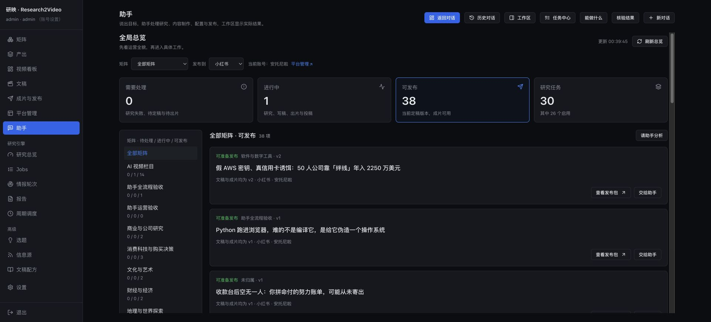

# 助手全局总览验收

日期：2026-10-26。范围：从助手了解各矩阵的运营状态，进入具体事项或预填后续请求。

## 入口与行为

- 助手顶部「全局总览」，直达 `/ask?overview=1`。按矩阵、发布平台、需要处理 / 进行中 / 可发布切换；地址保留筛选，可分享和刷新恢复。
- 研究失败、待确认方案、待定稿、待出片和出片失败进入待处理；研究、写稿、当前版本渲染和原投稿核对进入进行中。投稿状态沿用原生发布回执，不因为查询而重投。
- 发布候选使用所选平台当前账号的原生规则、实际视频文件、当前文稿和定稿版本；不跨平台相加。已归档矩阵和文稿隐藏，未归属单独分组。
- 汇总先计完整范围，再分页。读取失败保留明确提示，相关总数显示未知。托管周期详情仅管理员可见；每日结果按任务最近一次运行统计，并非全天运行次数。
- 每项提供原页面入口和「交给助手」。后者只预填，发送后才执行；清除旧页面对象，保留对话和未发送草稿。宽泛清单仅关联总览，不把所有视频自动塞进相关对象。
- 页面和 `query_operations_overview` 共用本地聚合；查询不调用模型、同步平台或启动业务。进行中每 15 秒刷新，后台标签页暂停，空闲停止轮询。

## 回归与真实数据

- 后端组合 184 项通过；收尾工作区与应用权限相关 56 项、最终总览专项 9 项通过，范围有重叠。
- 完整前端 74 个文件、568 项通过。生产构建、变更文件 ESLint、`git diff --check` 通过。
- 浏览器实际切换 B 站和小红书、限定软件矩阵、进入文稿 v2 / 对应 render 的发布包，以及交给助手预填通过。回复中的候选入口实际点击保留完整筛选参数。
- 当次数据：13 个未归档矩阵，另有未归属分组；30 个研究任务、26 个启用。B 站当前账号候选 3 条，小红书当前账号候选 38 条，其中 AI 视频栏目 14、软件矩阵 1。候选全分页去重、总数及定稿版本核验通过。数值随业务变化。
- 本机首次聚合约 268 ms；包含候选分页和版本核验的两次读取分别约 234 / 363 ms。这是当前数据量的本机观测，不是负载测试。
- 自然语言真实助手请求 `a9f65b0a4c42424d9962e5441cda7431`，会话 `b01a9fe2f22b43c294c2cff2fec51acd`：4 次只读操作，返回矩阵分布、正在核对的原投稿及准确总览链接。没有步骤上限或循环等待。
- 最终复验请求 `84623d3283df48598f60cf71bdaf0ce3`，会话 `96359182861b44b99fc20e570416012f`：2 次只读操作；正确区分 13 个矩阵与未归属分组，回复当前账号的 38 条候选。仅保留总览引用，工作区没有无关视频；回复的总览入口实际点击通过。

## 作用范围核验

194 份 jobs / config YAML 指纹未变；文稿、版本、渲染、发布记录、发布草稿五张业务表未变；周期配置未变；无新增上传任务，原平台队列记录保留。原有平台后台正常产生只读回查任务，未将其误记为新投稿。

服务启用前核验空闲、备份状态，保留独立工作进程与已有队列。证据位于忽略目录 `state/acceptance/assistant-overview-20261026/`，含启用记录、全量范围核验、指纹和真实请求回执。

