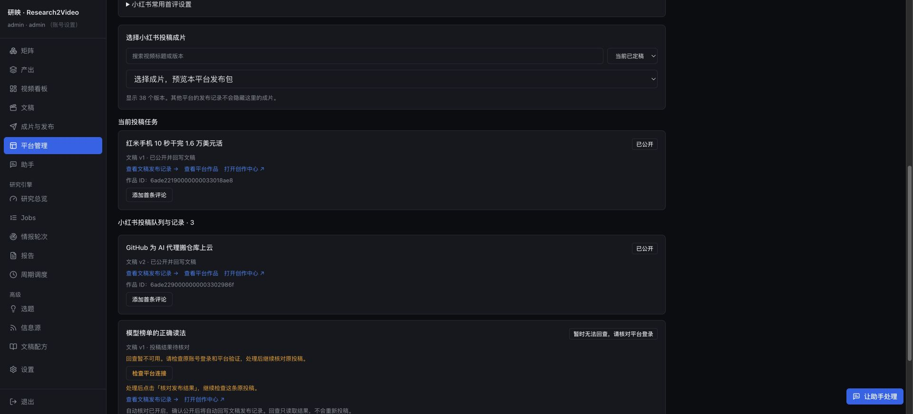

# 发布结果与原任务恢复验收

2026-10-25 开始，10-26 完成。继续使用用户已确认的小红书账号「安托尼啦」及两个原投稿任务；没有新建上传，没有修改标题、简介、话题、文稿或视频。

## 原因与修复

两条作品已经由平台接受，原生作品列表返回 `tab_status=1`、`permission_code=0`、`schedule_post_time=0`，但可选限制标记 `high_self` 没有值。原解析要求它显式为 0，因而一直显示待确认。

对照当日保存的官方创作中心前端（`4108.10b0aee5.js` 枚举与 `98.6a90c3f6.js` note-card 打开条件），`high_self` 使用真值判断；缺省或 null 不表示限制。现按这一语义处理，仍分别识别审核、定时、非公开、拒绝及未知状态。回执保留少量数字/布尔状态字段用于诊断，未保存完整平台响应或凭据。

## 恢复行为

- 助手、请求任务卡、应用批次与平台页使用同一发布状态解释。需要连接检查或处理平台意见时，展示处理原因和准确任务入口。
- 新增 `manage_publishing resume`：先读取指定账号的原任务；已公开直接返回，已投稿只回查，确认未提交才调用原任务重试。恢复不会换成片、版本或发布包。
- 批次保留成功项。回查任务 ID 与上传 ID 分开，继续核对时始终保留原上传 ID；旧回查失败不会覆盖刚发出的新检查。等待处理的发布批次仍可只读发现后续公开结果并完成。
- 平台页可直接跳到账号连接，处理后核对原作品。登录、验证及审核意见不会被伪装为上传进度。

## 真实结果

| 视频 | 文稿 | 原投稿任务 | 作品 ID | 结果 |
| --- | --- | --- | --- | --- |
| 红米手机 10 秒干完 1.6 万美元活 | v1 | `dd613b05c1d94ea19ab88f24189f08df` | `6ade22190000000033018ae8` | 已公开，已回写文稿 |
| GitHub 为 AI 代理搬仓库上云 | v2 | `6a58ebb32eed4030bf5b4b94fb5955ad` | `6ade2290000000003302986f` | 已公开，已回写文稿 |

原应用批次 `474395a69f2444b39f951da789b0d728` 自动完成。随后在真实浏览器助手中执行两条原任务的 resume，请求 `acde388a31d74035bde38c52aaf4596a` 共 4 项操作（2 次读取、2 次 resume），均返回已有公开结果，两次 `submitted=false`。上传总数、原提交时间、作品 ID、版本及完整发布包均未改变，公开记录恰好两条。

## 验证范围

- 后端相关组合 395 项通过，包含可选字段解析、账号/版本隔离、发布回写、重复保护、原任务恢复、登录回查失败、批次部分成功与恢复。
- 前端完整 559 项通过；生产构建和本次改动的 ESLint 检查通过。既有构建包体积提示保留。
- 真实平台验收覆盖上述两条已投稿作品的公开回查与幂等恢复；登录失效和确认未提交后的重试使用隔离数据库与提供者替身测试，没有故意破坏真实账号登录，也没有额外公开投稿。
- 启用前备份状态并确认独立投稿进程可继续，后端更新后健康检查通过。

证据：`state/acceptance/assistant-publishing-recovery-20261025/`。含原任务、逐次只读回查、公开记录、助手请求及操作、启用备份和测试日志。截图见同名目录。

[查看原发布批次](http://127.0.0.1:8775/ask?tasks=1&batch=474395a69f2444b39f951da789b0d728)
