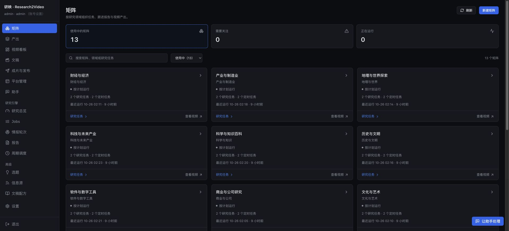
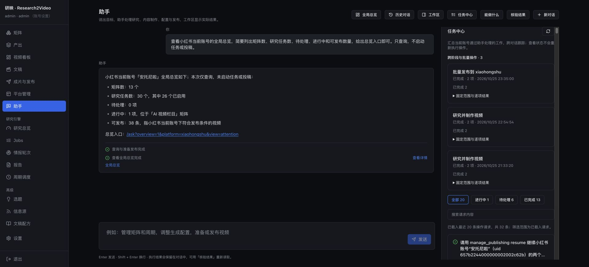

# 研映控制台逐页性能检查 · 2026-10-26

已完成 16 个侧栏主页面及 32 个详情、标签页和表单视图，共 48 个视图的检查。后台已按用户授权重启，前端已构建并投入本地运行。最终复测的主页面均成功显示主内容，未复现服务启动中或请求超时。

## 实测结论

- 主页面中位加载时间为 0.27–1.28 秒；最慢的主页面单次样本为情报轮次 2.06 秒。
- 助手任务中心首次实测 2.83 秒；优化后 4 次中位数 0.90 秒，范围 0.85–2.90 秒。仍存在偶发长尾，不能保证每次都在 1 秒内。
- 40 个后台读取处理器均成功，含 JSON 编码的中位耗时最高为文稿列表 134.6 毫秒；任务中心为 131.4 毫秒。
- 配置页的模型清单自动刷新另行异步进行：本表统计主表单可用时间，不把远端服务商响应计入页面主内容就绪时间。

## 本次修改

1. 助手任务中心和工作区等待初次对话恢复完成后再挂载，避免恢复动作立即刷新同一列表，消除首次进入时的重复请求。保留后续操作完成后的刷新。
2. 同一任务列表中的多个投稿回执，每个平台共享一次带账号权限的原生概览；旧记录未出现在概览内时仍逐项兜底读取。
3. 文本脱敏在每次完整遍历开始时读取一次环境配置，避免每个字符串重复扫描。下一次调用仍立即读取新配置，原有字段和文本处理规则保留。
4. 扩充 scripts/benchmark_console.py，加入各平台、助手总览、任务中心，以及 JSON 编码耗时；使用 SQLite 快照，不改动运行中的业务数据库。

## 测量口径

浏览器为本机已登录管理员会话，访问 http://127.0.0.1:8775。由页面导航或按钮点击开始计时，到主内容加载提示消失、数据区域或编辑器可用为止。计时包含自动化调用开销，不是浏览器 Performance API 的 LCP/FCP，也不是并发压测。主页面最终记录 3–4 次，详情和表单最终记录 1–3 次。后台同时有既存视频渲染和其他本机负载，因此保留全部有效样本及长尾。

详情按页面模板抽取现有矩阵、Job、报告、文稿各一个；各文稿标签均打开检查。创建表单只打开，不提交研究、出片或投稿。登录页在已登录会话下重定向到看板，未退出账号测试匿名登录；分享页没有生效中的链接，未创建新的分享链接。

最终构建期间有一次平台页面导航遇到临时 404；构建完成后重新加载及后续复测均正常。该维护窗口样本没有计入性能表。早期选择器错误、过早就绪的样本不计入最终表；原始 JSON 保留各阶段并用 phase / valid 标注。

## 全部主页面

| 页面 | 中位秒数 | 最小–最大秒数 | 样本数 |
| --- | ---: | ---: | ---: |
| 矩阵 | 0.47 | 0.32–0.68 | 4 |
| 产出 | 0.71 | 0.66–0.81 | 3 |
| 视频看板 | 0.93 | 0.61–1.09 | 3 |
| 文稿 | 1.14 | 1.04–1.21 | 4 |
| 成片与发布 | 1.20 | 0.83–1.73 | 3 |
| 平台管理 | 0.50 | 0.42–0.54 | 3 |
| 助手 / 对话与工作区 | 0.31 | 0.24–0.35 | 4 |
| 研究总览 | 0.45 | 0.45–0.66 | 3 |
| Jobs | 0.68 | 0.47–0.90 | 3 |
| 情报轮次 | 1.28 | 0.52–2.06 | 3 |
| 报告 | 0.27 | 0.25–0.36 | 3 |
| 周期调度 | 0.30 | 0.24–0.66 | 4 |
| 选题 | 0.57 | 0.38–0.58 | 3 |
| 信息源 | 0.42 | 0.33–0.65 | 4 |
| 文稿配方 | 0.43 | 0.31–0.43 | 3 |
| 设置 | 0.32 | 0.22–0.36 | 4 |

## 详情与标签页

| 视图 | 中位秒数 | 最小–最大秒数 | 样本数 |
| --- | ---: | ---: | ---: |
| 助手 / 任务中心 | 0.90 | 0.85–2.90 | 4 |
| 助手 / 全局总览 | 0.54 | 0.52–0.55 | 2 |
| 矩阵 / 研究任务 | 0.46 | 0.46–0.46 | 1 |
| 矩阵 / 运行记录 | 0.57 | 0.57–0.57 | 1 |
| 矩阵 / 周期安排 | 0.45 | 0.45–0.45 | 1 |
| 矩阵 / 设置 | 0.77 | 0.77–0.77 | 1 |
| Job / 概览 | 0.26 | 0.25–0.35 | 3 |
| 报告 / 阅读详情 | 0.28 | 0.28–0.28 | 1 |
| 文稿详情 / 文稿 | 0.41 | 0.41–0.41 | 1 |
| 文稿详情 / 审校 | 0.33 | 0.33–0.33 | 1 |
| 文稿详情 / 视频 | 0.33 | 0.33–0.33 | 1 |
| 文稿详情 / 发布 | 0.32 | 0.32–0.32 | 1 |
| B 站 / 投稿概览 | 0.34 | 0.34–0.34 | 1 |
| B 站 / 视频数据 | 0.54 | 0.54–0.54 | 1 |
| B 站 / 评论收件箱 | 0.32 | 0.32–0.32 | 1 |
| B 站 / 账号与策略 | 0.21 | 0.21–0.21 | 1 |
| 抖音 / 投稿概览 | 0.53 | 0.53–0.53 | 1 |
| 快手 / 投稿概览 | 0.33 | 0.33–0.33 | 1 |
| 小红书 / 投稿概览 | 0.21 | 0.21–0.21 | 1 |
| 矩阵 / 视频配置 | 0.85 | 0.85–0.85 | 1 |
| 配方 / 包装部件编辑器 | 0.35 | 0.35–0.35 | 1 |
| 设置/用户管理 | 0.35 | 0.35–0.35 | 1 |
| 设置/审计日志 | 0.52 | 0.52–0.52 | 1 |
| 设置/运行日志 | 0.32 | 0.32–0.32 | 1 |
| 任务详情/运行历史 | 0.30 | 0.30–0.30 | 1 |
| 任务详情/日志 | 0.28 | 0.28–0.28 | 1 |
| 助手/历史对话 | 0.30 | 0.30–0.30 | 1 |
| 文稿/新建表单 | 0.32 | 0.32–0.32 | 1 |
| 文稿/文章创作表单 | 0.34 | 0.34–0.34 | 1 |
| 调度/新建表单 | 0.47 | 0.47–0.47 | 1 |
| 信息源/新增表单 | 0.37 | 0.37–0.37 | 1 |
| 任务详情/YAML 编辑器 | 0.36 | 0.36–0.36 | 1 |

## 其余观察

周期调度保留了既有提示：com.arec.pipeline.daily 和 com.arec.pipeline.catchup 已删除。设置页保留了已关闭的报告清理配置中的旧模型 ID 提示。这两项是现有配置状态，均未阻断页面加载，本次未改变调度或模型设置。

重启后的完整索引耗时约 12.5 秒（503 篇报告）；运行稳定后的 /api/live 复测为 13.8 毫秒。重启后的首次启动窗口与日常页面响应分别记录。

## 验证

- 后台相关回归：57 + 81 = 138 项通过。
- UI 对话恢复、总览及资源读取回归：31 项通过。
- npm run build、npm run lint、git diff --check 均通过。
- scripts/benchmark_console.py --iterations 3：40 个读取处理器无错误。

```bash
# 在 AI_research/Base_CodingCLi 中运行
../.AI_research/bin/python -m pytest tests/test_assistant_read_performance.py tests/test_assistant_workspace.py tests/test_assistant_management.py tests/test_console_performance.py tests/test_console_read_performance.py -q
../.AI_research/bin/python -m pytest tests/test_application_assistant.py tests/test_assistant_api.py tests/test_assistant_task_center.py tests/test_assistant_batches.py -q
../.AI_research/bin/python scripts/benchmark_console.py --iterations 3
# 在 ui 中运行
npm test -- src/pages/Ask.test.tsx src/components/AssistantOverview.test.tsx src/lib/use-page-resource.test.tsx
npm run build
npm run lint
```

原始记录：[浏览器逐页计时](console-performance-20261026/browser-timings.json) · [后台 40 项计时](console-performance-20261026/backend-timings.json)。




