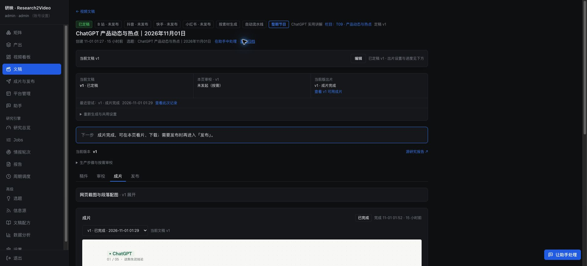

# 日任务范围纠正与空选题处理

2026-11-01。先修正 AI 与 ChatGPT 日任务的原始素材复用及零候选跳过，再通过正式 App 补充报道和验收。本文件前两节记录初轮修复；后续原生流程记录单独列出。没有增加周期任务。

## 收回的偏移

- 移除 `ai_opensource` 栏目的 `mixed_tutorial` 覆盖，保留其项目解读定位，恢复继承原矩阵和配方。栏目中的输入、代码、截图等展示能力继续可用，不再将这个栏目默认设为教程制作。
- 已启动的独立账号切换任务 `eae621cb8d784eb4b3d6b3849a5ef640` 保留为草稿，未定稿、没有出片记录，也没有关联的自动批次。没有继续制作。
- 保留既有问候、转场、截图、代码和声音继承修复；正式 App 已有的教程栏目继续沿用原栏目定位。

## 1. ChatGPT 取材复用

两条日任务已共享官方新闻、官方 Learn 更新、API 更新日志、AI Catchup 和 Ratelimit Now 等源标识，使用现有 `state/materials.db` 归档。共享的是原始素材，各任务仍按自己的栏目选题。

在正式素材库中，按今天 T09 的实际窗口 `2026-10-31 01:25` 至 `2026-11-01 01:25`（Asia/Shanghai）只读复验，Ratelimit Now 的账号切换消息可由 T09 当前配置读取。素材库没有因本次复验而修改。相关回归还覆盖：AI 先归档、ChatGPT 随后实时读取失败时，仍取回同一原始条目。

使用当前生产读取器、关闭付费正文服务，实际读取结果：

| 来源 | 结果 |
| --- | --- |
| Help Center Release Notes | 仍返回 HTTP 403 |
| ChatGPT Learn 视频目录 | 成功取得 4 条，无 Exa 调用 |
| ChatGPT Learn 官方 Markdown 更新 | 成功取得 4 条，无 Exa 调用 |

因此，素材复用与其他公开读取通路已经接通，但没有声称原站的 403 已解除。历史读取错误仍保留。今天原先的“暂无新题材”研究报告没有重跑或覆盖。

证据：[正式素材库与实际窗口](evidence/production-input-and-empty-report.json)、[公开入口实读](evidence/public-reader.json)。

## 2. 无候选不制作

自动发现报告和已有自动批次复用原选题解析器；零候选时跳过写稿、定稿与渲染。本轮补齐正式 App 的手动入口：

- “选报告写”的列表不再提供零候选报告。
- 栏目写稿和直接创建栏目文稿的 API 共用同一检查，返回 `422 / no_topic_content`，不会创建文稿或启动作者。
- 未声明结构化选题格式的正常研究报告仍可以整份制作，不使用关键词或新模型判断是否有题材。

旧片 `5f10a2a8dd484b02b7b9596257b2b451` 源报告确实为零候选，内容却转向“如何判断更新是否可信”。本轮在正式 App 点击归档，移出正常列表与看板；它的原定稿、成片和 32 个回传文件记录保留。该片没有对外发布记录。

证据：[生产记录](evidence/app-records.json)、[正式 App 的可写报告列表](evidence/t09-report-picker.jpg)。

## 验证与生效

- 174 passed，1 个原有 Starlette 弃用提示，25.31 秒。覆盖来源复用、失败回退、空报告自动跳过、两个手动写稿入口、栏目定位和声音继承。
- 全部任务与系统配置、生产策略验证通过，`git diff --check` 通过。
- 通过项目已有空闲维护助手加载到正式 App；重载时 362 条文稿、371 条出片和 61 条排期的记录内容保持。没有新增文稿、出片或排期。
- 正式 T09 页面再次核对：今天的零候选报告不在可写列表，历史有内容的报告继续显示。

日志：[回归测试](evidence/regression.log)、[配置检查](evidence/config-validation.log)、[正式服务加载](evidence/service-reload.json)、[交付核对](evidence/final-verification.json)。

## 3. 后续检查与正式 App 补充

后续按用户要求检查遗漏并处理，研究、写稿、定稿、自动续做与渲染均从正式 App 发起；未运行隔离生产脚本，未手写报告或旁白。

- T09 在 App 重跑原研究任务，生成 `output/chatgpt_acquisition/2026-11-01_t09_updates_1.md`。通过栏目“选报告写”使用该报告，保留原配方、旁白和矩阵设置。更新任务及栏目说明，合并同一产品变化的不同问题，不再把个人登录、双账号录屏或额外实测作为制作前提。移除本任务的 Bilibili / Google Trends 两个依赖付费搜索的泛搜源，保留原有公开产品入口和共享源。此前暂停的 T09 自动制作开关已在 App 恢复。
- 历史正式成片已覆盖 Ultra、Claude Code 2.1.316、Agentic Workflows、工作目录写入变化和青少年保护等，不重复制作。
- 通过正式 App 助手把原公开链接交给现有 `flash_daily` 制作流程，按真实发布日期补充 Rosalind、AI 安全简报与 Credit Saison 三项。使用 App 原生材料读取及自动写稿、定稿、出片续做，没有新增配方或周期任务。

正式任务：

| 任务 | 文稿 | 成片记录 | AutoVideo job |
| --- | --- | --- | --- |
| T09 产品动态（同稿修正版） | `0868102204dc4f2e954c30612b1eec39` | `46e0098ee2394af7bb07a84eeb4bd066` | `e3bc2d9b-a4f4-4bc8-9e98-80bb16807684` |
| AI 快讯补充（配图及表格聚焦修正版） | `26d755b67a5646ca975093ff9ecbc843` | `c3b1f41c89e342c69fab6bb1b6d619f8` | `581a7817-1c5a-4e78-95b8-ccb0ab062dab` |

核对正式提交记录，两条均使用 `voxcpm_anchor`、1.25 倍速及矩阵的 `common` 包装；不覆盖声音和呈现配方。T09 定稿含固定问候，账号入口、数据和权益合为一节。快讯保留原 AI 栏目的开场方式。所有任务仅制作，未发布。

证据：[历史与本次内容核对](evidence/native-app-content-audit.json)、[T09 说明调整](evidence/t09-rules-updated.jpg)、[T09 自动制作恢复](evidence/t09-auto-restored.jpg)。

## 4. 未采用材料的后续选题

复用已有 `SupplyStore.retry_candidates`，给 ChatGPT 信息供给启用与 AI 矩阵相同的 `retry_items: 3`。仍受原有 24 小时间隔、14 天范围和最多 3 次交付的限制，不新增队列或模型步骤。

修正采集回执：当确实交付了未采用材料时，不再标记为静默日；超过正文预算、没有交付的候选仍不改变静默状态。写作材料明确说明这是此前未采用的内容，可按原发布日期补充报道，不表述成今日新发布。已采用材料不会进入重提。

继续核对发现 T09 旧任务说明仍要求“若变化监测显示没有新增或修改”就返回暂无。在 App 原 YAML 编辑器同步改为“既无新增/修改，也无此前未采用且仍值得补充的材料”才跳过，防止说明与现有重提机制冲突。其余任务及报告未改；保存后配置验证通过。[App 保存证据](evidence/t09-catchup-rule-saved.jpg)。

相关回归 54 passed，覆盖共享素材读取、状态生命周期、未采用材料重提、正文预算不足和已采用材料不重复。正式服务加载与成片检查记录在后续验收结果中。

## 5. 完整项目检查

`bash scripts/check.sh` 全部通过：Python 编译、4037 passed / 2 skipped、配置验证、前端类型检查与 lint、92 个前端文件 / 730 项测试、生产构建。初次受限沙箱运行因禁止本地端口绑定而中断，允许隔离测试的临时回环端口后完整通过。构建保留已有体积提示，没有引入新的依赖或拆包机制。

结果：[检查摘要](evidence/final-check-result.json)、[完整日志](evidence/final-check-local.log)。测试数字分别记录，不与前面的子集回归相加。

最终截图关联修复后再次完整执行：4041 passed / 2 skipped，前端 92 个文件 / 730 项测试，编译、配置、类型检查、lint 和构建均通过。日志：[最终完整检查](evidence/final-check-complete.log)。出片模块保持 994 passed / 1 skipped；最终针对匹配规则的回归为 51 passed。

## 6. 实际画面检查发现的重复编号

T09 首次正式 App 成片 `0733f650e698483f964ca7c33d9ec220`（AutoVideo `8e5fdd52-83b1-4821-ac13-8b573246039b`）完成，原生媒体 QA 完整解码通过，25 个画面，包含路径图、对照图、公开截图及 20 处渐变转场。实际关键帧清晰展示添加账号路径和两个账号的数据归属。

同时发现上方章节计数包含导读、回顾（例如 2/5），下方新闻进度只计算正文（例如 1/3），形成重复且口径不同的编号。将现有浅色画面页眉改为仅显示主题名称；节目进度继续由原有导航显示，没有新增开关、组件或数据字段。

在 App 点击同一份定稿 v1 的“重新出片”，使用原配置验证修正版。首版视频及全部 33 个制品保留，不修改历史文件。AI 补充快讯也会在现有渲染步骤自动使用更新后的可信源码。

渲染相关 77 项回归及 esbuild 编译通过；出片模块完整离线检查 994 passed / 1 skipped，见[渲染检查日志](evidence/renderer-check.log)。首版完成截图：[正式 App 首次回传](evidence/t09-native-first-completed.jpg)。

## 7. 实片发现的截图跨主题错配

AI 补充快讯首轮的技术媒体检查通过，但实际关键帧里，OpenAI Secure MCP Tunnel 流程图被放到了 Rosalind 和 Hugging Face 安全段落。这轮不能作为配图正确的验收证据；原成片及尝试保留。

定位到两处共同原因：从通用更新页的域名提取 `openai` 作为画面对象，且图片理解可以在全片任意段落间分配图片。修正现有逻辑：优先使用章节和讲稿中的具体产品、模型或操作；同一具体对象的段落仍可复用图片，跨对象的段落不参与匹配。模型说明同步强调具体对象对应；旧配图选择缓存更新版本，已有文件保留。

仍使用原图片获取、图片理解和原生画面流程，页面预算、调用限额和阶段数量不变。没有改写已定稿的事实、数字或口播。50 项相关回归通过，覆盖同一对象复用、跨产品错配阻止和旧配图决定不能跨主题应用，见[匹配回归](evidence/visual-matching-regression.log)。修复加载后使用同一 App 定稿重出补充快讯。

中间重出 `b841778a944e4b7a861d2ac9b0822223` 已消除跨主题分配，但开场仍选择了泛化 MCP 图，因此在 AutoVideo 原界面取消并保留记录。补齐同站链接关联及通用术语触发：只凭来源域名相同不追加其他产品页面；章节没有明确讲述 API/MCP 等术语时，概览中提到这些词不单独触发配图。明确以 MCP 为主题的段落仍可取图。相关回归更新为 51 passed。

正式 App 再次按同一份定稿重出，实际选图记录现已仅将 Rosalind 价格表放在该模型的价格段落，开场与安全段落使用原生画面。两次服务加载均通过原空闲维护机制，文稿、渲染和 61 条排期内容保持。[首次加载](evidence/native-app-fix-reload.json)、[最终配图修复加载](evidence/native-app-visual-reload.json)、[中间重出已取消](evidence/ai-supplement-intermediate-cancelled.jpg)。

## 8. 表格镜头保留完整数据行

配图修正版 `6689f07d43664defbbfca60b00e7b693` 的媒体检查通过且图片归属正确，实际关键帧仍发现表格镜头放大了 Cached input 表头，将对应模型的数据行裁出视口。该轮用于定位镜头问题，不作为最终画面验收。

在现有 `visual_focus.for_asset` 中调整表格聚焦：优先用讲稿中出现的完整模型/对象名称对应 OCR 数据行，聚焦范围横向覆盖整行，使对象和数值列一起保留；没有明确对象行时显示完整表格。图片、代码和其他画面的原路径保留，没有新增模型、阶段、选项或数据字段。

相关检查 55 passed，覆盖本次模型行与价格列同框、无法定位行时全表展示、截图匹配、可读性及既有教程素材。见[表格聚焦回归](evidence/visual-focus-final.log)。通过已有空闲维护加载，数据和排期内容保持：[加载记录](evidence/native-app-table-focus-reload.json)。在正式 App 同一定稿 v1 重新出片；新提交的实际聚焦范围为 `x1=0, x2=1000, y1=572, y2=750`，标签 `gpt-rosalind-research`。

## 9. 用户质疑后的泛化审查：尚未完成通用验收

用户指出不能围绕同一条内容反复修补，再据此认定换题材仍然可靠。本轮停止新增制作和继续修改启发式规则，进行只读审查。

生产代码没有写死 Rosalind、Credit Saison 等样例名称，但“标题中的最后一个英文实体作为主体”“按主体字符串相同跨段落分配图片”“表格最长命中文字作为目标行”等仍是启发式，不能据此承诺跨题材稳定。既有接口、流程和技术媒体 QA 通过也不等于视觉语义正确。

新增不调用模型、不发起出片的表述/布局变换检查，发现可复现的边界：

- 4 个中文叙述中，候选筛选层仍可能回退到发布者，并放行同站的无关图片。后续图片理解仍可能拒绝，因此这不是 4 条完整生产链路已失败的结论。
- 3 组对比标题换序中，3 种标题顺序使明确相关的产品图在候选层被拒绝；正文与来源没有变化。
- 3 个“产品是列标题”的竖向表格中，聚焦逻辑将列标题当成数据行，强调范围没有覆盖数值。全宽聚焦保护了整图可见性，但没有证明强调对象正确。
- 12 个英文显式产品名与发布者替换检查通过，说明部分通用机制有收益。这一小组探针不代表总体通过率。

证据：[只读泛化检查](evidence/generalization-audit.json)。另外保留 6 个既有正式 App 任务作为独立验收候选，覆盖不同栏目，当前全部标记 `not_evaluated`，没有据其调参或生成新片：[候选集](evidence/generalization-holdout-candidates.json)。

因此当前结论限定为：机制层修复与当前回归样片已有证据，视觉主体识别、图片用途和聚焦目标仍未完成通用验收。当前 ChatGPT 动态与 AI 快讯只能作为回归案例，不能充当整体功能完成的证明。后续应先统一画面对象、图片用途与完整数据范围的决定位置，复用现有编排字段，减少多处重复猜测；再以不参与调参的实际任务验证，并明确不同内容形式的退化行为。

## 10. 撤回不成熟行为，停止按样例追加规则

用户要求功能不能依靠对单个案例持续打补丁维持。本轮选择撤回未完成通用验收的行为，不再继续扩充实体词、标题规则或表格标题黑名单。

- 新的自动配图需求不再从标题、段落英文词或发布者推断 `visual_subject`。来源链接仍是候选入口，恢复以完整上游段落进行原有匹配；标题换序不会再改变所猜测的画面主体。
- 图片理解只评估当前段落，服务端只登记该段落的位置。不同段落即使提到同一产品，也不共享一次图片用途判断。相同图片在分别匹配后仍可合并登记，原始素材共享机制不受影响。
- 图片缓存绑定完整段落内容，旧版本的推断缓存不再命中。相同产品的不同功能不会仅凭实体词相同复用图片决策。
- 没有可靠表格结构时始终展示完整表格，撤回“最长命中的 OCR 文字就是目标行”的自动强调。完整条件、行列和数值一并保留，不再声称自动识别了目标行。
- 不符合现有逐段匹配的图片沿用原有原生画面；问候、转场、栏目配方、配音继承、来源共享、空题材跳过等独立能力继续保留。

验证：针对变动的 68 项检查通过；现有视频、截图、配图及教程输入等 49 个模块的 926 项回归通过。新增检查覆盖标题换序、不同产品名、纯中文表述、横纵表格和不同功能的缓存隔离，不把通过数量当作视觉语义准确率。日志：[针对性检查](evidence/withdraw-speculative-visuals-tests.log)、[公共链路回归](evidence/withdraw-speculative-visuals-regression.log)。

另外对当前 ChatGPT 动态、AI 快讯及 6 条其他既有正式任务的定稿做了只读输入检查：更换章节标题后匹配需求保持，均不再生成推断主体，原定稿不变。这只验证撤回行为对实际输入生效；没有获取新图片、调用模型或重新出片，不能声称这 8 条视频已通过新版画面验收。[实际输入检查](evidence/withdraw-speculative-native-inputs.json)。独立任务候选集的完整视频验收仍保持 `not_evaluated`。

撤回已通过现有空闲维护流程加载到正式 App（PID 56239 → 84543，健康检查正常）。364 条文稿、377 条出片记录与 61 条排期在加载前后内容哈希一致，没有新增任务或覆盖历史产物。[服务加载记录](evidence/native-app-withdraw-speculative-reload.json)。此前已提交的 AI 快讯修正版已完成；它使用旧冻结输入，保留为历史回归产物，不作为本轮撤回后的新效果证明。

当前交付是收回不成熟的自动推断，恢复公共基础路径，并非将“智能主体识别与表格自动聚焦”重新宣告为已完成。
