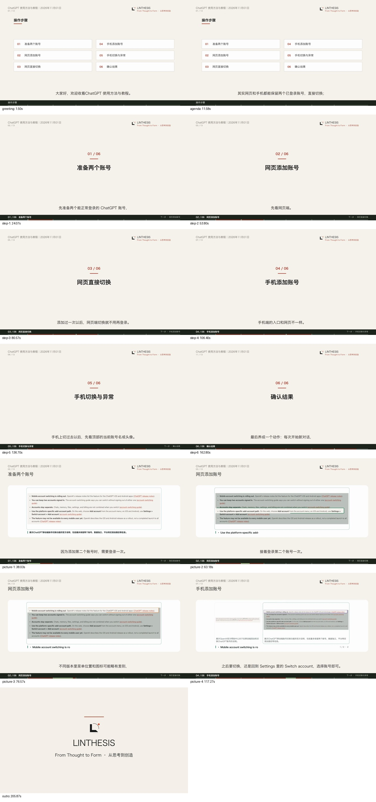

# 日任务取材复用与公开资料教程验收

2026-11-01。本轮优化现有 AI 快讯和 ChatGPT 产品动态：共享公开原文，改善读取，空选题报告不再进入自动写稿；以“双账号切换”检验从公开来源到教程成片的通用流程。没有增加周期任务、服务、生产依赖或公开请求字段。

后续范围纠正：本文的教程成片来自隔离验收，不能代表正式 App 已完成相同出片验证。独立教程现停在正式 App 草稿；AI 开源发现的教程配方覆盖已撤回。现有日任务的素材复用、空报告自动与手动入口处理，以及跑题旧片归档，见 [范围纠正与正式 App 核对](../daily-scope-correction-20261101/README.md)。以下保留原验收过程与历史产物。

## 信息源与共享

- 两条日任务使用已有来源注册表中的同一组源标识：OpenAI News、ChatGPT Learn 官方更新、OpenAI API 更新日志、AI Catchup 和 Ratelimit Now。采集结果进入原 `materials.db`，各任务保留各自的选材方向与交付记录，不复制另一栏目的成稿。
- 官方 Markdown 页面通过原页面读取器保留标题、链接与章节正文；更新日志中的 `Oct 30` 结合上级年份读取。同一天多条公告共用日期标题时，正文合并保留，避免归档时覆盖。
- 目录页失败时也可使用已有匿名浏览器回退。正常的公开 HTTP 读取继续优先；新官方入口和实读成功的 Learn 目录不依赖 Exa 正文额度。
- 首次观察用于建立基线，明确日期且位于采集范围的公告仍可用于选题；日期不明的说明继续作为背景。

最终公开读取验证使用当前生产读取器，不调用付费正文服务：

| 公开来源 | 本次读取条数 |
| --- | ---: |
| OpenAI API 更新日志 | 80 |
| ChatGPT Learn 官方更新 | 80 |
| OpenAI News RSS | 80 |
| AI Catchup RSS | 50 |
| Ratelimit Now RSS | 80 |
| ChatGPT Learn 视频目录 | 80 |
| Claude Code GitHub Releases | 30 |

Rosalind、Credit Saison、账号切换及 Claude Code 2.1.316 均出现在实读原文中。API 模型与 ChatGPT 产品按现有栏目区分，客户案例按具体工作和成果组织。

帮助中心的直接读取仍遇到 HTTP 403，该失败继续保留在记录中。可读的官方文档、RSS 和已有归档提供其他取材通路，没有将读取失败记成“没有新闻”。全部原文和读取回执保存在本机运行目录 `state/acceptance-daily-sources-20261101/run-1/`。

## 无选题时的自动行为

日任务已有结构化选题格式。自动发现报告时，以及已保存的整期批次开始选题时，均用原解析器检查实际条目。零条目直接跳过写稿和渲染，已有批次记录为“没有可写的新选题”；不调用新的分类模型，不占制作名额。

没有声明选题格式的正常长篇研究和工具教程继续作为整份报告制作。已有历史视频与失败尝试保留。

本机只读复验：今天 T09 的“暂无新题材”报告解析为零条目；原 AI 素材归档中的账号切换原文，在同一个 T09 时间范围内可读取且与当前来源配置匹配。

## 公开资料教程与配图

教程使用既有 T03 的定题研究输入，只选“双账号切换”；正式 T03 配置和周期不变。研究引擎读取 [公开账号切换文章](https://aicatchup.com/news/chatgpt-account-switching-mobile)，保存原文，再按原矩阵流程自动写稿、定稿、配图、调用 AutoVideo 与下载产物。操作路径对应 [官方公开说明](https://help.openai.com/en/articles/20001068-using-multiple-chatgpt-accounts-on-web-and-mobile)。

流程不要求登录两个个人账号或录制个人屏幕。公开说明截图用于展示依据，菜单路径及两个账号之间的关系由既有步骤、图解和对照组件呈现；没有仿制个人操作记录。

第一版自动配图误将资讯站导航和相关阅读当成目标，原有图片检查将其退回文字画面。修正原配图器后，画面对象优先取讲稿和文章路径共同给出的产品名称，中文账号／切换等操作词能匹配英文说明；正文取景排除导航、相关阅读及以链接为主的列表。没有增加新组件或新的模型阶段。

第一版完整自动批次与成片保留；复用相同 v1 定稿，通过原重出片入口验证修正后的公开资料配图，没有手改讲稿、分镜或图片段落。

最终成片 207.87 秒，1920×1080、30 fps、6236 帧，共 13 个场景。两张公开正文截图自动进入 5 个场景，6 段步骤转场、一次栏目问候、既有 LINTHESIS 品牌及 6 秒片尾自动生效。本片是公开资料讲解教程，截图来自公开文章正文，菜单路径由现有步骤画面说明；验收没有要求个人登录或实操录屏。

正文与包装片均完整解码，媒体、包装、品牌 QA 为 PASS；33 个回传产物校验通过。公开截图与实际渲染资产像素一致，完成 13 个时间点及网页／手机配图全尺寸检查。完整成片保存在本机运行目录：

`state/acceptance-daily-sources-20261101/run-1/state/video_renders/aaf0a751ad3e4e4082964ea102bb342c/video.mp4`

| 记录 | 标识 |
| --- | --- |
| 自动批次 | `1d2a656571d047d9896527bc7f9051fa` |
| 原定稿 | `bd834feccb9844b3acfcc6ef41f9d922` / v1 |
| 最终出片 | `aaf0a751ad3e4e4082964ea102bb342c` |
| AutoVideo 任务 | `c2fe1190-7ff7-4319-ac9c-60a1e3246164` |



关键记录：[最终核验](evidence/verification.json)、[自动批次回执](evidence/receipt.json)、[保留的首次出片](evidence/baseline-receipt.json)、[两次出片摘要](evidence/render-attempts.json)、[原自动定稿](evidence/version.json)、[自动配图决策](evidence/public-picture-decisions.json)。

## 验证与加载

- 最终相关回归：163 passed、1 个原有 Starlette 弃用提示，19.42 秒。覆盖共享来源、归档复用、读取回退、同日多条公告、空报告跳过、整期节目、教程、视觉匹配和自动流程。
- 最终源码已通过既有空闲维护助手加载到主服务，PID 82029 → 92585，健康状态 ok。361 条原文稿、371 条原出片、61 条原排期均保持，没有新增周期计划。
- 正式排期的时间和每日四期自动预算保持。验收账本隔离，实际引擎任务与所有输出保留。
- 全部 186 个任务配置、系统配置与生产策略验证通过。服务加载记录、成片核验与当前 9 个生产源文件的 SHA256 一致，最终视频哈希亦已复核。

验证记录：[回归日志](evidence/research-tests.log)、[配置验证](evidence/config-validation.log)、[加载记录](evidence/service-reload-final.json)、[媒体 QA](evidence/qa.json)、[包装 QA](evidence/package-qa.json)、[品牌 QA](evidence/brand-qa.json)、[交付前复核](evidence/final-consistency.json)。

## 复现

从研究模块运行，使用正式 Python 环境、既有 AutoVideo 服务和已配置模型。公开来源验证不需要个人登录；研究和出片沿用正常模型费用与调用限额。

```sh
../.AI_research/bin/python spec/acceptance/daily-sources-20261101/run_accounts.py \
  --output state/acceptance-daily-sources-20261101/new-run
../.AI_research/bin/python spec/acceptance/daily-sources-20261101/run_accounts.py \
  --output state/acceptance-daily-sources-20261101/new-run --sources
../.AI_research/bin/python spec/acceptance/daily-sources-20261101/run_accounts.py \
  --output state/acceptance-daily-sources-20261101/new-run --research
# 按原报告稳定规则等满 60 秒。
../.AI_research/bin/python spec/acceptance/daily-sources-20261101/run_accounts.py \
  --output state/acceptance-daily-sources-20261101/new-run --run
../.AI_research/bin/python spec/acceptance/daily-sources-20261101/verify_accounts.py \
  state/acceptance-daily-sources-20261101/new-run
```
