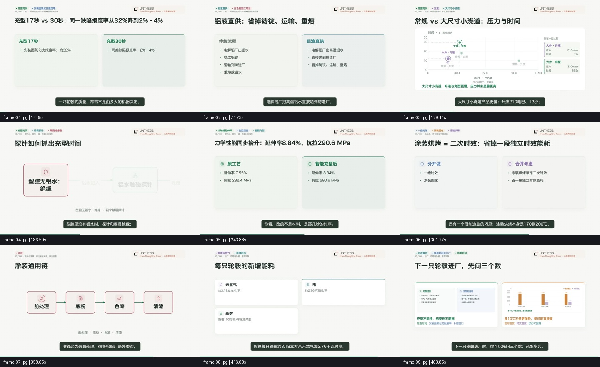

# 产业推荐主题完整试跑

日期：2026-10-28。使用正式工作台中的既有推荐主题和自动生成的讲稿，完整执行资料收集、文稿、自动定稿和视频生成。状态：已完成。

## 选择与启动

- 矩阵：产业与制造；分类：T01 · 一件东西怎样造。
- 推荐题目：一块铝锭变成汽车轮毂，要经过哪些关键工序？
- 主题 ID：`f0f4239e6a4c4f3893806b34f6dc7137`。
- 文稿 ID：`9d6ba001f72c4ea88d94eab667bd5274`。
- 正式入口：[文稿与成片](http://127.0.0.1:8775/video/9d6ba001f72c4ea88d94eab667bd5274)。
- 2026-10-28 14:28:06（北京时间）点击该推荐题目的“研究并制作视频”，参考时长为 4 分钟。
- 沿用 `industry_weekly` 制作绑定与产业矩阵的 1.25 倍速；新主题分类和受众进入了研究、写稿及画面方向。
- 原主题已进入使用记录，资料、文稿与视频关联在同一条主题上。

## 实际资料收集

参考库提供的是“跟随一件东西的制造过程”题型，其示例是 ASML 的芯片制造介绍。新主题进入研究后以铝合金轮毂为检索对象，搜索工艺流程、低压铸造、充型控制、热处理、机加工、涂装和检测等资料。

研究任务：`video/theme_research-m4_9d6ba001`。运行 405.6 秒，记录 8 次模型请求、8 批搜索，575,825 tokens。底稿 16,100 字符，见 [研究底稿](research.md)；定向检索与网页阅读过程见 [研究事件](research-events.jsonl)。

底稿组织了十个子问题，包含具体工序、案例、图表与页面展示建议。原始报告保存在 `output/video/2026-10-28_14-28-06_theme_research-m4_9d6ba001.md`。

## 实际文稿

一次写稿完成，耗时 98.387 秒，记录 1 次模型请求、220,488 tokens。写稿接收了主题底稿与原始材料；元数据显示底稿 16,100 字符，原始材料 458,350 字符。

自动标题：**充型快8秒，报废率32%：一块铝锭怎样变成轮毂**。

讲稿六章依次为熔炼、低压铸造成形、充型检测与控制、热处理、机加与涂装、出厂检测。正文见 [讲稿](script.md)，原始版本和生成记录见 [script.json](script.json)。

系统测得 2,475 个口播单位，估计旁白 551 秒，是 4 分钟参考预算的 2.297 倍。系统仍按完整文稿进入制作，这是本次试跑实际暴露的时长控制问题。

## 画面素材与制作

自动配图访问了三个不同 PDF 来源。页面采集均返回“页面正文尚未加载或内容过少”，最终没有采用截图，进入既有程序化画面路径，过程见 [visuals.json](visuals.json)。

AutoVideo Job：`9817bfde-4083-4de4-a0c0-3e68ed771e18`。研究端渲染 ID：`12e887524418455ebf16eff34abd5f63`。

出片端识别为 `process_diagram`，完整保留上游六章讲稿，生成 94 段本地配音；日志显示 94 段均为本次合成。详细运行关联见 [run.json](run.json)，阶段用量见 [usage.json](usage.json)。

最终生成 31 个镜头：7 个对比、6 个流程图、10 个概念展开、3 个大数字、2 个散点图、2 个柱状图、1 个其他数据图，见 [镜头摘要](scene-summary.json)。

## 成片与实测

- 完成时间：2026-10-28 15:16:10（北京时间）。从选用主题到成片回传共约 **48 分 4 秒**。
- 成片：**7 分 58.2 秒**，1920×1080，30 fps，H.264 视频、48 kHz 双声道 AAC 音频；155 条字幕。
- 本地文件：`/Volumes/个人资料/2026/视频生成工作流/AI创作/视频输出/研究成片/12e887524418455ebf16eff34abd5f63/video.mp4`。
- 六章、94 段旁白按顺序保留；旁白覆盖检查通过，见 [narration-check.json](narration-check.json)。引擎媒体检查中的 AAC/TTS 匹配相关系数为 0.99995。
- 对下载后的最终视频另做全量音视频解码，退出码 0，见 [full-decode.log](full-decode.log) 和 [ffprobe.json](ffprobe.json)。
- 正式工作台播放器可以正常播放，读取到视频时长 478.2 秒、播放进度持续推进，验收后暂停在约 1 分 34 秒；见 [播放器画面](video-completed.png)。
- 抽取覆盖开头、中段与结尾的九个时点，逐帧记录对应字幕；检查总览与散点图、流程图的放大帧，所检查帧的主要文字、图表和字幕可读，未见明显裁切或重叠。这里记录的是抽帧检查范围。
- 媒体检查可复现：`python spec/acceptance/industry-theme-20261028/check_video.py`，只读取已经完成的这条视频。

实际观感：工序顺序、参数对照和逐步强调能够跟随讲述，品牌与字幕保持一致。整体更接近图文讲解；探针、模具、铝水流动等物理过程依赖文字框和箭头，缺少真实工件、设备或剖面演示，普通观众仍需要较多想象。

本轮暴露的改进点：

1. **篇幅控制**：4 分钟参考生成了接近 8 分钟的成片；需要在写稿阶段收束讲述范围和篇幅。
2. **制造业画面素材**：三个 PDF 页面未取得可用截图；应让 PDF 工艺图、实物、设备与加工前后状态进入素材链路。
3. **界面推进**：自动定稿后，打开的稿件页曾停留在旧状态；刷新后正确显示自动制作进度。完成后正常显示成片及播放器。

## 用量与耗时

| 阶段 | 已记录模型请求 | 已记录 tokens | 搜索批次 | 耗时 |
| --- | ---: | ---: | ---: | ---: |
| 主题研究 | 8 | 575,825 | 8 | 405.6 秒 |
| 文稿 | 1 | 220,488 | — | 98.387 秒 |
| 视频制作 | 7 | 86,159 | — | 2,372 秒（包含配图、排队/轮询和回传） |
| 本次主题生产合计 | 16 | 882,472 | 8 | 全链路 2,884 秒 |

先前出题批次的一次请求、9,885 tokens 为八个主题共享，另列于 [usage.json](usage.json)，不重复记入本次主题生产。当前没有可用单价，未据此编造金额。自动配图记录模型调用为 0；本地配音和渲染的时间单独体现在执行日志中。

实际制作中，本地配音与对齐 718.52 秒、分镜 240.21 秒、画面编译 85.19 秒、渲染 994.76 秒；完整步骤见 [worker.log](worker.log)。本地文件回传 4.883 秒，渲染过程只运行一次，详情见 [render-summary.json](render-summary.json)。本次生成结果保存在工作台，尚未发布到平台。
