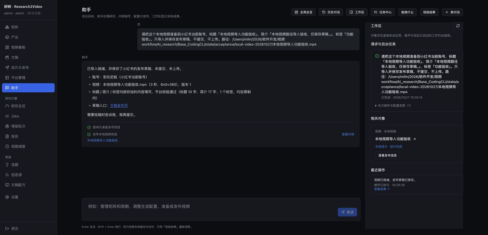
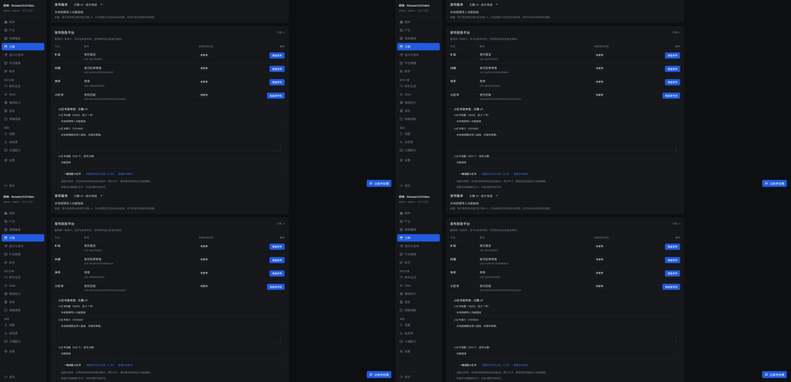
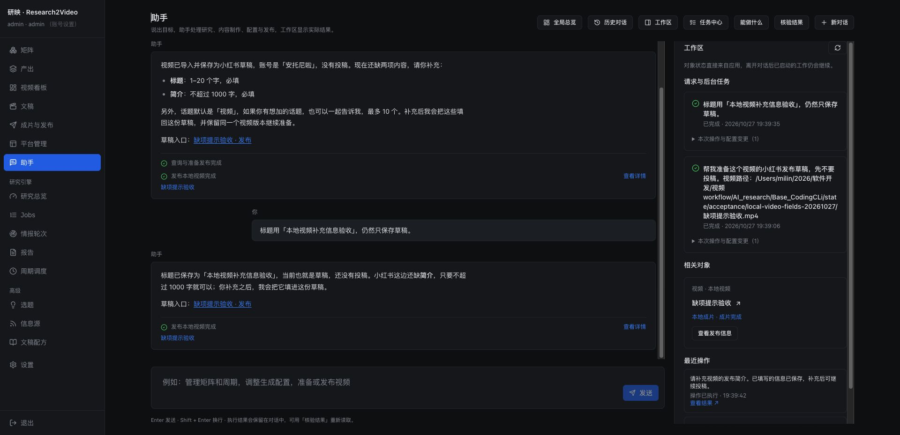

# 本地视频路径投稿验收

日期：2026-10-27。目标：用户给出本机成片路径和平台，助手直接接入现有投稿流程，无需研究、写稿或重新渲染。

## 能力

- 助手工具 `publish_local_video`，共用编辑权限接口 `POST /api/assistant/local-video`。`action=prepare` 导入并保存发布草稿；`submit` 使用当前平台账号的原生投稿队列。明确要求投稿时直接提交，无新增确认步骤。
- `path` 是运行应用电脑上的绝对路径，支持 `~`、中文和空格，文件格式 MP4 / MOV / M4V。文件名用于识别成片；发布标题或简介缺失时提示补充，仅询问缺项，沿用已保存草稿。可提供标签；B站可提供分区 `tid`，也可使用平台默认分区。
- 使用 ffprobe 读取视频轨、时长和尺寸。外部文件保存独立成片副本，同内容及并发导入复用同一资产；同路径换成新内容时保留旧成片。已有受管成片路径保留原文稿、版本和投稿历史。
- 发布信息按平台、账号和版本保存；平台字数或必填项问题可修改后继续，不必再次导入。重复投稿继续原任务；已公开沿用原结果。导入视频不加入其他平台的全局自动投稿。
- 详情和助手工作区显示「本地视频」，提供看片与发布入口，隐藏文稿重写、配音和生成步骤。没有生成正文、调研报告或新增内容审校。

## 验证

- 专项后端 **20 项通过**：四个平台派发到原生队列、版本/账号隔离、真实 MP4 导入及完整解码、路径/文件错误、重复与并发复用、已有成片复用、草稿保存及平台要求、自动投稿排除、工作区跟踪。
- 相关后端组合 **1052 项通过**，4 项隔离服务测试因沙箱禁止绑定回环端口而未执行成功；在允许本机端口的环境补跑该文件，**5 项全部通过**。这两组有重叠，不相加统计。
- 完整前端 **79 个文件、598 项通过**；最后显示文案精简后重跑相关 **24 项通过**。生产构建和定向 ESLint 通过；构建保留现有 YamlEditor 大分块提示。
- 当前服务已启用；启用前备份业务状态，启用后网关健康检查通过。

## 真实页面助手验收

向助手提供 3 秒、640×360 的合成 MP4，明确只准备小红书草稿。助手实际执行 `query_publishing` 和 `publish_local_video prepare`，保存指定标题、简介、标签；点击结果入口可编辑该平台的已保存草稿。浏览器读取成片 `readyState=4`，时长/尺寸匹配且无媒体错误。

- 对话：`dbedbb269942406aaf15a9a741f1a6c5`；请求：`bea8a4f814df4d58948b02bd715f78ac`。
- 资产：`ad13d5e26c6846c5ac44f89a06a8f8c5`；成片：`c7ff8d74c2b74b41bd58ec75c202c494`。
- 仅新增本地资产、导入版本、成片和小红书草稿/历史。原有 181 篇文稿、253 个版本、275 个成片、178 条发布记录和原有草稿保持；四个平台新增上传任务均为 **0**。验收资产已通过原页面归档，文件和记录保留。
- 本次助手无配置操作；验收窗口观察到五份 AI 栏目配置由并行工作变化，未覆盖这些修改，因此不将整库配置不变列为本次结论。
- 本轮没有真实公开投稿；平台派发由隔离提供者验证，真实界面验证止于草稿保存与播放。登录、验证码以及平台审核沿用原业务处理。

本机日志、基线及核验：`state/acceptance/local-video-20261027/`。

## 缺项提示追加验收

按用户要求，未提供发布标题或简介时，助手提示补充缺项，不再默认以文件名直接投稿。工具返回 `needs_input` 和 `missing_fields`，保存已有信息；补充后沿用原资产及平台草稿。已有投稿仍继续原任务，已有发布记录仍直接返回结果。

- 相关后端 **35 项通过**（本地视频专项 23 项、助手管理 12 项），覆盖两项都缺、只缺标题、只缺简介、重复请求仍提示、仅补缺项后进入原生队列、其他已填字段保留。Python 编译与 `git diff --check` 通过；本次无前端代码变更。
- 服务已启用。真实页面助手对话 `a7ae31d034f84a719e23febce715b31e`：仅给视频路径后询问标题和简介；仅补充标题后，实际保存标题并只询问简介。两个请求 `2c460f5c2e6a4f10ad6496e036d6e809`、`f2029c19c4064ba990ccd52f358b41b5` 均完成，始终复用成片 `1e30b9f23d1e42d78c52f29c3e7085ad`。
- 原生草稿核验标题已保存、简介仍空；四个平台均无该视频的上传任务或发布记录。临时验收资产 `17cbfaff60b34d8c8659dae511473a69` 已归档。本机证据：`state/acceptance/local-video-fields-20261027/`。

