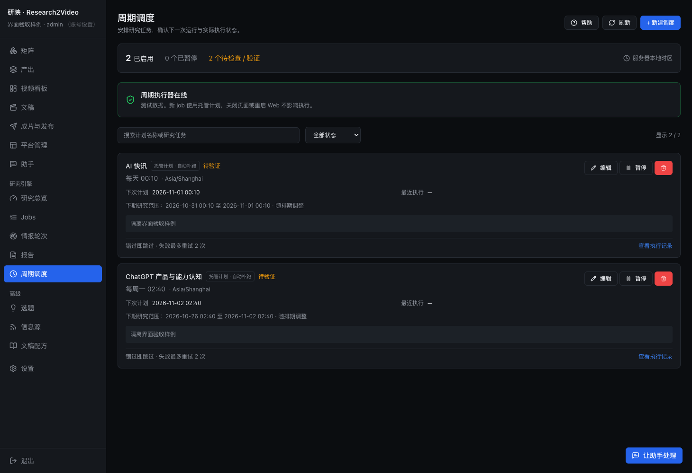
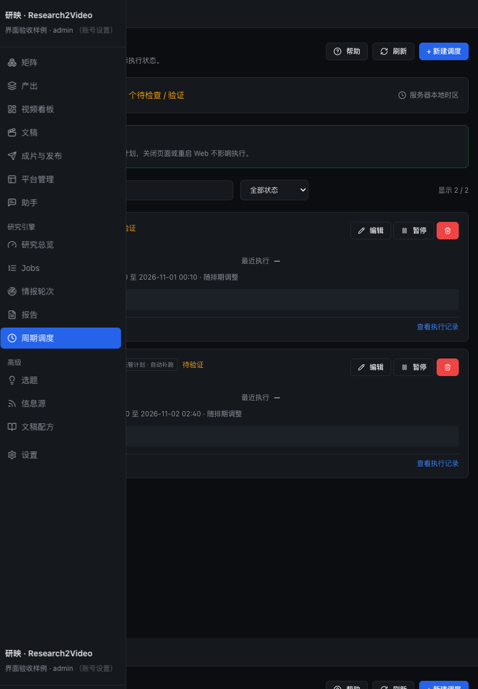

# 可调整周期生产架构验收

2026-10-31。本轮实现与配置见 [架构说明](../../matrix-cadence-architecture.md)。

## 隔离验证

- 完整 `bash scripts/check.sh`：后端 3897 项通过、2 项跳过，UI 89 个测试文件、699 项通过；编译、配置、类型、lint 与构建通过。
- 收尾定向回归：素材缓存与自动接续相关 114 项通过；原生跨入口额度与账本相关 5 项通过。上述定向结果不重复计入完整回归数量。
- 覆盖排期窗口变化、排队延迟、配置修改、重试快照、历史运行兼容、归档版本、源列表消失后的历史素材、部分日期失败、缓存不可用降级、日期时区、底稿及原文进入作者、跨矩阵并发额度、超额保留与手动批次。
- 原生额度测试让一个矩阵自动写稿、另一个矩阵自动出片，共用同一额度；耗尽后新条目保持 PENDING，话题不变、未创建文稿，明确手动批次仍可运行。提供商和视频提交使用隔离替身，没有真实研究、渲染或公开发布。

可从研究模块运行本轮集中测试：

```bash
../.AI_research/bin/python -m pytest \
  tests/test_production_policy.py tests/test_production_policy_api.py \
  tests/test_research_window.py tests/test_material_archive.py \
  tests/test_production_admission.py tests/test_admission_handoff.py \
  tests/test_cadence_handoff.py -q
```

## 界面

以下为真实 `SchedulerPage` 在独立前端测试端口的截图，API 数据使用明确标注的模拟样例；不是已启用生产后台的证明，也未读取生产登录信息。





## 正式迁移与加载

增量迁移保留了 60 条原计划、1860 个执行记录及1865 次尝试的原字段，仅新增未来的素材积累计划、期次上下文列和独立额度账本。14 个研究任务保持既有凌晨排期及整期生产绑定。

调度器已在无研究执行及子进程时通过原受管服务优雅加载，心跳确认期次上下文协议为 v1。Web 后台仍等待既有任务结束，再通过正常登录与原受管维护入口加载并核对能力、实例和服务状态；不把源码已提交视作全部生产实例已生效。

本机完整回执、日志、源文件摘要及后续启用进度位于 `state/validation/matrix-cadence-architecture-20261031/`，本地数据库和原任务制品不纳入此提交。
