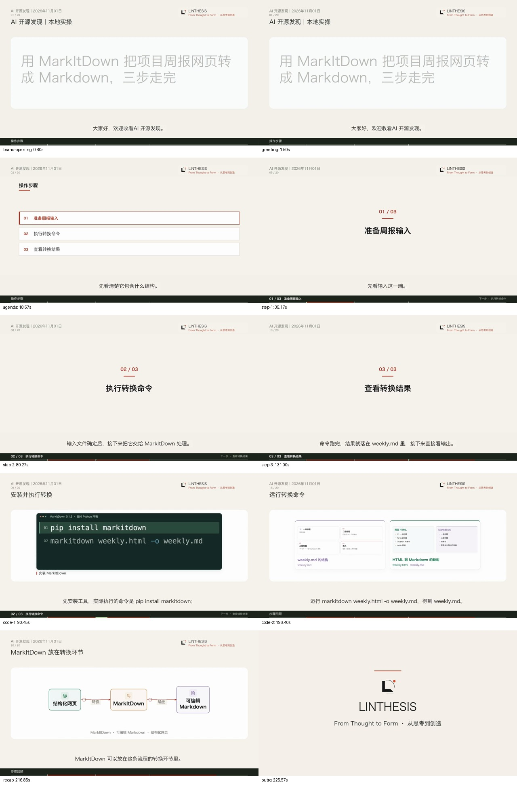

# 矩阵教程完整链路验收

2026-11-01。已将既有教程呈现接入矩阵自动出片，并用一次真实 MarkItDown 教程批次完成选取报告、写稿、自动定稿、自动配图、AutoVideo 出片和文件回传。未手工补问候、编辑讲稿、修改分镜或拼接成片。

最终视频：`state/acceptance-matrix-tutorial-20261101/run-1/state/video_renders/8a42d300602e4d61aa8b4cfacebdf39a/video.mp4`（相对研究模块）。1920×1080、30fps、6827 帧、227.57 秒；正文 221.57 秒。完整运行目录保留在研究模块忽略目录 `state/acceptance-matrix-tutorial-20261101/run-1/`。

## 接线改动

- 教程型栏目在没有显式制作配方时，默认使用现有 `mixed_tutorial`；已有矩阵、栏目和生产任务的显式选择继续优先。
- AI 开源发现通过原有 `render.production_recipe` 选择同一配方，配方仍由视频引擎维护。
- 修复矩阵指定制作配方时，旧文稿配方的默认视频形式、声音与包装反向覆盖制作配方的问题。
- 自动或已保存的配图作为素材进入制作配方，保留其制作模式；具体命令继续复用原生代码画面。

问候、章节映射、步骤转场、代码强调、故事回顾和品牌包装均复用原链路。没有新增生产依赖、服务、队列、请求字段或模型阶段；没有改动生产配置文件的自动启用时间。

## 真实自动任务

底稿来自上一轮实际运行 MarkItDown 0.1.9 的 HTML 周报转换，保留同一份输入、命令与实际输出；[本轮底稿](evidence/report.md)包含操作内容，[转换记录及原文件](../../../../../autovideo/g3/acceptance/tool-tutorial-20261101/README.md)保留。没有重新启动素材发现或联网研究。

验收使用现有配置与 Job 的快照、隔离账本和正式研究端 Python 环境。`auto.pending` 从该 Job 的真实报告文件中生成批次，原来的 `_tick_run`、`video_executor`、`video_workflow`、`video_render` 执行后续工作。AutoVideo 使用正在运行的本机服务与当前模型配置，全部写稿、视觉请求、语音和视频生成均为真实执行。

| 对象 | 实际记录 |
| --- | --- |
| 领域／栏目 | ai_media／AI 开源发现 |
| 生产配置 | ai_media_opensource_digest |
| 原供稿 Job | ai_media/daily_opensource_radar |
| 自动批次 | e778b4baa11744f0baeed10d516c1705 |
| 自动文稿 | 1b559626cc89494490eb905fe69b9757，v1 |
| 成功出片 | 8a42d300602e4d61aa8b4cfacebdf39a |
| AutoVideo 任务 | d018731b-0056-4264-8c75-bb5a6cc8cb83 |
| 制作设置 | mixed_tutorial v2、fast、information_cards、editorial_light、1.25 倍速 |

作者按现有逻辑自动生成“大家好，欢迎收看AI 开源发现。”，出现一次；讲稿与实际视频 IR 旁白一致。三步为“准备周报输入 → 执行转换命令 → 查看转换结果”，导航直接来自作者章节。安装与转换命令自动进入 code_demo；流程和结果映射使用现有解释组件，结尾回顾同一任务。

本机引擎既有 LINTHESIS 品牌设置同时自动生效，片头为 0 秒、品牌角标在开场出现，片尾 6 秒，包含已有 CTA 与声音；通用包装服从既有品牌设置。未用验收专用参数覆盖这些设置。

本次自动登记 1 张安装说明截图及焦点区域，与实际命令关联到同一段；原生代码优先展示清晰命令，因此实际图片场景数为 0。本片验证自动代码、流程、转场与品牌呈现；实际输入／输出截图聚焦的画面证据见上一轮工具教程。素材请求及配方模式在本轮保留并通过回归覆盖。



## 中间尝试与调用

首次验收误用基础 Python，缺少正式环境已有的 Playwright，自动配图降级。取消该次 AutoVideo 任务 `2adf7c0d-73c9-4d1f-b5db-7dd15477e5b0`，保留全部记录；切回正式环境后，原批次按已有一次出片重试策略复用同一份自动定稿完成任务，没有重新写稿或另建批次。

写稿共 2 次调用（原有 JSON 解析重试）；润色没有新增调用。成功出片使用 5 次章节分镜请求；自动配图使用既有限额内的 3 次本机视觉请求。取消任务的尝试单独保留，未计入成功出片的调用数。详见 [任务回执](evidence/receipt.json)、[实际模型记录](evidence/model-cost.json)、[取消记录](evidence/first-render-cancellation.json)。

## 验证与加载

- 正式研究端环境相关回归：344 passed、1 warning（现有 Starlette 弃用提示），50.13 秒；定向配置／素材测试 52 passed。
- 33 个回传文件逐个核对 SHA-256；正文及最终视频独立完整解码通过，媒体、包装及品牌 QA PASS。
- 旁白与自动定稿一致，问候一次；三张步骤卡、“操作步骤／下一步／步骤回顾”已进入实际正文，导航报告的视频哈希与回传正文一致。
- 自动请求保留制作配方且没有截图形式覆盖；当前 CodeDemo 源码哈希与实际任务渲染器一致。
- 抽查 10 个时间点及完整命令页，覆盖开场、问候、导读、三次步骤转场、命令、回顾和品牌片尾；关键帧检查不等同于全片人工审看。
- 通过项目已有空闲维护助手加载研究端：PID 34229 → 16410，健康状态 ok。361 条原文稿和 371 条原出片记录的 ID、状态、版本／源文哈希保持不变。隔离验收批次未写入主研究端历史列表，视频引擎中的真实任务保留。

证据见 [完整核验](evidence/verification.json)、[回归日志](evidence/research-tests.log)、[媒体 QA](evidence/qa.json)、[品牌 QA](evidence/brand-qa.json)、[服务加载](evidence/service-reload.json)。

从研究模块执行：

```sh
../.AI_research/bin/python spec/acceptance/matrix-tutorial-20261101/run_matrix.py \
  --output state/acceptance-matrix-tutorial-20261101/new-run
# 等待报告按既有规则稳定满 60 秒，再运行真实模型／视频任务。
../.AI_research/bin/python spec/acceptance/matrix-tutorial-20261101/run_matrix.py \
  --output state/acceptance-matrix-tutorial-20261101/new-run --run
../.AI_research/bin/python spec/acceptance/matrix-tutorial-20261101/verify_matrix.py \
  state/acceptance-matrix-tutorial-20261101/new-run
```

验收沿用已有生产函数和模型服务，不修改真实周期计划或增加自动发布步骤。未来没有实际输入／输出图片的任务，可直接使用原生代码和流程；上游已经提供的素材继续由原素材链路传入。
