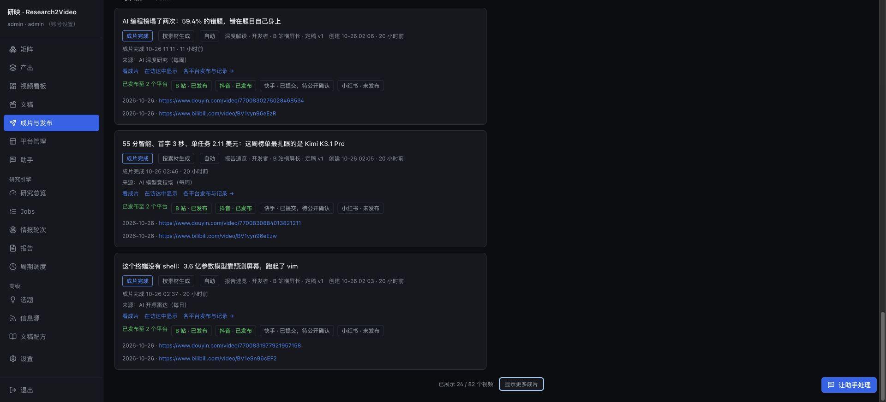

# 逐页性能打磨验收 · 2026-10-26

本轮针对研映研究控制台的页面切换、列表渲染、长文阅读、助手对话与历史回执读取。性能改动已构建并加载，后台在所有业务队列空闲时平滑重启；没有强制终止视频或投稿任务。

## 已实施

1. 所有主路由与常用详情路由共用按需加载器。指针移入、键盘聚焦或触摸站内链接时提前下载目标页面代码；重复预加载合并，失败后可重试。只预热代码，不提前查询业务数据或调用模型。
2. 成片按每批 24 张卡片显示，保留全量搜索、筛选和数量统计，按一次“显示更多”增加 24 张。真实 82 个成片的初始卡片由 82 张降为 24 张，减少约 71%；浏览器已验证展开到 48 张和刷新状态。
3. 助手长对话先显示最近 20 条消息，点击可展开更早消息。完整历史继续保留在会话状态，提交后续问题时不会被显示数量截断。真实会话初始渲染 10 条助手回复，展开后 17 条均可读取。
4. 助手完成回复的 Markdown 和操作卡片复用；输入草稿、回复流式更新时，不重新解析已完成的正文。集成测试验证旧回复不再被重复解析，新回复仍正常显示。
5. 报告正文与目录按内容缓存。工具栏状态、目录开关、目录选择变化时，不重新解析整份 Markdown；重复标题锚点保持稳定。
6. 文稿只在“稿件”标签读取风格目录和事实提示，在“成片”标签读取所需引擎状态。进入审校或发布时减少无关请求，进入稿件后仍显示完整风格选择和提示。
7. 助手历史的操作回执批量读取。60 条请求的回执 SQL 从逐条查询改为一次查询；工作区读取 operations 时直接检查会话归属，不再重复解码、恢复整份历史。保留空会话归属检查和中断回执恢复。

## 页面覆盖与浏览器测量

已检查 16 个主页面，并重复导航和读取；可用的刷新入口也进行了复测。明细位于 [browser-checks.json](page-performance-polish-20261026/browser-checks.json)。矩阵的栏目、研究来源、运行记录、周期、设置；任务视频配置、概览、YAML 编辑器、日志、运行历史；报告正文和目录；文稿五个标签；四个平台管理；设置的账号、审计、运行日志；配方与共享部件编辑器均逐项打开验证。

以下为导航到主内容可见的本机耗时。包含自动化开销，缓存列表可先显示再后台更新，不是 LCP/FCP 或压测。主页面取最后两轮样本；助手取增加历史分批显示后的两个有效样本。第三次助手自动化等待工作区时触及选择器时限，随后确认工作区返回；该次没有可靠总耗时，不纳入统计。详情标签的记录只表示操作反馈，不作为所有后台数据齐备的精确计时。

| 页面 | 有效样本（秒） | 中位数（秒） |
| --- | --- | --- |
| 产出 | 0.645, 0.630 | 0.637 |
| 视频看板 | 0.869, 0.502 | 0.685 |
| 文稿 | 1.505, 0.453 | 0.979 |
| 成片与发布 | 0.354, 0.369 | 0.361 |
| 平台管理 | 0.338, 0.311 | 0.325 |
| 助手 | 1.896, 1.318 | 1.607 |
| 研究总览 | 0.399, 0.209 | 0.304 |
| Jobs | 0.508, 0.315 | 0.411 |
| 情报轮次 | 0.334, 0.290 | 0.312 |
| 报告 | 0.396, 0.261 | 0.329 |
| 周期调度 | 0.514, 0.313 | 0.413 |
| 选题 | 0.340, 0.228 | 0.284 |
| 信息源 | 0.714, 0.792 | 0.753 |
| 文稿配方 | 0.252, 0.204 | 0.228 |
| 设置 | 0.289, 0.332 | 0.310 |
| 矩阵 | 0.433, 0.304 | 0.368 |

助手工作区仍存在耗时长尾。本次没有将“所有页面永远低于一秒”作为结论，也没有用不同负载下的前后单次耗时计算整体加速比例。

## 后台读取与验证

后台 40 个读取 handler 均返回成功，每项 5 次，见 [handlers-final.json](page-performance-polish-20261026/handlers-final.json)。数据库使用 SQLite 快照，未启动研究、渲染或模型调用。该测量不包含认证、网关和浏览器。前后接口耗时波动未体现一致的整体下降，因此只报告已验证的 SQL 次数、卡片数量、Markdown 重解析及多余请求的减少，不作全局倍数承诺。

最近三个会话的工作区快照读取中位数分别为 196.2、164.0、124.4 ms，见 [assistant-workspaces.json](page-performance-polish-20261026/assistant-workspaces.json)。这些是快照 handler 测量，不等同于页面可用时间。

- 前端完整回归：591 项通过、79 个文件通过；包含工作区已有的助手总览及随后出现的品牌设置前端测试。
- 前端 ESLint、TypeScript 与生产构建通过；`git diff --check` 通过。
- 后台完整回归：3206 项通过、3 项跳过、2 项失败，耗时 351.48 秒。两项失败与此前验收一致：`tests/test_recipe_audiences.py::test_shipped_recipes_come_out_exactly_as_they_were_written_out_per_audience`、`tests/test_video_golden.py::test_a_shipped_column_resolves_as_it_did[flash]`，均为既存配方配置与固定快照不一致。没有修改快照掩盖失败。
- 新增的历史读取测试及助手工作区/任务中心/读取性能相关 35 项测试通过。
- 单独的前后 handler 数据与原始浏览器样本保留；后台重启证据见 [reload.json](page-performance-polish-20261026/reload.json)。

本轮只验收性能相关改动。工作区同时存在独立的助手总览、品牌设置与渲染修改，均予以保留；其完整功能和渲染验收不由本记录确认。后台完整回归运行早于随后出现的品牌后端/渲染修改。本轮没有改变渲染器或启动新的真实 MP4 生成，也没有新增 Git 提交或推送。

高级 YAML 编辑器仍是独立的大型按需模块（约 3.72 MB，gzip 约 964 KB），首次打开需要下载；不进入普通页面的入口代码。录像、视频输出目录和已迁移文件保持现有配置。

