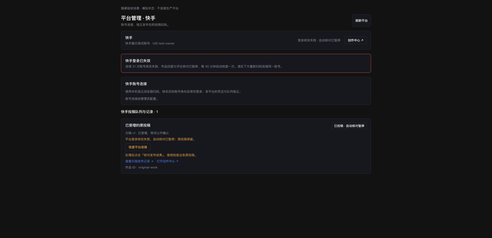
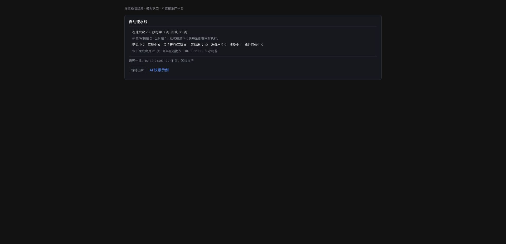

# 应用回归修复：平台状态、验收入口和列表性能

本轮按照用户确认的范围修复状态展示与验收问题。Exa 额度等待下个月，现有搜索配置保持；快手当前无法提交可以接受，本轮处理状态表达，不操作平台登录、投稿或旧任务。

## 改动后的行为

快手等社交平台的页首先读取会话健康状态。会话失效时显示“登录核实失败 · 自动核对已暂停”，待核对投稿显示对应的暂停状态；没有核实过的会话显示“登录状态待核实”。投稿详情、平台列表和共用发布进度使用同一暂停信息。原 `SUBMITTED`、`UNKNOWN` 状态、作品 ID、发布包和尝试历史保留。成功核实原账号后，原有会话健康逻辑仍可恢复核对展示。

截图为隔离的模拟状态页面，使用真实 UI 组件，不连接生产平台。没有通过模拟账号登录正式应用。

默认 pytest 通过 `pytest.ini` 限定正式 `tests` 目录，`scripts/check.sh` 也显式执行该目录。历史 `state/validation` 验收快照保留，不再进入默认测试收集。另将两条精确断言 Cookie 有效期的测试固定到同一时钟：首次完整回归中，30 天 Cookie 在登录处理跨秒后为 2591999 秒，导致原先 2592000 秒的精确断言偶发失败；认证实现和有效期没有修改。

自动生产卡汇总全部在途批次，不受原有“最近十批”列表限制。条目按当前文稿及当前版本的出片记录区分排队、研究、写稿、准备出片、渲染和成片回传；旧版已完成成片不会让新版条目提前显示完成。保留原批次与条目的业务状态，新增只读展示字段。页面同时显示现有执行槽、当天完成出片次数和最早在途批次创建时间；后者不是某一阶段的精确等待时长，也没有据此预测完成时间。

研究或写稿尚未产生第一个版本时，文稿 H1 回退到选题标题；空白版本标题也有回退，最后使用“视频文稿”。已有版本继续显示其原有标题。

## 列表传输测量

文稿、成片及自动批次列表的 GET 支持按客户端能力协商 gzip；小响应、详情、修改请求、SSE 和媒体 Range 传输保持原行为。compact 列表还精简未使用的来源快照及文章正文，完整详情接口保留原记录。账号、历史版本、发布链接与现有筛选字段保留。

同一份只读输入快照，UTF-8 紧凑 JSON，gzip 级别 3：

| 列表 | 记录数 | 修改前 JSON | 修改后 JSON | 修改后 gzip |
| --- | ---: | ---: | ---: | ---: |
| 文稿 | 181 | 448487 B | 447383 B | 60475 B |
| 成片 | 176 | 488961 B | 480946 B | 60115 B |

相对修改前未压缩 JSON，压缩体积分别降低 86.52% 和 87.71%，主要收益来自重复字段的 HTTP 压缩。七次本机 gzip 测量的中位处理时间分别约 1.12 ms 和 1.06 ms。这是固定快照的编码和压缩测量，尚不是正式网关或浏览器的上线前后测速。

队列汇总在一次数据库只读快照上测得约 3.19 ms 中位耗时，读取 73 个在途批次、98 个条目，区分出 3 个执行阶段条目与 80 个排队条目。其余 15 个条目已有取消状态；没有因它们仍属于在途批次而再次标记执行。汇总使用批量查询，没有逐条打开连接或读取完整稿件。

## 验收与上线边界

隔离副本的 `bash scripts/check.sh` 已完整通过：后端 3802 条通过、5 条跳过；前端 88 个文件、693 条通过；Python 编译、配置检查、TypeScript、ESLint 和生产构建全部通过。默认测试收集成功收集 3807 条用例，没有扫描历史副本。日志保存在 `state/validation/regression-fixes-20261030/full-check.log`，源文件与验证快照的最终差异为空。

2026-10-31 提交前，将本轮变更单独叠加到已提交基线 `32db2d6`，排除其他聊天未完成的改动，再次完整运行同一验收脚本：后端 3771 条通过、5 条跳过；前端 84 个文件、658 条通过；编译、配置、类型、Lint 和构建全部通过。用例数差异来自未纳入的其他聊天变更，日志为 `commit-isolated-check.log`。本次提交采用这份独立验证后的代码，不将共享文件的其他改动一并暂存。

定向后端另有 192 条通过；平台及队列 UI 定向 61 条通过；文稿详情定向 38 条通过。初次在受限沙箱执行的本地回环测试受到网络限制，已中止该隔离测试进程并在允许回环的环境重新验收；其日志独立保留。首次完整执行遇到上述 Cookie 时钟断言后，仅修正测试时钟，最终完整重跑通过。前端构建仍有既有的大块资源提醒，本轮没有扩大为整站分包改造。

没有发起实际研究、写稿、出片或投稿，没有改变周期、执行限额、任务顺序或恢复策略；生产数据库只做读取和备份。没有重启研究端、网关、AutoVideo 或独立调度，没有替换生产 UI 资源。当前阶段是源码修复与隔离验收，生产加载另行记录，不能以本报告声称已经上线。

其他聊天未完成的源码和配置保留。本轮的前置文件备份、文件哈希及独立补丁另存在证据目录中，便于后续只提交本轮改动。
