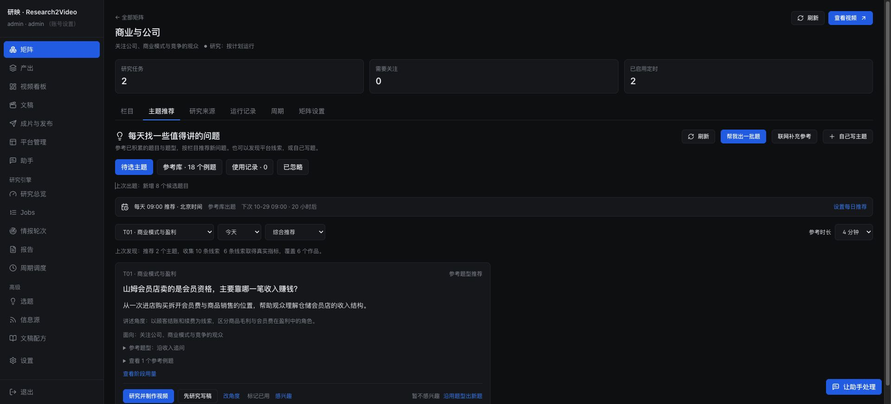
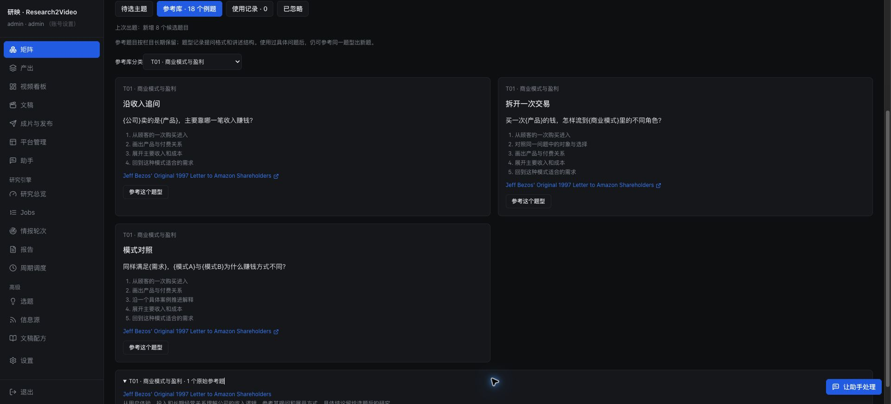
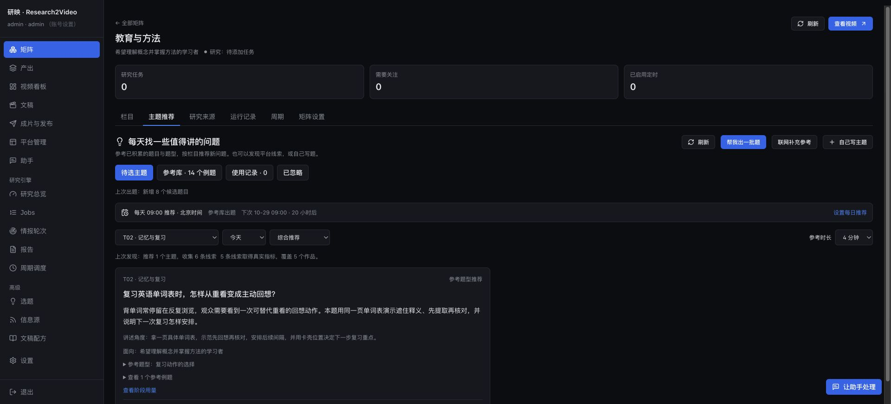
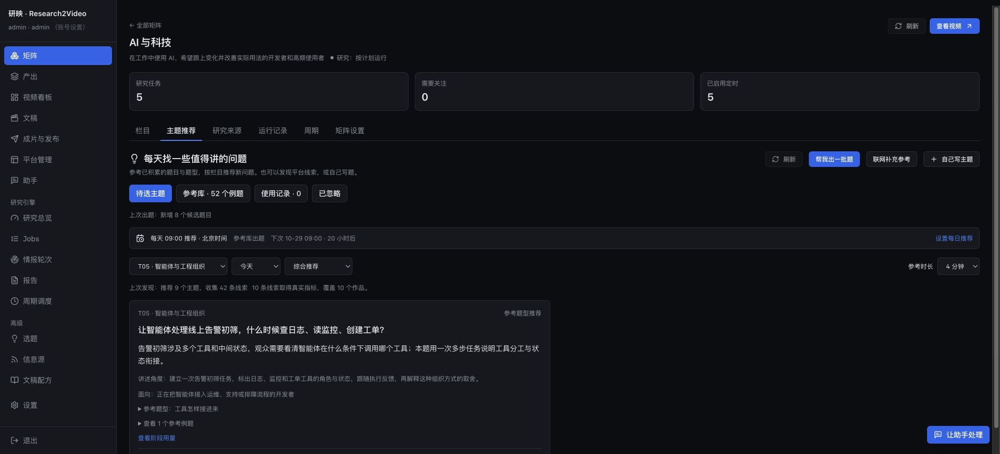

# 多矩阵参考题型库验收

日期：2026-10-28。范围：除 ChatGPT 外的十个内容矩阵；ChatGPT 原有九类保持可用。设计与行为见 [主题分类说明](../../theme-catalogs.md) 和 [长任务计划](../../theme-catalog-expansion-plan.md)。

## 已启用的分类与题型

| 矩阵 | 当前分类 | 本次配置的题型 | 本次分类参考例题 | 实际新增推荐 |
| --- | ---: | ---: | ---: | ---: |
| AI 与科技 | 9 | 27 | 10 | 8 |
| 商业与公司 | 8 | 24 | 8 | 8 |
| 消费科技与购买决策 | 8 | 24 | 8 | 8 |
| 文化与艺术 | 8 | 24 | 12 | 8 |
| 财经与经济 | 8 | 24 | 8 | 8 |
| 教育与方法 | 8 | 24 | 8 | 8 |
| 地理与世界探索 | 8 | 24 | 9 | 8 |
| 历史与文明 | 8 | 24 | 9 | 8 |
| 产业与制造业 | 8 | 24 | 10 | 8 |
| 科学与知识百科 | 8 | 24 | 8 | 8 |
| 合计 | 81 | 243 | 90 | 80 |

90 条按“分类 + 来源链接”计数，同一来源可能供不同分类参考；它们包含真实原文标题、链接和编辑归纳的题型说明。既有例题另行保留，因此界面中的例题总数可能更高。AI 的动态类没有当前变化材料时留空，本轮其余八类各有一题。当前分类、保留的旧分类和实际参考链接见 [catalogs.json](catalogs.json)。

十一份内容矩阵配置均为 `mode: ideas`，缺省模式也改为参考库出题。原有十一条每日计划的 ID、北京时间 09:00、启用状态和平台设置保留，未新增调度服务或修改用户的系统计划，快照见 [schedules.json](schedules.json)。

“联网补充参考”保留主动发现入口：参考库模式下运行独立的 `topic_platform/<matrix>` 任务，不修改每日推荐方式。相关行为通过隔离测试验证；本次验收未再次运行付费联网发现。

## 真实生成与用量

使用已有 `run.py topic_discovery/<matrix>` 链路实际运行十个矩阵，共保存 80 个新主题。每个成功批次一次模型请求，全部使用参考库，无搜索调用。完整尝试、主题 ID、分类、题目、输出路径和用量见 [generation.json](generation.json)。

| 尝试 | 请求次数 | 搜索次数 | total_tokens |
| --- | ---: | ---: | ---: |
| 10 个成功批次 | 10 | 0 | 115,225 |
| 初版输出上限导致的 2 个失败尝试 | 2 | 0 | 27,992 |
| 全部实际验收 | 12 | 0 | 143,217 |

公司、文化的初次请求在 8,192 输出上限处截断。压缩重复大纲输出，并把请求上限提高到最高 16,384、继续尊重更低的系统配置后，两者各重试一次成功。原始失败和实际用量保留；运行逻辑不会因截断自动追加调用，截断结果不会成为部分主题。金额取决于已配置服务的计价，本记录只报告实际调用与 token 数。

随后以新引擎实例再次执行全部十个每日任务，均复用成功批次，新增请求、搜索、tokens 都是 0，见 [replays.json](replays.json)。没有再次生成成功批次，也没有触发文稿、成片或发布任务。

部分实际题目：

- 教育：复习英语单词表时，怎样从重看变成主动回想？
- 消费：主要用来清理宠物毛发，选扫地机器人前先确定什么？
- 文化：看懂《清明上河图》，为什么可以先看虹桥上的视线交汇？
- 产业：一块铝锭变成汽车轮毂，要经过哪些关键工序？
- 科学：想知道空气有没有质量，可以怎样设计一次能看懂的演示？

## 历史与制作连接

旧分类作为 `legacy_categories` 返回，旧主题、例题、题型、反馈和永久使用记录继续保留。默认出题使用当前分类，指定旧题型仍可复用；旧主题仍能启动已有制作流程。新分类进入文稿上下文，同时继承已有制作绑定的配音、画面、倍速与包装；教育沿用通用主题制作路径。这些连接使用隔离数据库和模拟执行器回归，未为验收新建真实视频。

正式界面确认 ChatGPT 原有九类、158 个参考例题和 7 条使用记录仍在；点击“使用记录”可以看到既有文稿与视频入口，见 [历史画面](chatgpt-history.png)。

## 检查与正式界面

- 完整 `bash scripts/check.sh`：后端 3,483 通过、3 跳过，前端 619 通过；配置、类型检查、lint 和生产构建通过，见 [完整检查日志](full-check.log)。
- 最后一次后端定向回归：68 通过，涵盖真实 YAML 分类覆盖、幂等导入、默认零搜索、分类分布、旧记录与制作继承、联网补充和截断用量，见 [后端日志](focused-backend.log)。
- 最后一次界面定向回归：45 通过，涵盖参考库分类筛选、旧分类复用和补充发现入口，见 [界面日志](focused-ui.log)。
- 完整后端检查运行期间补充了截断处理与相应测试，最终代码由上述后端定向回归覆盖；最终前端已完成生产构建。
- Git 提交前从当前 `HEAD` 导出独立快照，只叠加本次提交文件，再次通过后端 68 项、前端 45 项定向回归；不依赖工作区其他未提交改动，见 [提交快照日志](commit-snapshot.log)。
- `git diff --check` 通过。本次提交仅包含多矩阵主题分类与题型库相关改动，未包含工作区其他聊天正在修改的发布、截图、渲染和科学矩阵产品化代码。

用户恢复登录后，经正常入口 `http://127.0.0.1:8775` 验收。运行中的服务已经加载新版，本任务无需再发重启；研究端与网关健康接口均为 `ok`，实例一致，见 [runtime.json](runtime.json)。通过浏览器确认：商业八类、教育八类、AI 九类；默认每日参考库方式、生成结果、题型筛选和复用表单，以及 ChatGPT 既有使用记录均可见。

