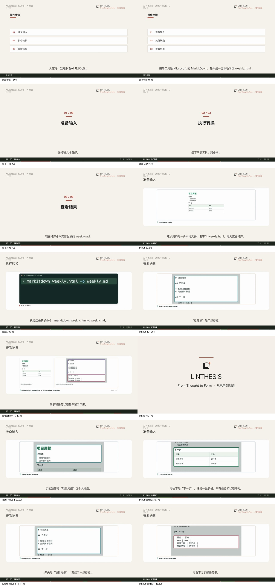

# 真实输入、代码与输出截图自动教程验收

2026-11-01。真实输入截图 → 操作代码 → 实际输出截图 → 同屏对照 → 品牌片尾，已通过原矩阵自动制作链路出片。图片段落由现有模型匹配，未手工指定；讲稿和分镜由原流程生成。

最终视频位于研究模块：`state/acceptance-tutorial-io-20261101/run-1/state/video_renders/90e2a29c6cb04e8e82b50519597dd2e5/video.mp4`。1920×1080、30fps、4865 帧、162.17 秒；正文 156.17 秒。完整运行、所有文稿版本和尝试保存在忽略目录 `state/acceptance-tutorial-io-20261101/run-1/`。

## 实际任务与画面

本轮重新用临时环境中的 MarkItDown 0.1.9 实际执行周报 HTML 转 Markdown，再复用已有浏览器截图脚本捕获本次输入与输出。原文件、输出及截图均保留：[转换回执](evidence/conversion.json)、[实际输入](evidence/weekly.html)、[实际输出](evidence/weekly.md)、[输入截图](evidence/input.png)、[输出截图](evidence/output.png)。

正常矩阵批次从底稿自动写稿、定稿、登记和匹配图片、调用 AutoVideo、轮询并回传 33 个文件。制作沿用 mixed_tutorial v2、fast、1.25 倍速和现有 LINTHESIS 品牌。

| 对象 | 记录 |
| --- | --- |
| 原生产绑定 | ai_media_opensource_digest／ai_media/daily_opensource_radar |
| 自动批次 | 56c9d9613139409abcfa363ee7976a3d |
| 文稿 | 34d64b0926034c16b84a4b686bcaa91a，最终 v3 |
| 成功出片 | 90e2a29c6cb04e8e82b50519597dd2e5 |
| 视频引擎任务 | 9227152e-b727-4f4f-95fe-16b3b0a4f848 |
| 三个步骤 | 准备输入 → 执行转换 → 查看结果 |
| 实际分镜 | 13 个；输入截图 4 场、代码 2 场、输出截图 2 场、输入输出对照 1 场，另有开场和解释／回顾 |

问候“大家好，欢迎收看AI 开源发现。”出现一次。输入画面按标题／已完成列表、任务表格分别聚焦；命令使用原生 code_demo；输出展示命令实际生成的 Markdown，分别突出标题／列表与任务表格；最后两张实际截图同屏对照。步骤卡、底部导航、字幕与品牌片尾沿用既有能力。



## 接入方式

1. 上游使用现有 `core.user_materials.save` 登记真实 PNG。原 `text` 参数可保留上游已知的画面说明，`focus` 复用已有图片区域结构；没有说明的图片继续使用原提取流程。
2. 报告通过已有 `report_meta` 侧记携带 `user_materials` 的图片 ID、owner 和目标。正常矩阵作者将这份上下文冻结到当前文稿版本；重写和旧版出片各用对应版本的素材。
3. 原持久化出片 worker 自动登记图片，并在原逐图匹配请求中选择所有适合的段落。输入与输出分别进入内容展示段，共享的对照段会匹配两图；安装和命令段保留代码画面。
4. 混合教程按任务阶段生成章节，原章节映射直接成为步骤导航。图片中的 Markdown 原文由画面呈现，旁白自然解释结构和结果。

没有新增生产依赖、服务、队列、公开请求字段或模型阶段。实际工具操作与截图来自上游；后续图片准备、匹配、代码和画面呈现使用既有链路。

上游登记可复用现有函数：

```python
picture = user_materials.save(
    state_dir, owner, name='实际输入.png', raw=png,
    text=known_description, focus=existing_focus,
)
report_meta.append_record(
    relative_report_path, job,
    extra={'user_materials': {'ids': [picture['id']], 'owner': owner,
                              'goal': '展示实际输入、操作和结果'}},
)
```

焦点坐标使用已有的 0–1000 图片相对坐标。保存时同步规范化图片尺寸，图片原始文件与说明保留。

## 实跑修正与保留记录

初版图片已自动进入任务，但作者将整个工具过程合为一个项目章节，逐图匹配遗漏结尾对照。修正原教程写稿提示和原逐图匹配提示后，通过既有改稿入口生成下一版本。

第二版已经具有三步与对照，但把整块 Markdown 原文、围栏和表格分隔线写入旁白，两个原有自动出片尝试在本机语音阶段失败。教程写法随后改为自然口语说明，原文继续由真实截图呈现；第三版完成全部自动流程。文稿未手改，图片位置未手工补写，原版、取消任务与失败尝试全部保留，见 [尝试记录](evidence/attempts.json)、[v1](evidence/version-v1.json)、[v2](evidence/version-v2.json)、[最终版](evidence/version.json)。

最终版写稿为 1 次原写稿请求，最终视频任务为 5 次章节分镜请求；逐图匹配复用已有调用。上述数字描述成功版本，历史开发尝试另有记录。

## 验证与加载

- 正式研究端相关回归：378 passed、1 warning（原有 Starlette 弃用提示），51.43 秒。
- 33 个回传文件 SHA-256 均核对通过，正文及最终 MP4 独立完整解码通过；媒体、包装和品牌 QA PASS。
- 两个渲染资产与上游真实截图的尺寸、RGB 像素哈希一致；输入 → 代码 → 输出的顺序，以及两张图实际同屏出现，均从最终场景和视频核验。
- 输入、输出的实际局部镜头均存在；四个区域没有只停留在请求中。导航合成报告的视频哈希与回传正文一致，旁白与自动定稿一致。
- 抽查 14 个时间点，覆盖问候、导读、三次步骤切换、输入、代码、输出、对照、片尾和四个局部重点；命令与对照页完成全尺寸检查。关键帧抽查不等同于全片人工审看。
- 通过原空闲维护助手加载研究端，PID 16410 → 42346，健康状态 ok；361 条原文稿和 371 条原出片的 ID、状态、版本／源文哈希保持。验收账本隔离，实际 AutoVideo 任务及输出保留。

详见 [完整核验](evidence/verification.json)、[图片自动匹配](evidence/image-decisions.json)、[回归日志](evidence/research-tests.log)、[服务加载](evidence/service-reload.json)。当前生产源码、加载记录和成功版本的哈希一致。

复现时从研究模块使用正式环境：

```sh
../.AI_research/bin/python spec/acceptance/tutorial-io-20261101/run_tutorial.py \
  --output state/acceptance-tutorial-io-20261101/new-run \
  --tool-python /path/to/markitdown-venv/bin/python
# 按原报告稳定规则等满 60 秒，再执行真实模型／出片流程。
../.AI_research/bin/python spec/acceptance/tutorial-io-20261101/run_tutorial.py \
  --output state/acceptance-tutorial-io-20261101/new-run --run
../.AI_research/bin/python spec/acceptance/tutorial-io-20261101/verify_tutorial.py \
  state/acceptance-tutorial-io-20261101/new-run
```
