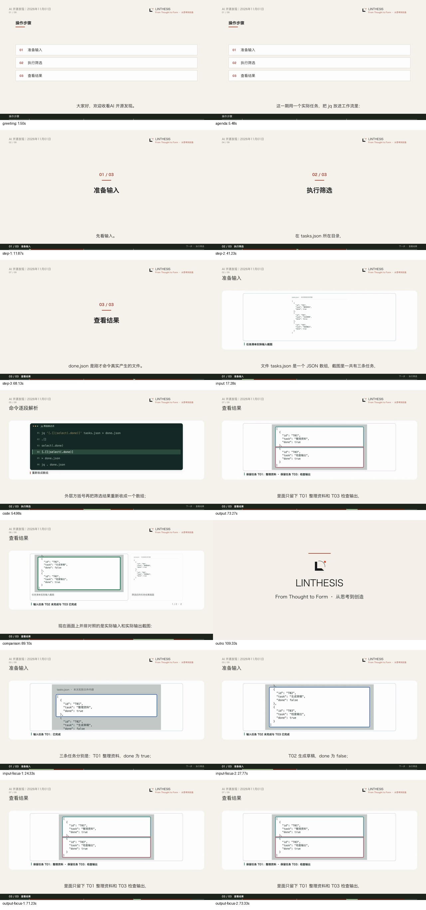

# 第二种真实工具：jq 矩阵自动教程验收

2026-11-01。换用 jq，从实际任务清单中筛出已完成任务，沿用上一条 MarkItDown 教程的生产源码和矩阵自动出片流程。首次写稿 v1、一次出片即完成；输入与输出截图、代码、栏目问候、三次步骤转场、同屏对照和 LINTHESIS 片尾均自动进入成片，没有手工分配图片段落或修改分镜。

最终视频位于研究模块：`state/acceptance-tutorial-jq-20261101/run-1/state/video_renders/a75279f29f15458486b0cf901a04e234/video.mp4`。1920×1080、30fps、3340 帧、111.33 秒；正文 105.33 秒。完整运行和输出保存在忽略目录 `state/acceptance-tutorial-jq-20261101/run-1/`。

## 真实操作与画面

使用本机已有的 `/usr/bin/jq`，版本 `jq-1.7.1-apple`，没有安装依赖。教程示例输入为本次自编的三条任务：T01 整理资料已完成、T02 生成草稿未完成、T03 检查输出已完成。实际执行以下命令，输出只保留 T01 和 T03。数组迭代、条件筛选和数组收集的用法见 [jq 1.7 官方手册](https://jqlang.org/manual/v1.7/)。

```sh
jq '[.[]|select(.done)]' tasks.json > done.json
jq . done.json
```

文件与执行结果保留：[实际输入](evidence/tasks.json)、[实际输出](evidence/done.json)、[操作回执与哈希](evidence/operation.json)、[命令记录](evidence/commands.log)。筛选操作不调用模型。两张截图是浏览器展示本次实际 JSON 文件内容后捕获的画面，分别保留两处重点区域，见 [输入截图](evidence/input.png)、[输出截图](evidence/output.png)、[截图尺寸与区域](evidence/screenshots.json)。

上游底稿和图片登记后，既有矩阵自动流程完成发现任务、写稿、定稿、图片匹配、引擎出片、轮询与 33 个文件回传。沿用 `mixed_tutorial` v2、fast、1.25 倍速和现有品牌包装。

| 对象 | 记录 |
| --- | --- |
| 原生产绑定 | ai_media_opensource_digest／ai_media/daily_opensource_radar |
| 自动批次 | 12d07acd3c7f4a1f80a9b6f7e121c053 |
| 文稿 | 5f5b5633c4ee45778b4e7bfc602fce96，v1 |
| 成功出片 | a75279f29f15458486b0cf901a04e234 |
| 视频引擎任务 | 4ac177be-44a0-46ac-9289-8adee3a83667 |
| 步骤转场 | 准备输入 → 执行筛选 → 查看结果 |
| 实际分镜 | 9 场；输入截图 2 场、代码 2 场、输出截图 1 场、双图对照 1 场，另有开场、解释和回顾 |

问候“大家好，欢迎收看AI 开源发现。”出现一次。截图先展示输入，再展示完整 jq 命令和语法重点，随后进入真实输出与输入输出同屏对照。命令及拆解行均使用原生 `code_demo`，局部镜头由既有图片区域和旁白时间对齐，结尾沿用 6 秒品牌片尾。



## 复用范围

与 [上一条真实截图教程](../tutorial-io-20261101/README.md) 相比，五个接入模块的 SHA-256 在准备、出片完成和最终检查时均一致，详见 [准备记录](evidence/preparation.json) 与 [核验结果](evidence/verification.json)。本轮没有修改生产逻辑，没有新增业务分支、依赖、服务、队列或公开请求字段，也不需要重新加载服务。

本轮代码只涉及验收：新增 `run_jq.py` 作为第二种工具的真实输入夹具；已有截图脚本可选指定输入／输出预览文件名，默认行为保留；已有视频核验器从准备记录读取本次实际命令，旧 MarkItDown 命令继续作为默认值。矩阵执行和视频核验仍调用原脚本。

验收使用原配置及任务的快照、隔离的研究端账本和真实 AutoVideo API／worker。正常主研究端历史记录不写入此次验收数据；引擎任务、原文件和完整产物保留。该结果证明 MarkItDown 与 jq 两个不同任务均可复用当前流程。

## 验证

- 正式研究环境相关回归：81 passed、1 个已有 Starlette 弃用提示，13.42 秒，见 [日志](evidence/research-tests.log)。覆盖教程图片、自动批次与视觉素材流程。
- 只有一次写稿请求、五次既有章节分镜请求，v1 一次出片完成；没有人工图片段落分配或分镜修订，见 [尝试记录](evidence/attempts.json)、[批次回执](evidence/receipt.json)、[图片自动匹配](evidence/image-decisions.json)。
- 33 个回传文件哈希一致；正文及最终视频完整解码通过，媒体、包装、品牌 QA 均为 PASS。最终视频 SHA-256 为 `a8febb09307018d57d9afda6adb54ca0411fc4f0ac70d20025465acc6b2638c4`。
- 两张实际截图与渲染资产的尺寸、RGB 像素一致；输入 → 代码 → 输出顺序成立，两张图在对照场同屏，四个局部重点进入真实画面。
- 抽查 14 个时间点，覆盖问候、导读、三次步骤转场、输入、代码、输出、对照、片尾和四个局部重点；命令与对照页完成全尺寸检查。

## 复现

从研究模块运行，使用现有正式 Python 环境、本机 jq、截图脚本所用 Node／浏览器和已配置的 AutoVideo 服务。`--run` 执行正常模型及出片调用，费用和调用限额沿用项目配置。

```sh
../.AI_research/bin/python spec/acceptance/tutorial-jq-20261101/run_jq.py \
  --output state/acceptance-tutorial-jq-20261101/new-run
# 按原报告稳定规则等满 60 秒，再运行自动出片。
../.AI_research/bin/python spec/acceptance/tutorial-jq-20261101/run_jq.py \
  --output state/acceptance-tutorial-jq-20261101/new-run --run
../.AI_research/bin/python spec/acceptance/tutorial-jq-20261101/run_jq.py \
  --output state/acceptance-tutorial-jq-20261101/new-run --verify
```
