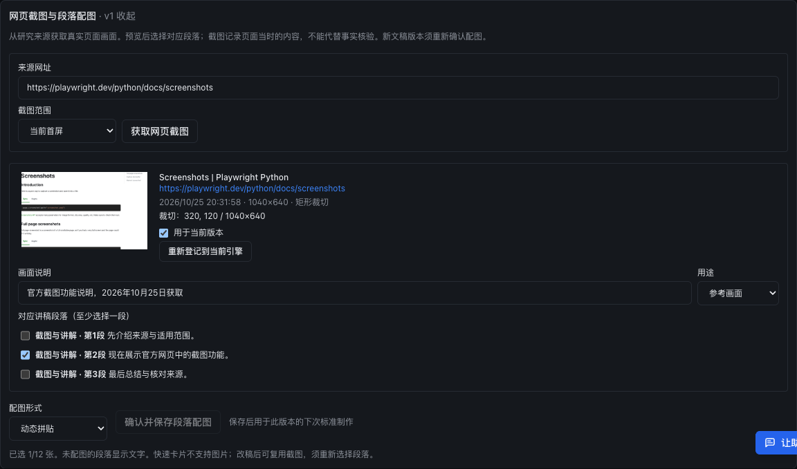
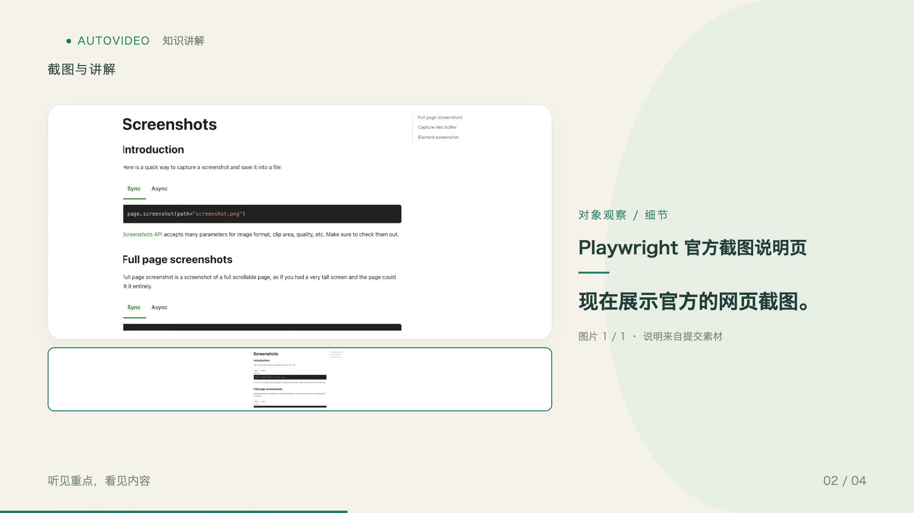

# 静态网页截图与段落配图验收 · 2026-10-25

本轮完成静态网页画面采集及明确的段落映射。MP4 镜头素材接入留待后续，未新增视频地址字段或视频素材库。
也没有实现图片内容识别或自动语义匹配，画面与段落由用户预览后选择。

## 实际链路

从 Playwright 官方截图说明页实际抓取元素及矩形区域，保存原 PNG、来源／跳转网址、标题、时间、
视口及裁切参数。通过真实 AutoVideo FastAPI 图片上传接口登记，再将已登记 UUID、说明、用途和
`placements` 提交到真实创建任务接口。验收使用隔离数据库和队列，不写入生产任务。

`browser_smoke.py` 启动隔离研究服务，使用当前生产前端构建，真实浏览器登录隔离账号，执行
「获取网页截图 → 登记 → 选第二段 → 填说明 → 选择动态拼贴 → 保存 → 刷新恢复」。
对应段落、说明、形式和选择状态均保持，页面脚本错误为零。见 `browser-qa.json` 和 `screenshot-panel.png`。

`smoke.py` 用原稿分句器及可信组件制作两条真实 MP4：

| 形式 | 时长 | 画面／帧率 | 全解码 | 段落映射 |
| --- | --- | --- | --- | --- |
| 对象展示 | 6.4 秒 | 1920×1080，30fps，192帧 | PASS | 第一／第三段文字，第二段两条分句使用截图 |
| 动态拼贴 | 6.4 秒 | 1920×1080，30fps，192帧 | PASS | 同上 |

这两条片使用静音时间轴夹具，不调用 LLM 或 TTS，不作为配音质量或完整模型生成验收。
媒体哈希、来源和原始路径见 `media-qa.json`。实际视频、IR、登记副本、浏览器数据库、渲染及解码日志已归档到：

`state/screenshot_acceptance/20261025/render-smoke/` 和 `browser-smoke/`（忽略目录，不提交生成数据）。






## 检查结果与边界

- 研究侧专项：`tests/test_video_screenshots.py tests/test_video_scripts.py`，135 passed。
- AutoVideo 图片、形式及 IR 专项：59 passed。原无位置请求、顺序分配、图片冻结、修订继承保持兼容。
- 研究前端全量：70 个测试文件、549 tests passed；类型检查、lint 和生产构建通过。
- 覆盖非公开地址拒绝、混合 DNS 地址拒绝、代理虚拟地址核验、图片篡改、登记失败后重试、历史版本只读、
  新版本不继承旧映射、无效／重复段落拒绝、快速卡片冲突，以及已创建 render 不受后续编辑影响。
- 研究完整检查首次在受限环境运行：3030 passed、21 failed、3 skipped、8 errors。
  监听端口／本地服务／AppleScript 相关文件在允许本机监听的环境重跑后 59 passed、2 skipped。
  剩余两项是已有 Flash 配方与黄金快照的文案差异：`test_recipe_audiences`、`test_video_golden[flash]`。
  本轮不改写这些共享工作区中原有的配方修改或快照。
- AutoVideo 完整回归：751 passed、1 skipped、3 failed。两项启动器监听权限失败重跑后 2 passed；
  剩余冻结发布清单 `test_manifest_hashes_and_file_coverage` 失败，清单与当前工作目录文件集合不一致。
  未更新冻结发布清单来掩盖差异。因此不声称全量回归干净。
- 单独配置校验发现共享工作区已有三个 assistant 验收 job 缺少 `keywords`：
  `assistant_iteration_acceptance_20261025`、`assistant_ops_acceptance_20261025`、
  `assistant_tracking_acceptance_20261025`。本轮没有新增或修改这些 job。
- `git diff --check` 通过。完整测试日志保留在上述 `state/screenshot_acceptance/20261025/`。

## 当前服务

确认研究服务无写作／出片运行、未持有执行中的研究锁，AutoVideo 无排队或制作任务后，温和重载两个已核验身份的服务。
研映现有网关保持监听；新截图路由、AutoVideo `ImagePlacement` 合同、研映主页、存活接口和引擎健康检查均通过。
重载前后原有制作记录均为 **280 条**，没有新增生产验收任务。详见 `service-update.json`。

## 复现

在项目根目录，使用研究虚拟环境运行；每次指定一个尚不存在的独立输出目录：

```sh
AI_research/.AI_research/bin/python AI_research/Base_CodingCLi/spec/acceptance/web-screenshots-20261025/smoke.py --output /tmp/yanying-media-check
AI_research/.AI_research/bin/python AI_research/Base_CodingCLi/spec/acceptance/web-screenshots-20261025/browser_smoke.py --output /tmp/yanying-browser-check
```

需要允许浏览器联网、监听测试回环端口，以及本机已有 Chrome、Node 和项目 Remotion／FFmpeg 依赖。
