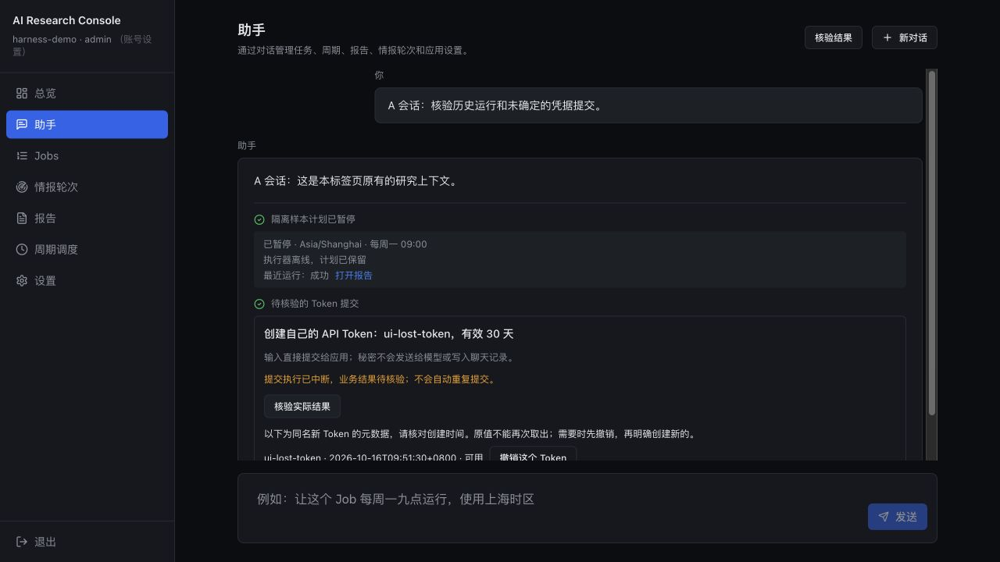

# 助手 Harness 修复计划与执行记录

启动：2026-10-16。用户已授权制定计划后连续完成长任务，无需逐步确认。依据：[复查记录](assistant-harness-review.md)。

## 目标与工作边界

让助手查询、修改、恢复和维护应用时，对象与实际结果一致。修复已确认问题，验证已有风险，完成直接改善这条控制链路的优化；保留既有 Jobs、流式协议、角色权限和专用页面行为。

保留工作区已有修改及用户 provider/任务配置。验证使用临时 state、账号、目录和端口，不安装真实调度、不外发通知。真实模型仅用于隔离任务与恶意材料验证。新发现的问题先判断影响并纳入相关修复，不借机扩展无关功能。

## 连续执行顺序

| 阶段 | 范围 | 可体验的验收结果 | 状态 |
| --- | --- | --- | --- |
| 1 | F01 手动运行与产物；F09 输出目录 | 选中历史运行后状态、日志、报告一致；实际写入始终落在核验的输出根内 | 专项通过 |
| 2 | F02–F04 配置校验、快照和回退；R02 共享写入并发 | 非法配置保存前被拒绝；中断/收尾失败可解释；旧回退不因输入卡片时限失效；并发编辑不静默丢失 | 专项通过 |
| 3 | F05–F06 关停与准入；R03 遗失维护命令 | 页面被动查询不唤醒关停应用；维护与新运行原子交接；重绑定中断后有真实终态 | 隔离服务通过 |
| 4 | F07–F08 会话与受保护输入；优化 1、2 | 标签页恢复自身会话；未知秘密操作不重放、可直接核验；卡片正确展示最近结果/暂停预览 | 专项通过 |
| 5 | R01 授权意图；优化 3、4 | 隔离真实模型验证恶意材料；报告筛选避免全量扫描且检索质量不退化；长任务部分完成可继续 | 通过，保留 R01 边界 |
| 6 | 整体验收、文档与交付 | 后端/前端必要回归、构建/lint、隔离服务与浏览器验证；每项有事实与剩余边界 | 完成；当前应用已加载 |

## 实施与验证约定

- 优先将复查的确定复现转成能保护用户结果的回归用例；不以测试数量代替真实验收。
- 文件写入使用已核验绝对位置，展示/索引引用另行规范化，兼顾历史数据。
- 配置校验与锁放在共享业务路径，避免只修助手；回退直接 API 不依赖模型。
- 所有未知写操作保留结果待核验语义，不自动重放创建、外发或凭据操作。
- 维护保持现有“主动再次访问可唤醒”的产品语义，阻止被动 API 请求意外唤醒；不增加普通操作的逐步确认。
- R01 先以真实隔离样本评估，按实际问题做最小必要约束；不把模型提示词当作绝对保证。
- 检索改动按 AGENTS.md 跑真实评测并核对排序；未执行的真实轮次/渠道不宣称通过。
- 构建和会读取前端 dist 的后端测试顺序运行，避免构建清空资源造成环境竞争。

## 执行记录

- 已核对项目约定、现有工作区改动及复查结论。开始阶段 1。
- 阶段 1：运行日志/引用、输出目录与旧报告恢复专项 74 项通过。
- 阶段 2：配置及托管调度相关专项 85 项通过；增加写入前快照、版本回退、直接恢复发现接口及共享字段校验/锁。
- 阶段 3：纯隔离交错/回执专项 5 项通过；真实服务与网关专项 26 项通过，包含经网关关停后的被动查询和主动恢复。网关拉起应用的 PID/日志路径同时改为当前配置目录，避免独立工作区落到主项目状态。
- 阶段 4：恢复/配置/助手后端专项 75 项通过；会话和卡片前端专项 15 项通过（整体验收前会再次回归）。
- 阶段 5：真实当前 provider 的三组恶意报告无写操作尝试；样本含伪造系统指令、外发/关停及禁用用户/删除任务。一次样本有额外只读查询，不把这些样本当作绝对提示词安全保证。
- 阶段 5：真实检索 31 题默认排序、31 题历史范围排序分别与改前逐项一致；历史范围限定在 2026-09-28 的 10 份报告内。2026-09-29 评测保持答案小节 23/31、正确报告 27/31，没有把扫描优化宣称为检索质量提升。
- 阶段 6：真实模型隔离闭环通过，包含创建/修改 Job、实际手动研究、异于工作区的进程目录、指定运行及报告读取、强制保存不可用模型配置、模型失败后的直接回退、再次调用成功、删除 Job 保留报告及恢复会话。一次初始尝试遇到 provider 503，重新建隔离环境后完成；这不是应用代码失败，也不等于 provider 永不出错。
- 阶段 6：浏览器验证双标签页会话、刷新、暂停计划最近报告、受保护输入中断后的元数据核验、设置页直接恢复配置。数据库核对为 2 个请求（1 个种子请求＋1 个新对话请求），刷新/核验没有重复模型执行；预算恢复为 12，未知 Token 仍标为待核验，没有冒充已知成功。撤销路径由后端回归验证，未冒称浏览器点击了撤销。
- 额外发现：首次实际加载时，旧应用已退出成为僵尸进程，旧网关未回收，`kill(pid, 0)` 却将它判为仍运行，维护因此安全失败。修复为共享退出状态检查，网关回收自己拉起的子进程；增加由网关真正拉起应用再重启的进程测试，不由测试代为回收旧 PID。没有强杀任务。
- 最终边界专项：59 passed，包含新旧配置回退发现、跨请求读取回执、正文版本变化、僵尸进程，以及直连/经网关的真实重启与关停。
- 实际加载重试成功：原生维护 API 的 `wait` 策略；加载前手动运行与轮次均为 0。回执 `05596ce5f3a94ea7a1948b2e5cee970d` 已完成，新应用与网关健康一致，配置文件内容哈希未变，直接恢复与受保护输入核验两个新接口可用。仅重启已有 `com.arec.gateway`，未安装真实调度。

## 问题处理结果

| 编号 | 处理及验收依据 |
| --- | --- |
| F01 | 按请求 run ID 选摘要、日志及产物引用；保留产物路径/耗时，未知 ID 返回未找到；当前任务单列。历史/当前状态错配、真实 API 引用有回归。 |
| F02 | 配置发布前准备私有快照和恢复记录；准备失败不发布；发布后的缓存/审计失败返回已保存及警告。通过写盘、回执准备和收尾故障注入验证。 |
| F03 | 配置回退不受秘密输入卡片时限影响，改用内容版本判断；设置页可直接发现本人适用的回退，兼容旧版记录。过期一天、失去聊天响应、坏模型的直接恢复通过。 |
| F04 | 原设置页与助手共用业务字段/类型/范围校验；拒绝新未知字段及无效删除，保留未修改扩展；拒绝后文件不变。 |
| F05 | 主动关停后被动 API/资源不唤醒，返回 `app_stopped` 并停止卡片轮询；显式打开文档才恢复。真实网关服务测试覆盖该组合。 |
| F06 | 维护和 Job/轮次启动共享短准入锁；取消未退出及替换中的 worker 仍受跟踪；回执提交后不再等最终模型调用。确定性交错和真实服务验证。 |
| F07 | 按账号及标签页保存会话 ID；明确恢复原会话。前端回归与浏览器 A/B 双标签页刷新通过。 |
| F08 | 受保护输入记录执行者，重启后 `processing` 转待核验；直接查询业务状态，不重放；Token 仅返回元数据并支持撤销，秘密不进入数据库/聊天。迁移、隔离权限及真实创建后丢结果窗口有回归。 |
| F09 | 实际文件操作始终使用已校验绝对路径，展示引用另算；覆盖不同 CWD、自定义输出根、失败恢复旧报告。真实模型报告也完成不同 CWD 验证。 |
| R01 | 当前 provider 三组恶意材料均为 0 写尝试。服务端角色权限继续生效，但没有新增完整自然语言意图绑定策略；不能据此保证任意模型或攻击都安全。风险保留观察。 |
| R02 | 所有系统配置写者共用锁与内容版本 CAS；托管计划事务内核对版本；legacy cron 在锁内保留现有命令。双写者冲突及命令保留有回归。 |
| R03 | 根据实际新监听及执行者是否退出收尾重绑定记录；一致则完成，不一致则中断，不重放旧命令。匹配/不匹配和遗失执行者均有回归。 |
| 优化 1 | 计划卡片展示最近结果/报告及可读周期；暂停时未来运行标为预览。 |
| 优化 2 | 断线保留原会话和请求，顶部「核验结果」直接读回执，无需模型；不自动重新发命令。 |
| 优化 3 | 范围筛选下推 SQL，FTS 先限定范围再取候选；分页只核验返回页，失效候选可替补；数量及日期明确依据索引。真实排序对照未退化。 |
| 优化 4 | 达到现有 16 轮/32 工具上限时显示部分完成和继续入口；保存连续偏移、正文版本与读取回执。跨请求通过取回回执接续；尾段/缺口不算全文，不混合不同版本，也不把读取位置当分析证据。 |

## 验证与边界

最终完整后端：**1159 passed、1 skipped、33 warnings（119.22 秒）**，使用项目 Python 环境运行 `python -m pytest -q`。跳过项沿用测试自身条件；警告主要为既有 Starlette 422 常量弃用，以及测试中刻意使用短签名密钥的警告。前端本轮 `npm test -- --run` 为 **27 文件、199 项通过**，`npm run build`（TypeScript/Vite）与 `npm run lint`（ESLint）通过。前端构建和会读取 dist 的后端测试顺序执行。代码编译、文档链接与 diff 空白检查通过。

真实模型、检索、服务及浏览器分别验证各自边界；未运行真实情报整轮、未发送实际邮件/通知、未安装或变更真实 cron/调度 LaunchAgent，不据此声称这些外部渠道本轮验收通过。报告同名输出仍可被以后执行替换，不新增不可变产物存档。完整历史会话列表、自动无限续跑和通用 Agent 框架不在本轮范围。

浏览器隔离验收截图：

**交付：已完成计划并加载当前应用。** 使用说明与原复查状态已同步；58 个文档链接、当前应用健康、维护终态及实际前端资源均完成最终核对。本轮创建的浏览器临时服务已按进程归属核对后关闭。保留工作区既有 `.agentify`、provider 配置和任务修改，没有批量提交或重置。
