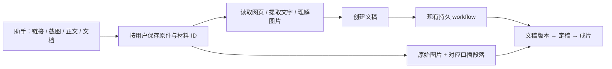

# 助手材料创作与来源覆盖

用户在现有助手提供链接、截图、正文或文档，并说明创作目标；助手创建一篇独立文稿，按要求交给现有持久视频 workflow。文稿页继续管理版本、制作与发布，不新增另一套材料聊天入口。

## 手动材料

- `/api/assistant/materials` 接受一个 multipart 文件、正文或链接，返回材料 ID。支持静态图片、txt/md、docx、pdf；单个文件 20 MB，粘贴正文上限 20 万字符。大于聊天限制的粘贴正文自动作为材料上传；图片可粘贴或拖入。附件失败显示原因，已上传的材料仍保留。
- 原件与提取内容分开保存在 `state/user_materials/<id>/`，材料按账号隔离。对话请求保存附件摘要和 ID，刷新、重开历史或后续要求继续创作时仍可复用。读取失败可在原 ID 上重试。
- `read_materials` 读取用户文件或公开链接；`create_video` 接受 `material_ids / urls / text / goal`。`column` 复用已有配方，`production` 可选，默认独立创作。
- `mode=adapt` 直接按材料写稿；`narration` 保留完整旁白用词；用户明确需要补充研究时才使用 `research`，已有研究结果可复用。
- `make_video=true` 在创建时交给现有 `continue_video` 流程。只要求文稿时停在草稿。聊天关闭不取消后台制作；任务中心、工作区继续读取真实状态。
- 原始图片登记到现有引擎图片接口，按文稿段落绑定 `placements`，保存位置缓存；优先使用用户在文稿中保存的人工配图。自动配图不会覆盖已提交图片。用户的画面要求也随 `creative_intent` 进入制作。

### 任务上下文与草稿

创作任务保存一份带 `revision` 的 `material_context`，包括材料 ID、完整要求、标题、受众、模式和风格。每份文稿版本保存当时的上下文；成片读取定稿版本的快照。后续追加材料、修改要求和手工编辑不会改动旧版材料绑定。

助手通过 `update_video_materials` 在原文稿上追加链接、图片、正文，或修改创作要求。先读取当前 `material_context.revision`，再提交 `base_revision`；默认生成新版本，可同时 `make_video=true` 完成视频。`replace_materials` 用于明确替换，`regenerate=false` 仅保存要求。对应 API 为 `PATCH /api/video/scripts/{script_id}/materials`。任务写稿或出片期间返回冲突，避免把正在制作的任务改指向另一版；原输入继续保留。

研究和写稿共同接收完整创作要求。材料、标题、受众或要求变化时使用新的研究任务；只换风格复用已有研究。用户材料任务无需研究报告也能换风格，页面与助手使用同一服务。

未发送的文字和材料按账号、对话分别暂存；文件原件暂存在 IndexedDB，粘贴正文随草稿保留。上传失败或刷新中断后可重试原输入，已成功的附件不重复上传。切换对话与延迟上传响应不会把材料带入其他对话。

### 后台配图与失败隔离

创建成片只建立持久任务，不调用图片理解或段落匹配模型。图片登记、段落匹配和提交快照冻结由现有成片 worker 执行；每个匹配结果必须使用现有段落坐标。空匹配必须明确说明不使用原因，非法结果不得写入缓存。模型调用有超时，不使用客户端内部重试；失败成为本次成片记录，由已有有限重试预算接续。

调度器分别隔离单项和整批异常，连续失败计数持久保存；一个任务不能阻断后续任务和批次。异常发生在启动工作之后时重新统计占用，保持并发限制。重试已提交任务时沿用冻结快照。

## 采集机制

`config/source_supply/*.yaml` 的 `coverage` 描述产品/主题、适用任务、检索方向、来源角色和新鲜度。新增对象通过数据配置扩展；正文读取、差异、预算与采用记录共用同一实现。

| 角色 | 处理 |
| --- | --- |
| `state` | 当前套餐、价格、额度、能力；不受页面旧发布日期排除，保留上次内容作对照；首次观察只是当前状态 |
| `release` | 产品更新公告、发布日志 |
| `snapshot` | 榜单和数据库快照；单独限制条数，避免大量排名变动挤占文章与产品变化 |
| `editorial` | 文章、案例和实践 |

覆盖目标来源在研究取材与日常归档中同时生效。日常归档优先读取缺失/过期目标；研究时在通用来源之前分配覆盖来源。页面使用现有 HTTP、正文服务和匿名浏览器读取路径。正文补读按**成功篇数**计预算，并另设最大尝试次数；失败不占用成功名额。

来源发现优先搜索缺口，保留通用探索名额；缺口按周轮换，同一域名限制试采次数。新发现来源可按已配置目标和角色归类，不能由模型编造来源地址。未读取、失败和过期均保持可见，不能称作无新闻。

素材有稳定编号，报告可用不可见 `material-use` 回执区分 `selected / background / deferred`。原先的交付基线继续用于页面变更比较；另存采用记录，**引用链接或交给模型不代表已采用**。没有回执的材料保持 offered；延后/待记录的材料在后一天有限重供，每份最多 3 次、14 天过期，不无限重复老新闻。仅成功保存的报告推进交付和采用记录。

实时观察、交付基线、逐份报告的采用历史分别保存。新的状态/快照一旦读到就淘汰旧版本的重供资格，不依赖报告是否成功生成；完整读取后已消失的条目也退出重供。采用历史只追加，后续报告未采用或仅作背景不会覆盖此前真正采用它的报告链接。旧版混合记录保留原件，无法确认的历史关系显示 `unknown`。

实时空结果或读取失败时，归档内容仍可用作缓存，但不刷新实时读取时间，覆盖状态显示 `cached / unavailable`。已有来源可以重新参与任务和覆盖目标分配；任务与目标取并集，即使来源池已满，也允许更新已有来源的分配。

信息源页面和助手 `query_sources(action=coverage)` 展示读取覆盖与采用计数。覆盖状态表示来源读取情况，不能推断报告已经包含该主题。既有报告不会因配置更新自动改写。
