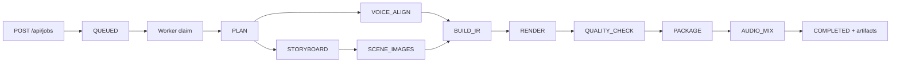

# 子文档：AutoVideo 阶段（接单 → 成片制品）

核对日期：2026-11-20。父文档：[end-to-end-production-chain.md](end-to-end-production-chain.md)。HTTP 契约详见 [`autovideo/UPSTREAM_INTEGRATION.md`](../../../autovideo/UPSTREAM_INTEGRATION.md)。

**范围**：本机 AutoVideo 从接收研映 `narration` 任务，到可下载 `video.mp4` 等制品。不含研映选题/写稿；不含平台投稿。

**日常上游模式**：`input_mode: "narration"` —— 讲稿锁定，只规划画面与配音。`material` 模式由 AutoVideo 自站整理讲稿，**不是**研映日更主路径。

**服务**：`python3 -m uvicorn g3.app:app --host 127.0.0.1 --port 8011`  
**工作区**：`autovideo/g3/data/jobs/{job_id}/`（与 `jobs.sqlite3` 同级）

阶段常量（`g3/store.py`）：  
`PLAN → VOICE_ALIGN → STORYBOARD → SCENE_IMAGES → BUILD_IR → RENDER → QUALITY_CHECK → PACKAGE → AUDIO_MIX`

---

## 0. 前置：健康与配置

创建任务前上游应查：

| 接口 | 含义 |
|------|------|
| `GET /api/health` | 应用可响应；`worker_primary` 表示本实例持有制作锁 |
| `GET /api/config/status` | `ready==true` 才宜建任务；看 `blockers` |
| `GET /api/voices` | 选 `available` 的 `voice_id` |

常见 503：`CONFIG_NOT_READY`、`VOICE_NOT_READY`、需要时的 `DRAW_THINGS_NOT_READY` / `DIAGRAM_LAYOUT_NOT_READY`。  
单 worker：`worker.lock` 独占；任务串行，排队正常。外接盘未挂载可导致 claim 空转或 `STORAGE_OFFLINE`。

---

## 1. 创建任务（入队）

- **接口**：`POST /api/jobs` → 202 `{job_id, status, status_url}`  
- **研映侧组装**：`web/services/video_render.py` + `core/video/autovideo.py`

日常 narration 请求要点：

- `chapters`（分章讲稿）必填；**禁止**再带 `source_text`  
- `duration_mode` 必须为 `content`  
- 可选：`title`、`voice_id`、`production_recipe`、`packaging`/`sources`、`idempotency_key`  

落盘（任务根下）：

| 路径 | 内容 |
|------|------|
| `input/source.txt` | 由 chapters 拼接的正文 |
| `input/input.json` | 请求快照（含 `input_mode`、`chapters`、`source_sha256`、配方/包装解析等） |
| SQLite `jobs` | `QUEUED`，`active_stage=PLAN` |

幂等：同 key + 同摘要返回原任务；冲突 → 409。

---

## 2. Worker Claim

- `g3/worker.py` 循环 → `store.claim_next`  
- 建 `attempts/{n}/`，设 `RUNNING`，PLAN 标 RUNNING  
- 子进程跑 g2，环境变量注入源文件、intent、音色等  
- **narration**：`AUTOVIDEO_G2_LOCK_NARRATION=1`  

上游轮询：`GET /api/jobs/{id}`，约 5s；无 Webhook。看 `status`、`active_stage`、`attempts[].stages`。

---

## 3. PLAN（讲稿计划）

含未单独映射 STAGES 的 `prepare-input` + `narration-plan`。

| 模式 | 行为 |
|------|------|
| narration | `authored_script.prepare` / `plan`：只分句与空白规整；**模型不改措辞**；`verify_exact` |
| material | 模型组织/改写讲稿（日更不用） |

关键产物（`attempts/{n}/g2-run/artifacts/`）：

- `narration-plan.json`、`prepared-source.txt`  
- `authored-narration.json`（narration：`model_rewrite:false`）  
- `input-brief.json`、`fact-ledger.json`、可选 `packaging-resolved.json`  

**硬失败**：`NARRATION_TEXT_MISMATCH`（`retryable=false`）—— 分句后无法逐字还原 chapters。不要改用 material 绕过同一份定稿。

---

## 4. VOICE_ALIGN（配音与对齐）

- TTS（Kokoro 等）+ 时间对齐  
- content 模式下常与 STORYBOARD **并行**  
- 产物：`final-narration-plan.json`、`alignment.json`、旁白 WAV、字幕相关、TTS 报告  

朗读文本可剥离反引号等；字幕可保留书面标记（`spoken_text` 约定）。

---

## 5. STORYBOARD（画面规划）

按形式分支，日常常见：

| 形式 | 模块要点 |
|------|----------|
| information_motion | 按章卡片；narration 开启 verbatim 保真 |
| process_diagram | 流程图按章 |
| 其它 | `creative_forms` / `explanation` 等 |

产物：`information-plan.json` / `diagram-plan.json` / `storyboard-plan.json` 等。  
保真或版式失败可成 G2Fault；部分 `DIAGRAM_CONTENT_UNSUPPORTED` 不可重试。

---

## 6. SCENE_IMAGES（可选场景图）

- Draw Things / 插画 / 幻灯素材等  
- information_motion、process_diagram 等常 **SKIP**（排版/关系图不依赖 DT）  
- 需要 DT 而服务未就绪时，创建任务阶段就可能 503  

---

## 7. BUILD_IR（编译 Video IR）

1. 各形式 `compile_storyboard`  
2. `compile_ir` + 可选倍速重定时  
3. **`g1.video_ir.validate_video_ir`**：schema、资产哈希、旁白时间单调、章节覆盖、只信注册组件  
4. narration 第二次闸：`authored_script.verify_outputs` → `narration-check.json`  
5. content：`chapters.json` 章节时间证据  

产物：`fixtures/video-ir-v0.2.json`（登记为 `video-ir.json`）、`compiled-timeline.json`、`narration-check.json`。  

再次可能触发 `NARRATION_TEXT_MISMATCH`（IR 旁白/字幕/标题与讲稿不一致）。

---

## 8. RENDER（Remotion）

- 可信 G1 渲染器拷入 attempt；Remotion CLI 出片  
- 产物：内容 MP4（如 `G2_自动生成.mp4`）、`render-props.json`  
- 失败：`TRUSTED_RENDERER_CHANGED`、`RENDER_CONFIG_INVALID`（多不可重试）、命令超时等  

---

## 9. QUALITY_CHECK（媒体 QA）

- 全量 decode、格式（常见期望 1920×1080@30 H.264/AAC）、时长与 IR、音轨与 TTS 相关度、可见节拍等  
- 产物：`qa.json`（须 `PASS`）、`ffprobe.json`、contact-sheet、keyframes  
- g2 退出 0 但 QA 非 PASS → worker 可标 `UNVERIFIED_OUTPUT`（不可重试）  

---

## 10. PACKAGE（包装）

- 片头 / 来源卡 / 片尾等 stinger；字幕与章节加 `offset_ms`  
- 未配置包装 → STEP SKIPPED；完成时 PENDING 的 PACKAGE/AUDIO_MIX 会被标 SKIPPED  
- 产物目录 `artifacts/package/`：登记后的 `video.mp4`、`content.mp4`、偏移后字幕/章节、`package.json`、`package-qa.json`  
- 包装 QA：完整解码、帧数拼接、接缝音相关等；配置类错误多不可重试  

---

## 11. AUDIO_MIX（可选配乐）

- 需显式启用背景乐；产品上常暂缓  
- 产物：混音后 `video.mp4`、`unmixed.mp4`、`music-mix.json`、`mix-qa.json`  
- 未启用 → SKIPPED  

---

## 12. 完成与上游下载

Worker 扫描安全制品 → `store.mark_completed` → `status=COMPLETED`。

上游：

1. `GET /api/jobs/{id}` 直到 COMPLETED / FAILED / CANCELLED  
2. `GET /api/jobs/{id}/artifacts`（未完成多为空数组）  
3. 按 `download_url` 拉文件，核对大小 / sha256  

| 常见制品名 | 用途 |
|------------|------|
| `video.mp4` | 最终成片（包装/混音后最外层） |
| `content.mp4` | 有包装时的内容片 |
| `captions.srt` / `chapters.json` | 与最终时间线对齐 |
| `narration.json` | 定稿讲稿 segments |
| `authored-narration.json` / `narration-check.json` | narration 来源与逐字 PASS |
| `qa.json` | 内容媒体 QA |
| `video-ir.json` / `storyboard.json` 等 | 中间产物 |

研映下载落点：`AI_research/Base_CodingCLi/state/video_renders/<render_id>/`。

---

## narration vs material（对照）

| | narration（日更） | material |
|--|-------------------|----------|
| 输入 | `chapters` | `source_text` |
| 讲稿 | 锁定，只分句 | 模型可改写 |
| 时长 | 必须 `content` | `fixed` 或 `content` |
| 逐字闸 | PLAN + BUILD_IR | 无同等强制 |
| 谁用 | 研映定稿出片 | AutoVideo 网页「从材料新建」 |

---

## `NARRATION_TEXT_MISMATCH` 专项

| 时机 | 核对 |
|------|------|
| PLAN 分句后 | segments 逐字还原 chapters |
| BUILD_IR 后 | IR 旁白、章节标题、字幕计划 |

`retryable=false`。成功时 `narration-check.json.status == "PASS"`。  
处理应回到**上游改稿/定稿**，而不是在 AutoVideo 里放开改写。

---

## 修订与重试（非日更新建）

| 操作 | 行为 |
|------|------|
| `POST .../retry` | 同 job 新 attempt；仅 `retryable` 错误 |
| revisions `narration` | 新 job，仍锁旁白 |
| revisions `source` / visual / music | 不同 command_mode；可复用旁白 |

日常生产入口：新建 narration 任务 → 轮询 COMPLETED → 下载制品。

---

## 分层职责

| 层 | 目录 | 职责 |
|----|------|------|
| G3 | `autovideo/g3/` | API、队列、SQLite、worker、前端 |
| G2 | `autovideo/g2/` | 规划、TTS、分镜、编译、渲染编排、包装 |
| G1 | `autovideo/g1/` | Video IR 校验与可信 Remotion 组件 |

上一步：[chain-video-production.md](chain-video-production.md)。总览：[end-to-end-production-chain.md](end-to-end-production-chain.md)。
