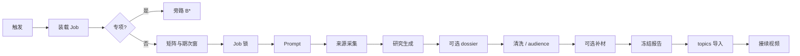

# 子文档：研究阶段（触发 → 冻结报告）

核对日期：2026-11-20。父文档：[end-to-end-production-chain.md](end-to-end-production-chain.md)。Job 级细表与附录见 [job-generation-pipelines.md](job-generation-pipelines.md)。

**范围**：从「有人/排期要跑一个 Job」到「Markdown 报告 + 材料快照 + report_meta 落盘，并可被视频侧发现」。不含视频批次与 AutoVideo。

**主入口**：无论 Web / 排期 / 链路 / CLI，最终都进 `core/engine.py` → `ResearchEngine.run_job`。

---

## R0. 触发入口

| ID | 入口 | 代码 | 要点 |
|----|------|------|------|
| R0a | Web Jobs / 矩阵页 | `web/runner/executor.py::start_job` | 预算、矩阵上限、维护闸；线程跑引擎；日志 `logs/jobs/<job>.jsonl` |
| R0b | 受管排期 | `core/schedule_runner.py` | 领 `schedules.db` 槽位；子进程 worker；可冻结期次 `run_context` |
| R0c | 链路「运行」 | `web/services/chain_runner.py::start` | 先写 `chains.db`（`stage=RESEARCH`），再 `start_job`，带 `chain_run_id` |
| R0d | CLI | `python run.py <job>` | 直调引擎；无 Web 任务表 |
| R0e | 其它 | 热触发快讯、视频侧重研临时 Job、主题工作台、情报轮次 | 仍汇入同一引擎 |

失败常见：Job 禁用、已在跑、预算/矩阵 cap、维护中。

---

## R1–R4. 装载、分流、期次、锁

### R1. 装载 Job

- **输入**：Job 路径；可选已冻结的 `run_context.job`
- **代码**：`core/config.load_job`；`engine._run_job`
- **失败**：找不到 → NOT FOUND；`enabled: false` → SKIPPED

### R2. 专项分流（命中即离开主路径）

| Job 字段 | 模块 | 产物方向 |
|----------|------|----------|
| `source_collection` | `core/material_collection` | 素材归档，不写常规报告 |
| `source_discovery` | `core/source_discovery` | 自动来源池 |
| `topic_discovery` | `core/theme_discovery` | 主题推荐 |
| `topic_ideas` | `core/theme_ideas` | 题目候选 |

### R3. 矩阵上下文与期次窗

- `matrices.for_run`：只标记 `_matrix`；`{domain}` / `{keywords}` 以 **Job 文件**为准（矩阵不再合并关键词）。未写 `domain` 的旧 Job 才回退矩阵 `domain`。
- 策略管理 Job：`production_policy.issue` 冻结 `issue_id`、研究窗、策略版本（**特例**，见 [config-simplification.md](config-simplification.md)）
- 其它：有 `collection_days` 则 `research_window.freeze`
- 事件记忆可按矩阵隔离（`_events_exclude`）
- 可选 `source_supply`：Job 命中供给档案时叠加自动池（**特例**，非人人必配）

### R4. Job 锁与超时

- `core/lock.LockManager` → `state/locks/<job>.lock`
- 超时取 `job.runtime.timeout_seconds` 或系统默认；可取消
- 锁冲突 → skipped「Already running」

---

## R5–R6. Prompt 与信源

### R5. 输出路径与 Prompt

- `_resolve_output_path`：限制在 `output/`（或 `runtime.output_root`）；渲染 `{date}` 等
- `_build_prompt`：替换变量；可拼 `{reported_events}`、`{recent_outcomes}`、采集窗说明
- 记录 `_prompt_urls` 供后续引用检查

### R6. 来源解析与抓取

三条主分支：

| 分支 | 条件 | 行为 |
|------|------|------|
| Knowledge | `job.knowledge` | 旧题避重 ± 可选题材线索；常无网页抓取列表 |
| 仅来源 | `search: false` | `_fetch_sources_strict`；无内容硬失败（如快讯发现） |
| 默认可搜索 | 其它 | 预取失败多仅 warning；Agent 内仍可搜索 |

**来源供给**（Job 命中 `config/source_supply/*.yaml` 时）：

1. `source_supply.for_job` 选档案  
2. `collect`：覆盖目标 + 声明源 + 自动池 → 扫描/深读/变更对比 → 按字符预算切块  
3. 写出材料块；pending 在报告保存后才 `commit`  
4. 回执可写 `*.source-supply.json`

可选 `source_history`：历史对照，同样延后 commit。

---

## R7–R8. 研究生成

### R7. ResearchAgent

配置：`config/system.yaml` 的 `research.mode`（默认 `auto`）。

| 模式 | 何时 | 做什么 |
|------|------|--------|
| `write_from` / fetch_only | `search: false` 或 knowledge 等价 | 用已有材料写初稿；过长则分批 |
| Agent 多轮 | `agent` / `auto` | 工具：`search_web`、`read_file`、`list_files`；`report_problem` 拒写垃圾报告 |
| Pipeline 回退 | `auto` 遇不支持工具，或 `mode=pipeline` | 规划查询 → 批量搜索 → 单次生成 |
| Agent 硬失败 | `mode=agent` 且无工具 | 抛错，不回退 |

输出：`raw_content`、已检索材料/URL、用量。空内容在保存前 FAILED。

### R8. 可选 dossier 深读

- 条件：`ai_dossier_sources.wanted(job)` 且有初稿  
- 读链扩写；可落 `*.dossier-initial-<hash>.json`  
- 非 LLM 失败多保留初稿并记 `expansion_error`

---

## R9–R11. 整理、补材、冻结

### R9. 清洗 + audience-v1

1. `extractor.extract_report`（失败则保留原文）  
2. 若 Job 启用 `content_strategy: audience-v1`：频道取 Job 的 `audience_channel`，缺省再查 `content_strategy.yaml` 的 `jobs:` 映射  
   - 写 `*.audience-initial-<hash>.json`  
   - `audience_strategy.prepare_report`：LLM 选题/结构化（知识频道可保留整稿）  
   - 失败 → `kept_original`，不丢报告  

### R10. 按问题补材

- 条件：`question_material: question-v1` + audience channel + 系统开关  
- `core/video/question_material.enhance`：对候选找缺口 → 搜索/读页 → 写回报告  
- 无候选或 kept_original → 跳过  

### R11. 冻结报告与证据

按顺序（后几步多为 best-effort）：

| 顺序 | 动作 | 落点 |
|------|------|------|
| 1 | 原子写 Markdown；同日重跑 `_1`、`_2`… | `output/...md` |
| 2 | 内容身份 | 旁路 `*.report.json` |
| 3 | supply / history commit | `*.source-supply.json` 等 |
| 4 | 原文材料快照 | `*.materials-<hash>.json` |
| 5 | 引用检查（不失败任务） | 记入 meta |
| 6 | 事件记忆 | `state` |
| 7 | 运行元数据 | `state/report_meta.jsonl` |
| 8 | Job 成功状态 / 通知 | StateManager |

**简报 vs 材料**：报告正文是整理结果；`materials` 是本次实际读到的原文。下游写稿按分支选用，可从文稿 `meta` 反查。

---

## R12–R13. 选题导入与接续

### R12. Topics 导入（异步）

- **不在引擎同步末尾强制完成**；由视频侧拉：`topic_store.sync`（autopilot / 视频页 / auto.pending 前等）  
- Job 声明 `topics:` → 拆条写入 `video.db` 的 `topics` / `topic_imports`  
- 无 `topics:` 的整份报告走 `whole_source`，不拆条  

### R13. 研究完成后的接续

| 路径 | 行为 |
|------|------|
| 链路 | `chain_runner.advance`：取报告 → 有 outputs 则 `video_autopilot.start_run`，`stage=VIDEO` |
| 生产 auto | `auto.pending`：满稳定秒数、有正文、身份未处理 → 建视频批次 |
| 仅研究 | 停在报告页，等人手「写成视频」 |

---

## 旁路简述

| 分支 | 说明 |
|------|------|
| B1 素材积累 | 只归档公开源，供后续 supply/archive |
| B2 来源发现 | 扩自动来源池 |
| B3/B4 主题/题目 | 工作台推荐；采纳后才进制作 |
| B5 知识 Job | 仍走主路径 R6a→R11；常整份出稿 |
| B6 无视频绑定 | 跑满 R0–R11 后停 |
| B7 情报轮次 P0–P9 | `web/runner/pipeline.py` 编排；组内并行；合成阶段注入 `upstream_reports`；落 `output/practical_ai_intelligence/<日期>/` |

轮次阶段：P0 采集计划 → P1–P6 雷达 → P7/P8 机会与风险 → P9 执行综合。上游失败时综合可标 `stale`。

---

## 失败 / 跳过速查

- **不跑**：disabled、NOT FOUND、专项分流、锁冲突、入口预算/矩阵 cap  
- **中途停**：取消、超时、空输出、`SourcesUnavailableError`（fetch_only）、agent 硬模式无工具  
- **软降级继续**：可搜索 Job 预取失败、dossier 非 LLM 失败、audience kept_original、citation 不达标仅记录、meta/材料写失败 warning  

---

## 关键落点

| 路径 | 内容 |
|------|------|
| `jobs/**/*.yaml` | Job 定义（含 `domain` / `keywords` / `audience_channel`） |
| `config/sources.yaml` | 共享信源注册表 |
| `config/source_supply/` | 特例：多 Job 自动供给池 |
| `config/matrices/` | 薄层：分组 / 避重 / 运维 |
| `config/content_strategy.yaml` | 受众频道文案库；`jobs:` 映射仅兼容回退 |
| `config/production_policy.yaml` | 特例：期次窗 |
| `output/**/*.md` + `*.materials-*.json` + `*.report.json` | 冻结报告与证据 |
| `state/report_meta.jsonl` | 报告身份与运行元数据 |
| `state/locks/`、`state/schedules.db`、`state/chains.db` | 锁、排期、链路 |
| `state/video.db`（topics） | 条目导入后的选题 |

下一步：[chain-video-production.md](chain-video-production.md)（报告 → 定稿 → 提交 AutoVideo）。
