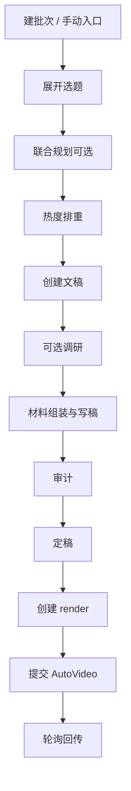

# 子文档：视频制作阶段（报告 → 定稿 → 提交 AutoVideo）

核对日期：2026-11-20。父文档：[end-to-end-production-chain.md](end-to-end-production-chain.md)。文稿五步交互细则见 [video-steps.md](video-steps.md)；作者输入边界见 [manuscript-input-gates.md](manuscript-input-gates.md)。

**范围**：报告已存在之后，到研映侧拿到 `autovideo_job_id`（并可继续轮询回传）。不含 AutoVideo 内部 PLAN→PACKAGE；不含平台投稿。

**编排主轴**：

- 周期：`video_autopilot.tick()` / `chain_runner.tick()`
- 文稿步骤唯一启动口：`web/services/video_executor.py`
- 步骤状态由 `core/video/steps.py:derive` 从现有记录推导，不另存

---

## V1. 如何进入视频批次

### V1. 报告自动发现

| 项 | 内容 |
|----|------|
| 触发 | `video_autopilot.tick` → `fire_auto` |
| 代码 | `core/video/auto.py:pending`；`start_run` |
| 条件 | 生产配置 `auto` 且可用；报告满约 60s 稳定；有正文；身份未处理；启用时间之后 |
| 产出 | `autopilot_runs`（`stage=TOPICS`，spec 含 job/report/identity/picks） |

### V1a. 报告交接锁

同报告同 identity、production 集合冲突时拒绝「部分重复接管」（`report-video-handoff` 文件锁）。

### V1b. 旧计划 / 手动批次

`fire_due_plans`；`POST /api/video/autopilot/runs`。过期计划不补跑。

### V1c. 主题推荐入队

`theme_workbench.enqueue_recommendations`：当日推荐可直接建成带 1 个 item 的批次。

### V1d. 链路接续

研究成功且有 outputs → `start_run(..., chain_run_id=)`；`chains.db` 进 `stage=VIDEO`。

### V1e. 手动写成视频

`POST /api/production/{key}/write` 或 `POST /api/video/scripts`：可**跳过** V2–V4，直接建文稿进五步。整份报告已写过会 409。

---

## V2–V4. 选题展开

### V2. TOPICS → ITEMS

1. `sync_topics`：按 Job `topics:` 增量导入报告条目  
2. `pick_topics`：按 production 的 each / whole / episode 展开  
3. `_add_items` → `autopilot_items`（PENDING）；run 进 `ITEMS`  

无候选 → run DONE「没有可写的新选题」。报告 identity 变化 → CANCELLED。

### V3. 联合规划

- **何时**：`joint_planning.enabled_for(spec)`（如快讯合辑+单条成对）  
- **代码**：`core/video/joint_planning.py`  
- **决定**：合辑收哪些条、单条各讲哪题、原文分配、写稿方向  
- **方向规则**：观众向问题 + 带走点；**不写**「同批合集 / 发布概况」等制作分工语  
- **落盘**：`state/joint-plans/<id>.json`；topic 上挂 `joint_plan={id,entry}`  
- **失败**：退回原 `pick_topics`，notes 记「保留原选题流程」

### V4. 热度 / 角度 / 排重 / 事件池

穿插在挑题与写稿前：

- `heat` 门槛与排序（如 `flash_each` 的 `heat_min`）  
- `angles` 超热多角度  
- `content_guard` / 历史 taken 排重  
- `story_pool` 事件预留与换候选；可能材料二次选题  

无法通过 → CANCELLED、换 fallback，或记原因停。

---

## V5–V6. 建稿与可选调研

### V5. 创建文稿

- `video_executor.create` → `store.create_script` → 后台线程  
- 写入 `production`、`content_context`、topic（含 `from_report` / `joint_plan` / `article` / `user_materials`…）  
- 并发上限约 2 篇写稿；搜索宕机可 hold  

有现成报告 / 文章 / 用户材料 → 调研步 SKIPPED。

### V6. 调研（按需）

- 无 `report_path` 时：生成临时 `jobs/video/<配方>_<短id>.yaml` → `start_job`  
- 成功写回 `report_path`；失败 → FAILED；搜索等待有独立重试预算  

---

## V7. 写稿（材料 → 作者 → 润色）

入口：`video_workflow._write`（及 rewrite / 方案确认后续写）。

### V7. 材料组装

合并：

- 报告正文 / 条目材料 / 适用的 `report_material`  
- 栏目与配方、受众、`content_context`、节目章节  
- 联合规划 `assignment`（方向再 scrub）  
- 可选 `research_dossier`、材料裁剪 `fit_material`、事件选择  

重复内容 / 无候选 → 归档或 FAILED。  
`writing.pause_after_plan` 仅手动改编可暂停；**批次文稿从不停**。

旁路分流：

| 旁路 | 模块 |
|------|------|
| 用户材料 | `assistant_materials.write` |
| 文章 | `video_articles.write` |

### V7a. 作者输入门禁

- `author_input_gates.scrub`：清洗联合方向、栏目风格中的制作套话  
- 可记 `meta.author_input_scrubbed`  
- 口播材料包剔除采集元数据：`report_material.for_narration`

### V7b. 一次写稿 / Job Profile 读改

- `manuscript_workflow.write` → `writer.write` / `write_for_column`  
- 现行主路径多为 `generation: goal_first`  
- 命中 Job Profile 时：读稿标问题 → `revise_passage` 按段改  
- 章节标题观众化：`viewer_section_title`（去掉「开场：」等工作名）

### V7c. 润色与口播收口

- `polish.apply`：有具体 findings 才局部改  
- `narration_stance.settle_sections`：去掉取材套话、续集口吻、残句连接等  
- 后果性缺口可标 `narration_blocks_auto_approval`（挡自动定稿，不挡人工）

### V7d. 改编分支（adapt）

`column.writer=="adapt"`：事实表 → 方案 → 写稿 → 内置审校。可选 `PLAN_READY` 等人确认。日常多数绑定不走此支。

写完：`store.add_version` → 文稿 `DRAFT`。

---

## V8–V9. 审计与定稿

### V8. 审计

- goal_first 初稿常 `checks.mode=on_request` → 步骤显示跳过/未完，直到重跑审计  
- `_audit_short` → 规则 + 可选模型审计；可触发改写复审  
- 文章路径有忠实度审计  

### V9. 定稿

| 路径 | 行为 |
|------|------|
| 手动 | 文稿页「定稿」→ `video_executor.approve`；等人 |
| 自动 | `advance_auto`：过 credibility / 核心问题 / `auto_approval_hold` 后写 `APPROVED` + `approved_version` |

挡住自动定稿的常见原因：严重/待核实层、口播未收口、重复内容、审计未完超重试。  
人工定稿仍可能被 `narration_problem` / 文章 readiness 拒绝。

---

## V10. 批次推进器

每个 RUNNING item 每 tick 调 `video_autopilot.advance` → `video_executor.advance_auto`：

- 缺调研就启调研，缺稿就写稿，草稿就尝试定稿，已定稿就尝试出片  
- 全局名额：写稿并发、渲染并发（约 renders&lt;1）  
- 终态：DONE / HELD / CANCELLED / FAILED；整 run 收齐后 DONE  

渲染相关 hold：`SUBMIT_UNCONFIRMED`、`DOWNLOAD_FAILED`、磁盘/外接盘不可用等。

---

## V11–V13. 出片对接（研映侧）

### V11. 创建 render 记录

- `video_render.create`：校验已定稿、口播可出片  
- 组装 narration `chapters`、配方/`production_context`、音色、包装、可选截图  
- 写入 `video.db.renders`（此时未必已有 `autovideo_job_id`）

### V12. 提交 AutoVideo（本阶段主终点）

- `_submit` / `_reconcile`：`AutoVideoClient.create_job`（`input_mode: narration`）  
- 幂等键对账；多匹配 → `SUBMIT_UNCONFIRMED`，不自动重生  
- 成功：写入 `autovideo_job_id`、`submitted_at`  
- 文件锁：`state/video_render_locks/`  

前置失败：存储离线、Draw Things 未就绪（若本片需要）等。

### V13. 轮询与下载

- 同进程 `_poll` → `_download`；重启 `resume_active`  
- 制品落到 `state/video_renders/<render_id>/`（`video.mp4`、字幕、章节…）  
- 复制失败可标 `DOWNLOAD_FAILED` 后续续拷；外接盘掉线停写  

**职责分界**：到此为止研映只负责提交与拿回文件；画面/配音/IR/渲染见 [chain-autovideo.md](chain-autovideo.md)。

---

## 旁路

| ID | 路径 | 要点 |
|----|------|------|
| B1 | 文章 | 跳过常规选题调研；定稿/出片依赖源文件可读 |
| B2 | 用户材料 | `input_kind=user_materials`；出片前可 `prepare_render` |
| B3 | 本地成片导入 | `local_video`：跳过 AutoVideo，直接 COMPLETED render，可投稿 |

---

## 关键落点

| 落点 | 用途 |
|------|------|
| `autopilot_runs` / `autopilot_items` | 批次账本 |
| `scripts` / `script_versions` / `script_events` / `script_plans` | 文稿与方案 |
| `renders` | 出片与 `autovideo_job_id` |
| `state/joint-plans/` | 联合规划 |
| `state/video_renders/` | 回传/导入成片 |
| `jobs/video/*.yaml` | 文稿触发的临时调研 Job |
| `config/production/`、`joint_planning.yaml` | 运行契约 |

上一步：[chain-research.md](chain-research.md)。下一步：[chain-autovideo.md](chain-autovideo.md)。发布见 [video-publish.md](video-publish.md)。
