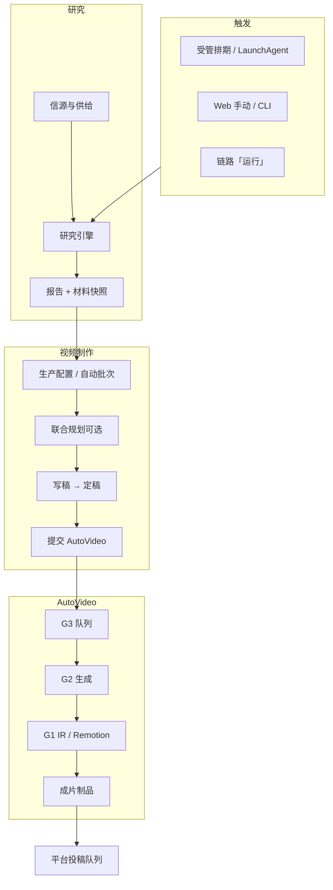

# 端到端生产链路（信息源头 → 成片 → 发布）

核对日期：2026-11-20。本文按日常主路径说明整条产品链。各段步骤拆进子文档：

| 段 | 子文档 | 覆盖 |
|----|--------|------|
| 研究 | [chain-research.md](chain-research.md) | 触发 → 采集 → 报告冻结 → 接续视频 |
| 视频制作 | [chain-video-production.md](chain-video-production.md) | 批次选题 → 写稿定稿 → 提交 AutoVideo → 回传 |
| AutoVideo | [chain-autovideo.md](chain-autovideo.md) | 接单 → PLAN…PACKAGE → 可下载制品 |

细查 Job 清单与附录见 [job-generation-pipelines.md](job-generation-pipelines.md)。文稿五步交互见 [video-steps.md](video-steps.md)。HTTP 契约见 [`autovideo/UPSTREAM_INTEGRATION.md`](../../../autovideo/UPSTREAM_INTEGRATION.md)。

两个子系统：

| 系统 | 目录 | 职责 |
|------|------|------|
| 研映（研究控制台） | `AI_research/Base_CodingCLi/` | 采信源、写报告、选题、写稿定稿、提交出片、平台投稿 |
| AutoVideo | `autovideo/` | 接收已审定口播讲稿，规划画面、配音、渲染、媒体 QA，回传 MP4 |



四个独立开关，互不替代：

1. Job YAML 的 `enabled` — 能否被研究执行  
2. 排期槽位的 `enabled` — 是否按时触发  
3. 生产配置的 `auto` — 合格报告是否自动进视频批次  
4. 平台账号的 `auto_upload` — 成片是否自动进投稿队列  

---

## 0. 配置层（运行前的契约）

运行时每一步都在读这些绑定；改配置等于改产品线，不等于改代码。

| 对象 | 放哪 | 管什么 |
|------|------|--------|
| Job | `jobs/**/*.yaml` | 研究题目、来源、prompt、输出路径、是否搜索；**报告用的 `domain` / `keywords` / `audience_channel` 写在这里** |
| 信源 | `config/sources.yaml` + Job `sources` | RSS / 页面 / 搜索等采集入口（共享注册表） |
| 矩阵 | `config/matrices/` | **薄层**：成员归属、暂停、月搜上限、事件避重、视频默认；不向报告注入关键词 |
| 栏目 | `config/content_columns/` | 受众、栏目创作方向、制作默认 |
| 配方 | `config/video_recipes/` | 怎么写、是否调研、画面偏好 |
| 生产配置 | `config/production/*.yaml` | **哪份 Job → 哪套配方 → 整期还是拆条 → 是否 auto** |
| 联合规划 | `config/joint_planning.yaml` | 合辑与单条如何同分一批报告 |
| 链路 | `config/chains/` | 产品化入口：Job + 输出绑定收成一条线 |
| 自动投稿 | `config/bilibili_auto_upload.yaml` 等 | 窗口、排除 Job、热度等 |
| 特例 | `source_supply/`、`production_policy` | 多 Job 自动池 / 期次窗；普通监测 Job 可忽略 |

研究侧去留细节见 [config-simplification.md](config-simplification.md)。

日常最常走的绑定示例：

- 快讯合辑 `flash_daily` + 快讯单条 `flash_each` ← Job `monitoring/ai_flash_discovery`  
  （两条产品线、两个 production 键；由 `joint_planning` 同分一批。整期 vs 热度单条、栏目与读稿 Profile 不同，**不合并成一个 production ID**。取舍见 [config-simplification.md](config-simplification.md)。）
- ChatGPT 动态整期 / 拆条成对绑定（同构，同样保留双键）  
- 科学链路 `ai_science_updates_each` ← Job `chains/ai_science_updates`（成片后默认不自动上 B 站）

---

## 1. 信息从哪来

> 步骤级细节：[chain-research.md](chain-research.md)（R0–R13）。

### 1.1 触发

| 入口 | 做什么 |
|------|--------|
| 受管排期 | `core/schedule_runner.py` 到期领取，写 `state/schedules.db` |
| LaunchAgent | 如情报矩阵 `com.arec.pipeline.daily`；调度器自身 `com.arec.scheduler.*` |
| Web Jobs / 矩阵页 | `web/runner/executor.py` → `start_job` |
| CLI | `python run.py <job>` |
| 链路页「运行」 | `web/services/chain_runner.py`：先建 `chains.db` 运行记录，再 `start_job`，研究完成后可接视频批次 |

### 1.2 采集与研究

引擎：`core/engine.py` → `core/research.py`。

典型顺序：

1. **解析来源** — Job 声明的 `source:<id>`、内联来源；可合并来源供给池与历史归档（`core/sources.py`、`core/source_supply.py`）。  
2. **组装提示** — Job prompt + 矩阵上下文 + 本期窗口 + 已读材料。  
3. **写初稿** — LLM 工具调用搜索/读工作区；`search: false` 的 Job（如快讯发现）只用已采集源写稿。  
4. **可选整理** — 受众候选整理（`audience-v1`）、按问题补材。  
5. **冻结** — 写出 Markdown 报告，并保存本次实际读到的原文材料快照。

产物：

| 产物 | 位置 |
|------|------|
| 研究报告 | `output/**/*.md`（同日重跑 `_1.md`…） |
| 原文材料快照 | 同目录 `*.materials-<hash>.json` |
| 报告身份与元数据 | `state/report_meta.jsonl` |
| 声明了 `topics` 的条目 | `state/video.db` → `topics` / `topic_imports` |

报告正文是整理后的简报；材料快照是运行读到的原文。写稿用哪一份由生产分支决定，可从文稿 `meta.input_kind` / `meta.material` 反查。

### 1.3 研究侧的旁路（不直接出片）

| 路径 | 作用 |
|------|------|
| 素材积累 | 只归档公开源，供后续研究读 |
| 来源发现 / 主题发现 / 题目生成 | 扩池与工作台推荐；采纳后才进制作 |
| 情报轮次 P0–P9 | 多 Job 流水线；综合报告可手接深度解读生产 |
| 图解知识 Job | 整份知识底稿 → 整份报告生产 |

---

## 2. 报告如何变成「要拍的选题」

> 步骤级细节：[chain-video-production.md](chain-video-production.md)（V1–V4）。

### 2.1 生产配置展开

一份报告可以进多个生产配置。每个配置规定：

- 用哪套栏目 / 配方  
- **整期**（一份报告或合辑做一篇）还是 **拆条**（每条选题一篇）  
- 是否 `auto`、热度门槛、是否允许重研  

入口：

- **自动**：`core/video/auto.py` 发现合格新报告 → `web/services/video_autopilot.py` 建批次  
- **手动**：生产页 / 报告页「写成视频」→ `web/routes/production.py`  
- **链路**：研究阶段结束后 `stage=VIDEO`，挂同一 autopilot 批次  

批次账本在 `video.db` 的 `autopilot_runs` / `autopilot_items`（含 Job、报告、picks、production）。

### 2.2 联合规划（快讯 / ChatGPT 成对绑定时）

同批同时命中「合辑 + 单条」时，`core/video/joint_planning.py` 决定：

- 合辑收哪些条目、单条各讲哪一题  
- 原文如何分配  
- 写稿方向（观众向问题 + 带走点；**不把「同批合集 / 发布概况」制作分工语写进作者输入**）  

规划落盘：`state/joint-plans/<id>.json`。失败则退回普通选题流程。作者输入边界见 [manuscript-input-gates.md](manuscript-input-gates.md)。

### 2.3 排重

按报告/条目身份、历史事件、角度与覆盖关系过滤（`story_pool`、`heat`、`angles` 等）。无法通过则换候选、跳过或记原因。

---

## 3. 文稿：调研 → 写稿 → 审计 → 定稿 → 出片

> 步骤级细节：[chain-video-production.md](chain-video-production.md)（V5–V13）。UI 五步交互另见 [video-steps.md](video-steps.md)。

文稿五步由 `web/services/video_executor.py` 统一启动；步骤状态从现有记录推导（`core/video/steps.py`），不另存。

```text
选题 / 报告
  →（可选）按配方再调研
  → 组装作者输入 → 写稿 → 读稿/润色 → DRAFT
  → 人工或自动定稿 → APPROVED + approved_version
  → 提交 AutoVideo
```

### 3.1 作者实际拿到什么

`web/services/video_workflow.py` 的 `_write` 合并：

- 栏目创作方向、配方、受众  
- 报告正文或条目材料（及适用的原始材料）  
- 联合规划方向（再经 `author_input_gates` 清洗）  
- 用户素材 / 文章路径时走旁路入口  

写稿：`core/video/writer.py`。可选 Job Profile 读稿改段、通用润色（`polish` / `narration_stance`）。

### 3.2 版本与状态

| 落点 | 内容 |
|------|------|
| `video.db.scripts` | 状态、定稿版本、production、content_context |
| `script_versions` | 章节段落、`meta`（材料、联合规划、creative_direction…） |
| `script_events` | 谁启动了哪一步 |

自动批次会 `advance_auto` 尽量往下走；手动稿在定稿/出片前等人。口播备忘未收干净时可挡住自动定稿或出片。

### 3.3 旁路建稿

| 路径 | 说明 |
|------|------|
| 用户素材 | `assistant_materials`；`topic.user_materials` |
| 文章朗读/解读 | `video_articles`；`topic.article` |
| 本地成片导入 | 跳过 AutoVideo，直接可发布 |

---

## 4. 出片：研映 → AutoVideo → 回传

> 研映提交与回传：[chain-video-production.md](chain-video-production.md)（V11–V13）。AutoVideo 内部：[chain-autovideo.md](chain-autovideo.md)。

### 4.1 研映侧提交

`web/services/video_render.py` + `core/video/autovideo.py`：

- 把定稿章节打成 `input_mode: "narration"` 请求  
- `POST http://127.0.0.1:8011/api/jobs`  
- 轮询、按 SHA 下载制品  

请求常带：`chapters`、`duration_mode: content`、`production_recipe` / `production_context`（文稿配方 + 矩阵 `render`）、音色、包装、幂等键。

研映落点：

- `video.db.renders`（含 `autovideo_job_id`）  
- `state/video_renders/<render_id>/`（`video.mp4`、`chapters.json`、`captions.srt`…）

### 4.2 AutoVideo 内部

服务：`python3 -m uvicorn g3.app:app --host 127.0.0.1 --port 8011`。单 worker 串行。

大致阶段：`PLAN` → `VOICE_ALIGN` → `STORYBOARD` →（可选场景图）→ `BUILD_IR` → `RENDER` → `QUALITY_CHECK` → `PACKAGE`。

| 层 | 目录 | 职责 |
|----|------|------|
| G3 | `autovideo/g3/` | API、队列、任务库、前端 |
| G2 | `autovideo/g2/` | 规划、TTS、画面生成、编译 |
| G1 | `autovideo/g1/` | Video IR 校验与可信 Remotion 组件 |

制品在 `autovideo/g3/data/jobs/<job_id>/attempts/...`。口播必须与提交讲稿逐字对齐；上游负责事实，AutoVideo 不做外核验。媒体 QA 通过后才对外可下。

职责分界：

```text
研映：选题、事实、讲稿、定稿、发布
AutoVideo：画面、配音、字幕时间轴、渲染、包装、基础媒体质检
```

---

## 5. 发布

成片 COMPLETED 后可进投稿：

1. 生成发布包（标题、简介、封面、标签等）— `core/video/publish.py`  
2. 入队 `state/platforms.db`（`uploads`）  
3. Worker / `platform_manager.tick()` 投 B 站等  
4. 成功后回写 `video.db.publications`  

自动投稿还要满足：账号已连、`auto_upload`、当前定稿版本、质量/时效未 hold、不在排除列表。  
科学链路 Job `chains/ai_science_updates` 默认排除自动上传：成片照常做，投稿留给人看。

---

## 6. 用一条日常快讯串起来

1. **夜里** 排期触发 `monitoring/ai_flash_discovery`，从订阅源等采当日 AI 动态。  
2. 报告写入 `output/flash/...md`，材料快照同目录；`report_meta` 登记身份。  
3. `flash_daily` / `flash_each` 因 `auto: 1` 进入同一批次；可能写出 `joint-plans/...json`。  
4. 自动写稿：合辑一篇「今日快讯」+ 若干单条深讲；过门禁与润色后自动或人工定稿。  
5. 定稿章节提交本机 AutoVideo（narration）；回传到 `state/video_renders/`。  
6. B 站窗口内按规则自动或手动投稿；公开状态写回 publications。

并行日常还有：ChatGPT 栏目日更、各矩阵日更/周更、图解知识、主题工作台采纳后制作、教程截图材料等。

---

## 7. 数据落点速查

| 位置 | 内容 |
|------|------|
| `output/` | 研究报告、材料 JSON、轮次目录 |
| `state/report_meta.jsonl` | 报告身份 |
| `state/schedules.db` | 排期与尝试 |
| `state/video.db` | 选题、文稿、版本、renders、publications、autopilot |
| `state/video_renders/` | 回传 MP4 / 字幕 / 章节 |
| `state/joint-plans/` | 联合分配 |
| `state/chains.db` | 链路运行 |
| `state/platforms.db` | 投稿任务 |
| `state/materials.db` | 素材归档 |
| `autovideo/g3/data/` | AutoVideo 任务与 attempt 产物 |

试验与隔离验收输出应落外接盘：仓库根执行  
`python3 AI_research/Base_CodingCLi/scripts/trial_storage.py research <试验名>`  
（AutoVideo 用同命令的 `autovideo` 参数）。

---

## 8. 关键代码入口（按阶段）

| 阶段 | 入口 |
|------|------|
| 触发 | `core/schedule_runner.py`、`web/runner/executor.py`、`web/services/chain_runner.py` |
| 研究 | `core/engine.py`、`core/research.py`、`core/sources.py` |
| 生产绑定 | `config/production/`、`core/video/production.py`、`core/video/auto.py` |
| 批次 / 联合 | `web/services/video_autopilot.py`、`core/video/joint_planning.py` |
| 文稿 | `web/services/video_workflow.py`、`web/services/video_executor.py`、`core/video/writer.py` |
| 出片对接 | `web/services/video_render.py`、`core/video/autovideo.py` |
| AutoVideo | `g3/worker.py`、`g2/`、`g1/` |
| 发布 | `web/services/platform_manager.py` |
| 链路 UI | `ui/src/pages/Chains.tsx`、`web/routes/chains.py` |

---

## 9. 相关文档

| 文档 | 用途 |
|------|------|
| [chain-research.md](chain-research.md) | 研究段逐步说明 |
| [chain-video-production.md](chain-video-production.md) | 视频制作段逐步说明 |
| [chain-autovideo.md](chain-autovideo.md) | AutoVideo 段逐步说明 |
| [config-simplification.md](config-simplification.md) | 配置减负计划与归档批次 |
| [job-generation-pipelines.md](job-generation-pipelines.md) | Job 级细表、附录、生产绑定展开 |
| [video-steps.md](video-steps.md) | 文稿五步与重跑规则 |
| [video-publish.md](video-publish.md) | 发布与投稿 |
| [manuscript-input-gates.md](manuscript-input-gates.md) | 作者输入白名单与清洗边界 |
| [scheduling.md](scheduling.md) | 排期与 LaunchAgent |
| [`autovideo/UPSTREAM_INTEGRATION.md`](../../../autovideo/UPSTREAM_INTEGRATION.md) | narration 请求契约 |
