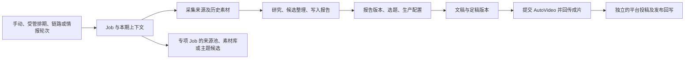

# Job 生成链路现状

记录日期为 2026 年 11 月 20 日，时区为中国标准时间。本文覆盖研映的 Job、报告、选题、文稿、AutoVideo 成片和平台发布，按仓库代码、配置解析结果和正式状态库的只读记录整理。附录 A 可以用 Job 路径查到它的上游、报告和生产绑定。附录 B 展开每一份生产绑定，附录 C 说明生成的调研 Job、归档和内部调度。

## 1. 从一条 Job 开始查

研映里，一个 Job 是一份定义研究或专项工作的 YAML。一个生产配置是从某个 Job 的报告制作某种视频的绑定。一份报告可以进入多个生产配置，每个配置可以得到一篇整期文稿，也可以拆成多篇单条文稿。链路页把 Job、生产配置和运行记录集中展示，研究和视频仍由原有执行器处理。

| 对象 | 主要字段或身份 | 在哪里看 |
| --- | --- | --- |
| Job | `jobs/` 下的相对路径、来源、提示、输出文件模板、`enabled` | [定义加载](../core/config.py#L103)、附录 A |
| 受管排期 | `job_name`、cron、时区、启停、执行版本、运行及尝试 | `state/schedules.db`、[调度器](../core/schedule_runner.py#L185) |
| 矩阵与栏目 | 领域、关键词、受众、栏目交付目标、生产绑定、制作默认值 | [矩阵](../config/matrices/)、[栏目](../config/content_columns/)、[栏目解析](../core/video/content_columns.py#L125) |
| 生产配置 | `production` ID、Job、配方、整份或拆条、是否重研、`auto`、出片覆盖 | [生产配置](../config/production/)、[解析逻辑](../core/video/production.py#L160)、附录 B |
| 报告与选题 | 报告路径和内容身份、条目编号、来源及受众、冻结后的原始材料 | `output/`、`state/report_meta.jsonl`、`video.db` 的 `topics` 和 `topic_imports` |
| 文稿与成片 | `script_id`、`version`、`approved_version`、`render_id`、`autovideo_job_id` | `state/video.db` 的 `scripts`、`script_versions`、`renders` |
| 投稿与发布 | 本地成片和文稿版本、平台任务、平台作品编号、公开状态 | 平台队列及 `video.db.publications` |
| 链路运行 | `chain_id`、Job、输出绑定、报告、视频批次、状态 | `state/chains.db`、[链路执行器](../web/services/chain_runner.py#L92)、[链路配置](../config/chains/) |

四个配置值分别控制不同工序。Job 的 `enabled` 决定是否接受研究执行，排期的 `enabled` 决定是否按时触发，生产配置的 `auto` 决定合格报告是否自动进入视频批次，平台的自动投稿设置决定已完成视频是否进入投稿队列。附录中的排期以数据库为准，Job YAML 中的 `schedule` 是单独的声明，历史或外部触发也可能直接运行 Job。

## 2. 触发到报告

### 2.1 启动与冻结本期输入

| 步骤 | 输入 | 做了什么 | 输出和落点 |
| --- | --- | --- | --- |
| R1. 接受执行 | 手动 Job ID、排期槽位、链路运行或情报阶段 | Web 手动入口提交 `start_job`，调度器从 SQLite 领取到期任务并起 worker，CLI 可直接调用研究引擎。调度 worker 还处理启停、预算和矩阵上限 | Web 任务 ID 与日志事件，或 `schedule_runs`、`schedule_attempts` 里的槽位与尝试 |
| R2. 装载配置 | Job YAML、矩阵配置、全局配置、本期上下文 | 解析规范 Job 路径，补入矩阵领域和关键词。策略管理的 Job 用期次快照冻结窗口、策略版本和配置，其他 Job 按自己的窗口配置处理 | 研究 prompt 的配置、工作区、期次 ID、研究起止时间 |
| R3. 进入执行分支 | 已解析 Job 和阶段字段 | `ResearchEngine` 按 `source_collection`、`source_discovery`、`topic_ideas`、`topic_discovery` 先分流专项 Job。常规报告执行使用 Job 锁、超时和取消控制 | 常规研究上下文，或第 3 节的专项产物 |

[Web 执行器](../web/runner/executor.py#L121) · [调度 worker](../core/schedule_runner.py#L209) · [研究引擎](../core/engine.py#L115) · [生产策略](../config/production_policy.yaml)

### 2.2 采集、研究、整理、保存

| 步骤 | 输入 | 做了什么 | 输出和落点 |
| --- | --- | --- | --- |
| R4. 解析来源 | Job `sources`、`config/sources.yaml`、可匹配的 `source_supply` 规则 | 解析 `source:<id>` 和直接声明的 RSS、页面、搜索等来源。接入来源供给的 Job 还可合并覆盖目标、自动来源池和适用的历史归档。供给模式、时间窗和来源限额共同决定实际交付 | 读取条目、可用原文、源读取状态和供给回执 |
| R5. 组装研究输入 | Job prompt、矩阵上下文、用户变量、窗口、采集块，轮次阶段还可能有上游报告 | 渲染提示中的日期、名称等变量。加上可用历史上下文。知识 Job 走自己的旧题与题材线索路径。过长材料按可用窗口分批 | 任务提示、资料块和可追踪的来源 |
| R6. 生成初稿 | 上述提示、资料、已配置模型与搜索服务 | 普通 Job 可由研究 Agent 工具调用搜索、读取工作区资料，`auto` 在模型不支持工具调用时转到查询规划、批量检索和综合。Job 的 `search: false` 使用已采集来源写初稿。此开关控制初稿路线，来源自身的 `search:` 和后续配置的补材仍要分开看 | 研究初稿 Markdown、模型使用量、已检索网址、实际读到的素材 |
| R7. 深读或组织候选 | 初稿、来源原文、Job 的 `dossier_sources` 或 `content_strategy` | 适用 Job 可深读已有链接并扩写底稿。启用 `audience-v1` 的 Job 会整理候选及原文，形成题目、受众、观众收获、来源关联和可讲的材料。个别长研究保留原研究正文 | 初稿回执、候选和整理后的报告、相关日志 |
| R8. 按问题补材 | 候选和已经读到的原文，Job 与全局补材开关 | 对适用选题识别有用的材料缺口，读取或搜索补充材料，补充实际取得的内容。执行结果和保留原报告的情况记录在回执 | 补材后的报告、补充原文、未填缺口与用量记录 |
| R9. 冻结报告和证据 | 完成的 Markdown、原始材料、引用及期次上下文 | 保存报告并登记内容身份，同日重跑使用新文件名。保存实际读到的原始材料及哈希，记录引用检查、来源供给、内容整理和期次信息，更新 Job 成功状态 | `output/...md`、同目录 `*.materials-<hash>.json`、`state/report_meta.jsonl`、Job 状态和索引 |
| R10. 导入报告或条目 | 报告路径、内容身份、Job 的 `topics` 声明 | 声明 `topics` 的 Job 使用对应格式导入条目。整份报告可被支持整份输入的生产配置消费。无候选或报告尚在写入时，自动发现暂不创建生产批次 | 列入报告页的报告，或用于下游的 `topics`、`topic_imports` 与报告身份 |

[来源解析与抓取](../core/sources.py) · [来源供给](../core/source_supply.py#L119) · [研究 Agent](../core/research.py#L263) · [候选整理](../core/video/audience_strategy.py#L155) · [问题补材](../core/video/question_material.py#L170) · [原始材料快照](../core/report_material.py#L21) · [条目导入](../core/video/topic_store.py#L392)

报告内的简报和原始材料快照是两个输入。简报放本期选择及组织结果，原始材料快照保留运行实际读到的原文。写稿时读取哪一份、是否同时读取两份，由第 4 节的分支决定。正式稿件的历史版本可以用 `meta.input_kind`、`meta.material`、`meta.research_dossier`、`meta.joint_plan` 追查。

## 3. 研究阶段的专项和多 Job 路径

| 路径 | 入口和所需输入 | 处理步骤 | 输出和接续 |
| --- | --- | --- | --- |
| 素材积累 | `system/material_collection`、生产策略范围、来源名单和保留期限 | ① 收集策略管理的来源。② 读公开内容并保留版本、观察时间和读取结果。③ 按保留期限管理归档 | 素材归档及 `output/source_collections/<时间戳>.json`。后续常规研究按规则读取归档 |
| 来源发现 | `source_discovery/<矩阵>`、来源供给档案、现有来源覆盖及候选页面 | ① 生成发现查询，检查可持续采集的入口。② 探测并选择适合该矩阵或 Job 的来源。③ 保存新增来源和匹配关系 | 自动来源池、Markdown 和 JSON 回执。常规 Job 之后按来源供给规则使用，手工注册表和自动池各自记录 |
| 主题发现 | `topic_discovery/<矩阵>` 或 `topic_platform/chatgpt_acquisition`，输入栏目分类、发现配置、历史及平台线索 | ① 选择发现方式。平台方式按栏目和日期轮转，取公开线索并补可取得的互动数据。② 从线索提炼候选，对照历史和栏目。③ 保存推荐。配置为 `ideas` 时转入题目生成，显式平台发现保留平台入口 | 主题工作台推荐、来源线索、运行回执。采纳后可走主题调研和文稿，自动接续还要满足矩阵与策略条件 |
| 题目生成 | 主题工作台或每日题目机制、题目生成请求、栏目、参考模式和实例、反馈与历史 | ① 加载有效请求。② 从例子与模式提炼候选问题。③ 写入选题库和主题状态 | `output/topic_ideas/` 与题目生成回执、推荐主题。制作入口再将主题和配方交给视频执行器 |
| 图解知识 | Job 声明 `knowledge`，输入栏目主题、既往题目和可选线索 | ① 读已讲题目以避开重复。② 按本期知识问题写整份底稿。③ 经适用的候选组织及补材，再绑定整份报告生产 | 一份知识底稿对应一个主题。常见 Job 为 `science/science_illustrated`、`economy/economy_illustrated` |
| 普通研究和没有视频绑定的 Job | 常规报告 Job YAML，包括来源、搜索、提示和输出 | 走 R1–R10。是否使用来源档案、受众整理或问题补材按附录 A 对照 | Markdown 和研究记录。后续仍可从报告或文稿入口手动制作 |
| 轮次流水线 | 情报轮次日期及阶段配置，或轮次接续和重试 | 按下面的 P0–P9 顺序执行。组内独立阶段可并行，综合阶段收到其依赖报告。依赖失败时综合可能记为 `stale` | `output/practical_ai_intelligence/<日期>/` 的各阶段报告、轮次状态、行动和观察项 |

[素材积累](../core/material_collection.py#L105) · [来源发现](../core/source_discovery.py#L334) · [主题发现](../core/theme_discovery.py#L104) · [题目生成](../core/theme_ideas.py#L118) · [知识任务](../core/knowledge_job.py) · [主题接续](../web/services/theme_workbench.py#L231)

| 轮次步骤 | 本次输入 | 处理和输出 |
| --- | --- | --- |
| P0 采集计划 | 本期 Job 说明和来源条件 | 先执行规划，输出 `00_collection_plan.md`。P1–P6 在代码中没有声明 P0 正文为数据依赖 |
| P1–P6 六个雷达 | 各自 YAML、材料和领域 | 分别生成模型与价格、编程工具、Agent 工作流、项目理解、上下文与 RAG、基础设施与评测报告 |
| P7 内容机会、P8 风险和替代 | P1–P6 报告的选取内容 | 分别合成内容机会与风险报告。P7 的 `opportunities` 条目可手动接深度解读生产配置 |
| P9 执行综合 | P7 和 P8 报告 | 汇总执行结论与行动。轮次结束后导出结构化行动项和观察项，生成轮次产物并同步跟踪 |

[轮次阶段和数据依赖](../core/pipeline_docs.py#L21) · [轮次执行](../web/runner/pipeline.py#L484) · [轮次产物](../core/artifacts.py#L613)

## 4. 报告到文稿

### 4.1 报告接续与批次选题

| 步骤 | 输入 | 做了什么 | 输出和落点 |
| --- | --- | --- | --- |
| V1. 创建或发现生产请求 | 一个已完成报告、报告版本、生产配置、触发来源 | 手动生产入口接收用户选择的条目或报告。报告自动化根据可用配置的 `auto`、启用时间、报告稳定时间及已处理身份对账。链路与报告自动接续会按 Job、报告身份和输出避免重复接管。旧流水线计划也有独立入口 | 生产请求或 `autopilot_runs`。批次 `spec` 留 Job、报告、`picks` 和相关运行 ID |
| V2. 按生产配置展开 | 报告条目、来源、栏目、配方、手动选择和选题状态 | 整期建立报告级节目选题，逐条配置建立条目级选题。整份专题也可按一稿制作。盘点配方可接一组选中的条目。先看已用、明确不写、适用的热度和候选规则 | `autopilot_items` 或直接创建的文稿任务，保留 `production`、选题 ID、报告、栏目上下文 |
| V3. 联合分配，按条件执行 | 同批有合辑和单条、候选及原文、既往覆盖 | 对快讯、ChatGPT 动态两对生产绑定，在同一合格新批次里联合决定合辑和单条各用哪些题、哪些原文及角度。一个报告并不保证每次执行该分支。规划失败走原选题流程 | `state/joint-plans/<id>.json`，合辑条目列表、独立问题、分配原文和写稿方向 |
| V4. 排重和预留 | 新选题、文稿和已发布历史、同矩阵已覆盖事件 | 用报告和条目身份、历史事件、本次角度及覆盖关系过滤重复。部分分支使用事件池提取主事件并预留。判断无法通过时，可能换候选、跳过或保留原因 | 合法可写选题、事件归属和排重记录，或任务停止状态 |

[手动生产入口](../web/routes/production.py#L280) · [报告自动发现](../core/video/auto.py#L38) · [批次选题](../web/services/video_autopilot.py#L206) · [报告交接](../web/services/video_autopilot.py#L1029) · [联合分配](../core/video/joint_planning.py) · [事件池](../core/video/story_pool.py#L367)

### 4.2 作者具体收到什么

| 生产分支 | 报告与事实材料 | 额外配置或处理 | 输出 |
| --- | --- | --- | --- |
| 整期节目 | 整份报告或联合规划分配的合辑底稿 | 栏目受众、节目条目清单、命名和章节意见。若有已覆盖章，按期次与历史条件处理 | 有节目章节和分集记录的一篇文稿 |
| 逐条出稿 | 报告中的一个条目和可归属证据，或联合规划中该单条的底稿与分配原文 | 受众、事件或角度、配方和适用的历史覆盖。开启内容策略时按候选范围提供材料。关闭重新调研时复用正式报告材料 | 每个合适条目独立的标题和文稿 |
| 整份报告做一个专题 | 报告全文和可用快照 | 适用时按主题、材料和事件取用证据。知识 Job 的专用分支以底稿为主要证据 | 一篇同主题文稿 |
| 条目重新调研 | 一个现有条目及配方的研究模板 | 生成 `jobs/video/<配方>_<文稿短 ID>.yaml`，通过原研究执行器收集资料。已有报告时重用，失败后按阶段接续 | 该文稿的研究报告，再回到共同写稿流程 |
| 手动素材或文章 | 用户上传文件、图片、文本、文章及其分析或目标 | `video_workflow._write` 在普通报告前分流，解析材料与数据，走各自作者入口。可用图片可在出片时与相关段落绑定 | 带用户素材或文章来源版本的文稿 |
| 导入已有成片 | 本地 MP4 和发布所需基础字段 | 走本地成片资产登记与平台投稿入口 | 可发布的本地成片记录 |

写稿时 `video_workflow._write` 决定交付物。它会合并栏目创作方向、配方、阶段选题、可用的原始资料和联合分配方向，保存时记录 `meta.creative_direction`。如果是联合规划单条，`joint_planning.writing_direction` 只写入该条问题和观众能带走的收获，不再把同批合辑摘要或「发布概况」分工语拼进作者方向；读冻结规划时也会按同一规则重建方向。若要对照作者在开头能看到哪些信息，可以连着查初稿整理、冻结报告、联合分配和这份文稿版本的元数据。

[写稿材料组装](../web/services/video_workflow.py#L331) · [报告正文、条目和规划材料](../web/services/video_workflow.py#L67) · [联合分配写稿交接](../core/video/joint_planning.py#L130) · [栏目快照](../core/video/content_columns.py#L161) · [作者输入拼装](../core/video/writer.py#L196) · [用户材料入口](../web/services/assistant_materials.py#L172) · [文章入口](../web/services/video_articles.py)

### 4.3 作者、读稿与定稿

| 步骤 | 输入 | 做了什么 | 输出和落点 |
| --- | --- | --- | --- |
| V5. 一次写稿 | 材料、受众、栏目与配方、节目章节、模型 | `writer.write_for_column` 调用作者，返回标题和章节、段落、引用。整期章节可含 `opening`、`item`、`closing`。程序处理章节和引用，记录模型、提示版本、用量与长度信息 | 结构化草稿 |
| V6. 读稿或改编分支 | 已选择的 Job Profile，或适用的改编模式 | 当前 73 份有效绑定均解析为内部 `writer: legacy`，其正式普通分支为 `generation: goal_first`。其中 19 份绑定命中 Job Profile，会用对应读稿器指出问题，然后按段落改稿。独立改编路径在代码中支持事实表、讲述计划、草稿、审校与修订 | 草稿或已局部修改的草稿。可查 `meta.manuscript_workflow`、改动段落和回执 |
| V7. 润色和保存版本 | 新草稿、配方、固定问候与标题规则 | 通用润色检测已有表达问题，有具体命中才生成局部改稿。保存文稿时记录版本、口播及原始输入关联。普通一次成稿的附加事实检查可按需触发 | `scripts` 状态 `DRAFT`、`script_versions`、`script_events`。重写、重审和修改可留下多版本 |
| V8. 定稿 | 当前文稿、已有质量标记、手动或自动入口 | 人工可显式定稿。自动批次按当前已有规则处理重复、质量状态、待核实项以及重试。达到条件后选定要出片的版本。需要处理的条目保持待处理或失败原因 | `APPROVED`、`approved_version`，或 `HELD` 及说明 |

Job Profile 的实际候选名单来自 `config/system.yaml` 中的 `video.manuscript_jobs`。省略此字段时从 `config/manuscript.yaml` 读取。部分 Profile 启用到一个生产绑定。例如快讯单条有 `flash-explanation-v2`，同一 Job 的整期没有这个 Profile。

[作者](../core/video/writer.py#L499) · [读稿分支](../core/video/manuscript_workflow.py#L577) · [局部改稿](../core/video/manuscript_workflow.py#L689) · [改编](../core/video/adapt/pipeline.py#L364) · [润色](../core/video/polish.py#L70) · [自动定稿](../web/services/video_executor.py#L248)
