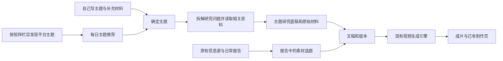

# 主题工作台实现说明

2026-10-27。开发计划见 [topic-workbench-plan.md](topic-workbench-plan.md)，实际运行与界面截图见 [验收记录](acceptance/theme-workbench-20261027/README.md)。

## 三个入口共用制作能力



原有报告选题不变。新主题走 `theme_research` 配方，研究输入由 `theme_context.research_spec` 生成；继承栏目对应制作配置的矩阵身份、画面方向、包装、配音与倍速。没有制作绑定的矩阵也能使用通用主题配方。

## 发现与选题

`core/theme_discovery.py` 通过普通 Job 执行；`core/engine.py` 在识别到 `topic_discovery` 字段时转交发现服务。

- 分类来自 `config/content_columns`，无需为每个矩阵另写分类逻辑；无业务栏目时使用领域主题入口。
- 初版按日期和栏目轮换已选平台，每类执行一次检索，最多保留 8 条匹配平台域名的内容线索。默认平台是 B站、知乎、YouTube；设置支持小红书和 Reddit。
- 分类检索之后，统一提炼观众问题，模型收到近 14 天主题列表以避免相近角度。每条建议必须关联本分类实际采集的来源。
- 播放、点赞等字段来自采集器；初版提供 B站公开计数适配器。不能读取时留空，界面显示为公开内容线索，不生成热度分。
- 数据库事务同时限制同一分类每日最多一条，并用标题规范化和相似度过滤重复。失败时保留历史推荐。

当前能力是分类主题发现。跨作品流量排名、跨日增长、平台内搜索热度需要后续接入相应原生数据，不能用模型对标题的猜测替代。

### B站指标接入阶段（开发中）

新版在同一个 `topic_discovery` Job 内接入 `core/theme_metrics.py`：按分类检索候选内容后，使用平台管理中已有的 B站连接读取视频详情计数，再将实际计数、采集时间和作品发布时间交给后续筛选。它使用独立的 `state/theme_metrics.db` 缓存同一视频，跨矩阵复用六小时内的结果，并保留观测历史。

`core/theme_ranking.py` 对作品的播放、点赞、收藏、发布时间及已观测到的增长计算工作台排序分，再结合栏目相关性从每类候选中选一条。仅有一次观测时显示发布以来的日均播放，不称为近期增长。连接不可用时保留历史数值和实际采集时间；没有数值时不以零填充。手动编辑、忽略和已经开始制作的主题不被当日刷新覆盖。

必须区分三种验证状态：

- 单独调用现有 B站客户端读取三个视频的计数已成功，证明现有连接可以读取数据；这不是正式发现任务的采集结果。
- 新采集器、缓存、排序、入库和界面已经进入正式任务代码，使用隔离数据和模拟搜索/模型进行回归验证。
- 新版真实全链路发现尚未验收，不能将单点读取和模拟测试表述为生产推荐已经使用真实热度。

正式链路为：调度器或立即发现 → 分类搜索 → B站计数采集与缓存 → 模型提炼候选 → 程序排序与分类去重 → 主题库及工作台。用户选中后，再进入主题研究、文稿和视频制作。原有日常报告任务与主题发现任务各自运行，复用已有搜索、账号连接、调度和制作能力。

成本也按两层记录：开发期间在 Codex 内进行的查询和接口验证，与正式 Job 对外调用的搜索、模型、视频服务费用分开。`SearchClient.calls` 是成功返回内容的逻辑批次数；Exa 对一个批次内的每条查询分别发起请求，失败重试与回退还可能增加调用，因此不能直接把该计数当作账单请求数。当前模型单价配置为零，预算页面算出的零费用也不能作为实际免费或已经盈利的证据。新版尚未执行付费发现验收，收益是否覆盖成本还需要正式运行用量及实际成交数据。

## 参考题库、题型与使用记录

`core/theme_library.py` 使用独立 `state/theme_library.db` 保存原始参考题、题型及出题执行记录。例题按矩阵、栏目和链接合并；题型按矩阵、栏目和格式标识保存，不删除使用过的格式。`config/theme_library/<matrix>.yaml` 可以提供起始整理样本；没有起始样本的矩阵在平台发现后积累自己的参考。

正式发现任务在筛选主题前保存全部采集线索。第一次接入时，ChatGPT 已有的 72 条 `.signals.json` 线索已导入，合并起始样本后为 80 条分类参考题、9 种题型。

`core/theme_ideas.py` 是普通 Job 的独立执行入口。`POST /generate` 保存出题方向、可选栏目及题型，创建 `topic_ideas/<matrix>` Job，复用现有任务注册、日志、取消和用量记录。执行时从参考库中按栏目取少量例题与格式，结合矩阵定位和历史问题，一次模型请求生成一批新题，不调用搜索。请求、模型原始回答及用量另存 `.response.json`，失败尝试保留。

新题使用 `origin=generated`，额外持久化 `inspiration`：核心问题、主题标识、题型、讲述结构、参考例题及生成依据。库中题目用于构思问题，选题后的研究仍按主题读取相关资料。

`ThemeStore.publish_generated` 在写事务中查询本矩阵完整历史，通过主题标识、标题和核心问题相似度避免重复，跨日期保留约束。模型上下文的历史条数有上限，存储层的去重查询没有日期截断；语义相近但措辞和标识完全不同的情况仍依赖模型理解和相似度，未宣称语义去重绝对无遗漏。

`used_at` 在研究制作启动时写入；对已关联文稿的历史数据自动补齐，用户也能手动标记外部已用主题。已用主题保留且不能再改写覆盖原记录。`GET /history` 按使用时间分页返回，并补充已有文稿、渲染状态；没有 30 天或 14 天的使用记录过期规则。参考题型仍可从历史卡片继续选择。

主题工作台增加“帮我出一批题”“待选主题”“参考库”“使用记录”。新题展示题型与参考例题，平台发现继续展示实际信号；按矩阵直接构思且没有例题的新题显示“矩阵灵感”。

## 主题研究

`core/theme_context.py` 结合题目、受众、栏目交付目标、创作角度、用户补充资料与发现线索形成研究任务。来源优先取该栏目的研究任务，必要时取矩阵研究任务。

研究读取当前和相关历史资料，不经过日常抓取的“仅新增页面”筛选。研究代理可以定向搜索并通过 `read_webpage` 读取页面正文。研究底稿与采集原始材料一起交给同一个作者，再使用原有文稿版本、制作页和视频接口。

参考时长影响写作预算；视频使用完整文稿和实测旁白时长，保持现有内容时长模式。

## 持久状态与自动制作

`core/theme_store.py` 使用独立 `state/themes.db`，不改变原有素材 `topic_store`。记录矩阵、栏目、标题、角度、受众、资料、来源方式、推荐日、推荐理由、实际信号、状态、关联文稿和自动制作选择。

启动前使用主题文件锁，创建文稿后持久关联。若进程在两次写入之间中断，可通过文稿的 `theme_task_id` 恢复关联，避免重复启动。

`web/services/theme_workbench.py.tick` 仅推进用户选择“研究并制作”的主题。文稿完成后调用现有批准与渲染接口；已有渲染记录时不重复创建。完成后标记完成，失败后停止推进并指向原有文稿页处理。视频提交、轮询、文件复制和中断恢复继续由 `video_render` 负责。

## 每日运行

发现配置在 `config/topic_discovery/<matrix>.yaml`，Job 在 `jobs/topic_discovery/<matrix>.yaml`。开关和时间由现有 ScheduleStore 与独立调度器管理，不依赖浏览器打开。

默认每天 09:00（Asia/Shanghai）。主题页可修改平台、时间、暂停或立即运行。新推荐不会自动批量生成视频。

一次性引导现有内容矩阵可运行：

```sh
../.AI_research/bin/python scripts/enable_theme_discovery.py --all --time 09:00
```

## 接口与界面

根路径：`/api/matrices/{matrix_key}/themes`。

| 操作 | 接口 |
|---|---|
| 查看主题、分类、执行记录和每日计划 | GET 根路径 |
| 创建自主命题 | POST 根路径 |
| 编辑题目和角度 | PATCH `/{id}` |
| 忽略主题 | POST `/{id}/dismiss` |
| 研究写稿或研究制作 | POST `/{id}/start` |
| 立即发现 | POST `/discover` |
| 设置每日发现 | PUT `/schedule` |

读取按 viewer 权限，写入按 editor 权限；所有主题操作检查矩阵归属。界面入口是各矩阵的“主题推荐”页签。

## 每日参考库出题与反馈（2026-10-28）

`config/topic_discovery/<matrix>.yaml` 新增 `mode: ideas | discovery` 与 `direction`。缺省仍为联网发现。每日计划沿用原有 `topic_discovery/<matrix>` Job 和 ScheduleStore ID；ideas 模式转入 `theme_ideas.run_daily`，不额外搜索。手动发现另用 `topic_platform/<matrix>`，不改变每日推荐方式。

`theme_library.db.daily_requests` 按矩阵和推荐日关联出题请求。成功结果当天复用，复用执行记录写入零新增请求；失败后创建新尝试并保留旧记录。矩阵级文件锁避免手动和每日出题同时调用，未取得锁的竞争者不修改正在运行请求的状态。手动出题继续明确创建新一批；未填写本次方向时沿用长期方向。

`themes.db.theme_feedback` 追加保存反馈事件，主题记录保存当前反馈。感兴趣可取消、忽略可恢复；原因包括暂时不做、不适合受众、太宽泛、不便用画面讲清楚。按每个主题的最新状态统计，重复点击不放大偏好；开始制作和标记已用各计一次选用。出题输入增加按栏目、题型汇总的选择与原因，仍限定每类最多一条。反馈是生成偏好，不是实测流量或确定的学习模型。

每类最多读取三个默认题型时，先按已选用、感兴趣及明确负面原因排序，避免后来被选中的题型永久落在截取范围外；“暂时不做”不降低题型权重，用户指定的题型始终带入。每日请求只在取得矩阵与作业两把锁后领取；独占锁内发现旧 running 记录时，保留为 interrupted 并创建新尝试，成功结果仍按当天复用。

新增接口：POST `/{id}/feedback`、GET `/{id}/usage`。使用记录、已忽略列表、阶段用量均可直接查看。用量按需读取保存的整批出题、研究执行历史、生成文稿版本、视频 model-cost 与 timings；手动编辑版本不重复计入模型用量。文稿增加实测生成耗时。出题按整批共享展示，价格缺失或全部配置为零时保留未知，缺失的旧尝试不假设为零费用。搜索批次不等同计费 API 请求，费用估算也不是实际账单。

ChatGPT 试点沿用 `themes_chatgpt_acquisition` 计划，北京时间每日 09:00，改为参考库出题；其他矩阵保持原模式。2026-10-28 首次运行新增 8 个主题，1 次请求、16,493 tokens、0 次搜索，55.1 秒；第二次运行复用相同输出，没有新调用。推荐不会自动批量制作视频。
