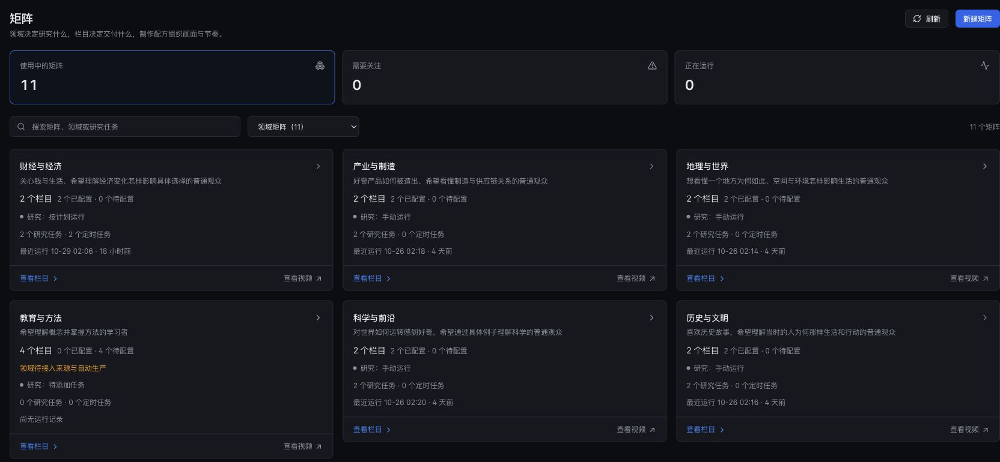
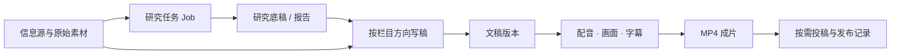
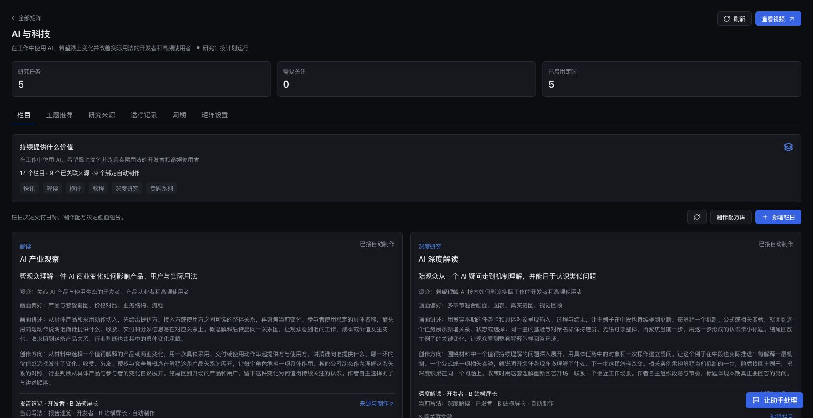
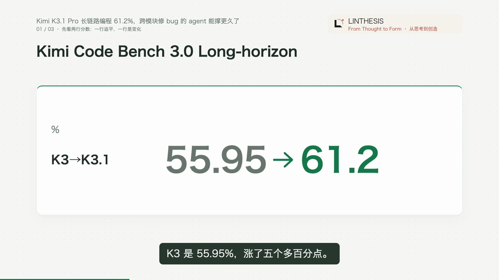
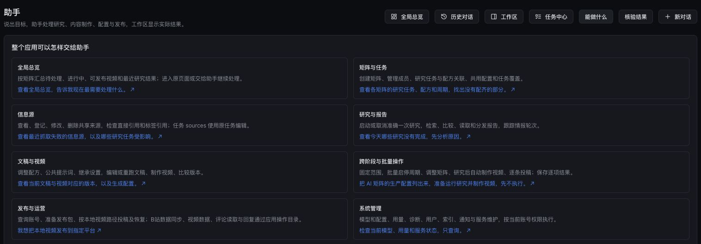

# 研映 · Research2Video

**把持续研究，变成值得持续观看的视频栏目。**

研映是面向知识类视频创作者和内容团队的本地创作工作台。它将信息源、选题、研究底稿、文稿、配音、画面、字幕和发布管理放在同一条生产链路中，让一个栏目能够持续发现内容、展开解释并产出视频。

你可以从一个具体问题、一份报告或一篇已有文稿开始，也可以配置矩阵和周期，让研究与视频制作自动衔接。日常操作通过网页完成，研映对话助手也能直接管理来源、任务、生产配置和发布工作。



*矩阵工作台。界面截图来自实际运行环境，已裁去账号导航区域；下方成片示例取自真实生成的视频。*

## 研映适合怎样的工作

| 你想做的事 | 在研映中的做法 |
| --- | --- |
| 持续运营一个领域的知识账号 | 用矩阵组织受众、栏目、来源和运行安排，让每个栏目有明确的观看收获。 |
| 将一项变化讲清楚 | 从订阅来源发现变化，围绕一个具体任务或例子研究，再组织成完整口播与画面。 |
| 将研究成果做成视频 | 复用研究底稿和对应原始素材，保留有价值的例子、过程与机制解释。 |
| 将已有文稿做成成片 | 从文稿进入配音、画面规划、字幕与渲染，沿用定稿版本重新制作视频。 |
| 把同一条成片分发到多个平台 | 分平台准备发布包、连接账号、提交投稿并查看各自进度与作品记录。 |

## 从素材到成片



这些对象各有自己的用途：

| 对象 | 负责什么 |
| --- | --- |
| **矩阵与栏目** | 确定面向谁、持续回答什么问题，以及内容和画面应怎样组织。 |
| **研究任务 Job** | 定义研究目的、来源、输出方式与运行安排；一次运行形成一份报告。 |
| **研究底稿 / 报告** | 保存值得讲述的问题、例子、过程与解释，供后续作者取用。 |
| **文稿** | 将底稿与素材重新组织成适合观看和收听的叙述；保留版本与对应栏目信息。 |
| **成片** | 将某个定稿版本制作成具体视频，配套保存字幕、画面规划与运行记录。 |
| **发布记录** | 记录某个文稿版本、某条成片在特定平台账号下的投稿和公开情况。 |

一份报告可以支持不同角度的文稿；同一份定稿也可以重新出片。文稿、成片和投稿分别管理，重新制作视频会保留原稿与原来的尝试。

## 以栏目组织内容

研映的矩阵用于经营一组可以长期持续的问题。栏目同时保存受众、观看收获、创作方向与画面讲述方式，使研究、写稿和制作围绕同一件事展开。

当前预设覆盖 AI、软件、科技、科学、财经、公司、产业、消费、历史、地理、文化等领域。已完成一轮产品化打磨的栏目包括：

| 矩阵 | 栏目示例 | 希望观众带走什么 |
| --- | --- | --- |
| **AI** | AI 快讯、AI 开源发现、AI 模型观察、AI 产业观察、AI 深度解读 | 理解一次用法变化、一个工具的任务位置、一项模型取舍或一层技术机制。 |
| **科学** | 科学新理解、现象背后的原理 | 理解研究做了什么，以及一个现象如何发生。 |
| **财经** | 变化怎样传到你、一条经济机制 | 看懂经济变化经过哪些环节，影响谁的一次选择或一笔账。 |
| **公司** | 公司这一招、一笔生意怎样运转 | 理解一次公司动作，以及具体生意中的价值、交付和参与者关系。 |
| **产业** | 产业链的一处变化、一件东西怎样造 | 沿同一件产品看懂制造步骤、上下游分工与取舍。 |
| **消费** | 一处体验变化、一个选择怎么做 | 将功能与参数放进实际使用场景，理解体验差别。 |
| **历史** | 回到那个现场、一个关键转折 | 从具体处境、人物行动和后续变化理解历史。 |
| **地理** | 一个地方怎样运转、地理如何塑造生活 | 通过路线与日常活动理解空间、环境和生活的联系。 |
| **文化** | 读懂一件作品、一个文化现象的来路 | 从作品细节理解表达，并认识文化现象的形成与传播。 |

同一矩阵内，各栏目可以采用不同的研究任务和周期，共用视频品牌、配音、速度等制作默认设置，并保留各自需要的覆盖项。



*栏目将观看收获、受众和画面讲述方式放在一起，并关联来源与自动制作。*

## 研究深度怎样进入视频

研究报告承担底稿的角色：简短导读帮助浏览，正文保留具体例子、操作过程、参与者关系和机制解释。

AI 五个栏目，以及科学、财经、公司、产业、消费、历史、地理、文化的产品化栏目，已经接入**研究底稿与对应原始材料联合写稿**。作者可以围绕一个主问题重新组织讲述，取用原文中的示例与细节；篇幅随解释需要分配。

栏目方向贯穿研究、写稿和画面组织。例如，同一条 AI 产品新闻，快讯可以讲“我的哪一步操作变了”，产业观察可以讲“谁向谁提供了什么”，深度解读则围绕具体例子展开机制。

## 画面跟着讲述展开

研映使用现有素材和结构化画面表达内容，配音时间决定画面展开与强调的节奏。

| 表达需要 | 对应能力 |
| --- | --- |
| 让观众看见实际对象 | 自动获取来源网页截图，理解图片内容，分配到相关讲稿段落。 |
| 告诉观众此刻看哪里 | 利用页面元素位置和图片聚焦区域，进行整体展示、局部放大、框选与连续聚焦。 |
| 解释数值与关系 | 使用数字变化、条形图、趋势、多组比较与散点等图形，按讲述逐步展开。 |
| 讲清步骤和参与者 | 使用流程、对比、概念卡和统一图标，让对象与关系持续出现在画面中。 |
| 形成统一的栏目观感 | 复用视觉风格、配音、字幕、视频品牌和片尾设置。 |

标准出片可以组合截图、数字和解释画面；快速卡片路线用于简洁的信息表达。素材不可用时沿用相应路线的文字或图解呈现。

视频呈现阶段沿用上游给出的讲稿、数据、计算结果与结论，将它们组织成观众容易跟随的画面。当前重点是表达、重点引导、旁白同步和观看节奏。



*实际成片示例：数字对比与旁白字幕共同呈现，画面来自 Kimi 讲解视频。*

## 自动生产与日常运营

完成来源、栏目和生产配置后，可以按现有周期自动执行研究、写稿、定稿、配音、渲染与成片回传。日常查看集中在几个入口：

| 页面 | 日常用途 |
| --- | --- |
| **矩阵** | 查看栏目、研究任务、运行安排和各矩阵的产出。 |
| **信息源** | 登记 RSS、网页及其他支持的来源，查看任务引用和最近抓取情况。 |
| **产出 / 文稿** | 浏览报告与文稿，查看版本、制作进度和对应成片。 |
| **成片与发布** | 选择已完成视频，准备各平台发布包并查看记录。 |
| **平台管理** | 连接账号，查看该平台的投稿队列、作品回执和后续状态。 |
| **周期调度** | 管理各研究任务的运行频率、下次执行时间和历史。 |
| **助手** | 用自然语言完成查询、配置、生产和明确指定的发布操作。 |

发布管理已接入 **B 站、抖音、快手和小红书**。平台账号、发布包与任务分别保存；同一成片可以面向不同平台调整标题、简介和话题。

正常研究与制作可以在后台接续，无需逐段写稿或手工挑选每一个镜头。首次配置、平台扫码及平台要求的身份验证由用户完成；公开投稿按用户明确指定的范围执行。部分网络与模型请求的短暂故障会在现有次数范围内自动恢复，持续失败会保留原因和原任务，供后续处理。

## 也可以直接对助手说

使用编辑者或管理员账号，可以在研映助手中提出业务目标，例如：



*助手能力面板。示例可以填入对话，执行结果回到原业务页面查看。*

> 把下面这些 RSS 信息源登记并关联到 AI 矩阵五个栏目，保留现有来源和周期。

> 检查科学矩阵的来源、运行安排和最近产出，告诉我哪些任务需要处理。

> 沿现有配置，让 AI 五个栏目各生产一条视频，不发布。

> 将这条已完成视频的发布包保存到抖音，先不投稿。

> 用原稿重新出这条视频，保留旧成片和历史尝试。

助手调用与页面相同的应用能力，操作结果可以回到对应的矩阵、文稿或平台页面查看。添加来源时，同时说明要关联的矩阵或任务；可直接粘贴 RSS 链接或 JSON 内容。

## 开始使用

### 已经部署好的工作台

1. 打开研映并登录，在「矩阵」选择一个领域与栏目。
2. 在「信息源」登记并关联来源，或让助手完成这一步。
3. 选择已有报告、提交文稿，或沿栏目配置启动一次研究与制作。
4. 在文稿页查看成片、字幕和版本；需要分发时进入「成片与发布」。
5. 在「周期调度」设置后续运行安排，让栏目按节奏持续产出。

### 首次本地部署

项目包含研究控制台和视频引擎两个服务，需要分别安装依赖。当前完整生产环境主要在 **macOS / Apple Silicon** 上验证；Python、Node.js、Chrome、FFmpeg 和本地语音模型的具体要求见模块文档。

| 部分 | 安装与配置入口 |
| --- | --- |
| 研究控制台 | [安装、模型与搜索配置](AI_research/Base_CodingCLi/README.md) |
| 视频生成服务 | [服务依赖与启动](autovideo/g3/README.md) · [渲染环境准备](autovideo/g0/README.md#新环境准备) |
| 真实网页截图 | [截图环境与素材接入](AI_research/Base_CodingCLi/spec/video-screenshots.md) |

研究模型和搜索服务按各自 `.env.example` 配置，本地视频服务使用独立的模型、语音与渲染环境。首次安装研究控制台时，还需构建前端：

```bash
cd AI_research/Base_CodingCLi/ui
npm ci
npm run build
```

完成依赖安装后，在仓库根目录的一个终端启动视频引擎：

```bash
cd autovideo
g3/.venv/bin/python -m uvicorn g3.app:app --host 127.0.0.1 --port 8011
```

研究控制台根据网关配置选择启动方式：

```bash
cd AI_research/Base_CodingCLi

# 已在 config/web.yaml 启用 gateway.enabled 时：
python scripts/gateway.py

# 未启用网关时，直接运行应用：
# python run_web.py serve
```

启用网关后，它会按需启动内部应用。当前项目配置的用户入口为 `http://127.0.0.1:8775`，AutoVideo 为 `http://127.0.0.1:8011`；其他部署以 `config/web.yaml` 中的端口和 `server.base_url` 为准。首次管理员账号创建方式见研究控制台安装说明。

本地优先表示运行记录、配置与媒体主要保存在本机；联网抓取和配置为远程服务的模型仍需要网络与相应服务额度。

## 当前能力范围

- 核心成片类型是中文旁白驱动的知识解释视频，标准交付为 16:9、1080p、30fps 的 H.264 / AAC MP4，并保留字幕与制作资料。
- 按内容组织的制作路线可以自动分章，时长随文稿与配音展开；实际受模型上下文、执行时间和本机资源影响。
- 网页与图片进入现有画面链路。外部 MP4 可以纳入发布管理；将 MP4 作为讲解中的动态镜头素材属于后续独立路线。
- 栏目配置会用于后续新任务；已有文稿、成片和发布记录保留当时版本。修改配置后，可选择用原定稿重新出片。

## 文档导航

| 想了解什么 | 文档 |
| --- | --- |
| 矩阵与栏目如何组织 | [矩阵](AI_research/Base_CodingCLi/spec/matrices.md) · [领域矩阵与栏目](AI_research/Base_CodingCLi/spec/video-content-architecture.md) · [生产配置](AI_research/Base_CodingCLi/spec/production.md) |
| 研究底稿与原始素材如何进入文稿 | [AI 联合写稿实施](AI_research/Base_CodingCLi/spec/ai-research-dossier-implementation.md) · [领域矩阵产品化](AI_research/Base_CodingCLi/spec/matrix-productization-long-task.md) |
| 截图、图片与图表怎样呈现 | [网页截图](AI_research/Base_CodingCLi/spec/video-screenshots.md) · [图片素材](autovideo/g3/IMAGE_MATERIALS.md) · [数据讲述](autovideo/g3/DATA_STORYTELLING.md) |
| 对话助手有哪些操作能力 | [助手能力清单](AI_research/Base_CodingCLi/spec/assistant-application-coverage.md) |
| 如何长期运行与分发 | [周期调度](AI_research/Base_CodingCLi/spec/scheduling.md) · [网关](AI_research/Base_CodingCLi/spec/gateway.md) · [多平台发布](AI_research/Base_CodingCLi/spec/multi-platform-publishing.md) |
| 视频品牌与引擎状态 | [视频品牌](autovideo/BRANDING.md) · [引擎实施状态](autovideo/RELEASE_STATUS.md) |

## 开发与数据

两个模块共用一个 Git 仓库，独立运行和测试：

| 目录 | 职责 |
| --- | --- |
| `AI_research/Base_CodingCLi/` | 研究引擎、来源、矩阵、栏目、调度、文稿与发布工作台。 |
| `autovideo/` | 配音、视觉规划、结构化画面、Remotion 渲染、字幕与成片交付。 |

研究端检查入口为 `AI_research/Base_CodingCLi/scripts/check.sh`。AutoVideo 的测试、前端构建和真实视频验证说明见其 [开发指南](autovideo/AGENTS.md) 与 [应用文档](autovideo/g3/README.md)。日常 Git 操作在仓库根目录执行，贡献约定见 [AGENTS.md](AGENTS.md)。

源码、栏目配置、测试和文档进入 Git；真实密钥、平台登录态、运行数据库、模型权重和生成媒体保留在本地。除仓库明确列出的可复用测试素材外，生成音视频不进入版本管理。文档中的历史成片与运行资料可能位于本地归档目录，干净克隆不包含这些产物。

项目仓库：[liamamilin/Research2Video](https://github.com/liamamilin/Research2Video)。
