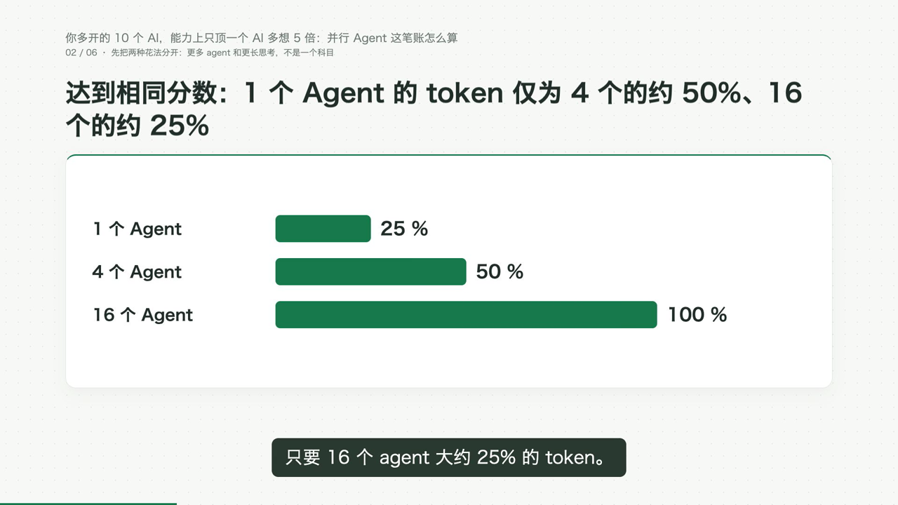
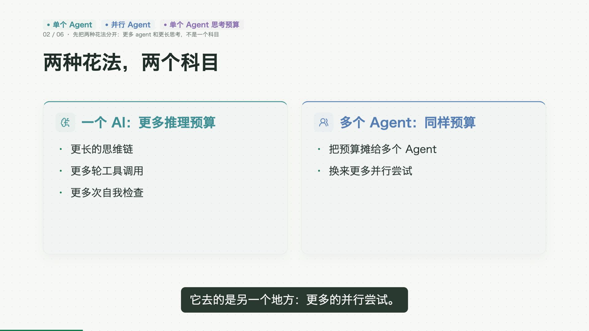

# AI 矩阵试产：画面字段兼容修复

2026-10-27。用户授权只修复数字标签和对比卡标题的兼容问题，完成五栏试产后统一打磨。其他底层能力继续保持。

深度稿 `f6026de8e9f547f29df298a828f49ab7` v1 的三次出片均停在分镜：两次把百分比基准挤入条形图的数字标签，一次给对比卡添加当前组件不接收的 `title`。

本次继续使用已有组件和标题区：

- 对比卡、条形图误放在 `props.title` 的标题接入页级 `headline`，编译后使用原有场景标题。
- 数字标签确实放不下时，把完整单位或基准移到标题区。原单位含一个百分号时，数字旁保留 `%`；其他情况在标题统一说明单位，数字旁留空。
- 保留原分类、数值、计算基准和旁白，不重新计算。既有运行时 schema 适配允许标题统一说明单位；冻结的组件合同文件保持原样。

验证：完整合同及离线回归 **901 passed、1 skipped**。三个原任务保存的九个中间响应离线重放，八个通过；剩余一个中间响应涉及既有实体数量上限，超出本次范围，未放宽。三次任务的最终失败响应均通过本次修复。测试包含标题实际进入场景、数值和分类保留、重复编译不重复追加说明、运行时 IR 兼容及未知字段仍被拒绝。

已通过正常登录的原稿页面恢复一次出片：`d848b3b7730547a0a9051f728775a533`，使用原 v1。四次出片的旁白源 SHA-256 相同：`752b203194535f172992facecfacf26aa513f4aafbb55ddb570421eae1da051e`。未重做研究或讲稿，未重启服务；新生成进程读取修复代码。

真实 MP4、解码与画面观察尚待该任务完成，当前不声明出片修复已完成验收。进度及原始响应重放、测试日志、界面回执保存在研究模块 `state/validation/ai-matrix-productization-round2-20261027/field-compatibility-repair/`。本轮改动暂未提交 GitHub。

18:31，原任务已通过分镜生成，在时间线编译时遇到数字图表的标签衔接问题：缺少展开短语时，镜头安排复用了原分类列表，追加总结短语后改变了原分类。`information_motion.automatic_cues` 改为复制标签列表，不再修改输入；原分类和数值保持。增加缺省展开短语的重复编译回归，相关 131 项测试通过。

复用本次任务保存的六章分镜和 96 段真实配音，完整 IR 编译通过：31 幕、5 个数字图表、13292 帧。逐图保留模型输入的分类及数值，旁白保持；没有新模型或配音调用。该离线记录只证明完整时间线编译，真实 MP4 仍待沿原生产入口恢复后完成。离线辅助脚本最初额外尝试本地字幕对齐，受沙箱环境限制未运行成功，单列于日志，未据此宣称视频验收通过。

最终完整回归 **902 passed、1 skipped**。18:39 经正常登录的原稿页恢复一次，当前仅跟踪 `a760d4a7244e4a7c81e621053aec717b`；旧 `d848b3b7730547a0a9051f728775a533` 保留失败记录。五次出片使用相同 v1 和旁白源 SHA-256。回执为 `field-compatibility-repair/render-receipt-v2.json` 与 `native-render-v2-started.png`，当前等待真实成片。

## 19:16：真实出片完成，修复验收完成

原恢复请求 `a760d4a7244e4a7c81e621053aec717b` 于 19:16:07 完成并回传，对应引擎任务 `1295b12e-fdaf-45ee-bf6c-db042cd8a28f`。内容片为 443.072 秒、13292 帧；内容、包装与品牌三份媒体报告均为 PASS。对实际 `content.mp4`、`video.mp4` 的完整解码均退出 0，错误日志为空。

实际影片采样画面中，87.248 秒条形图的 25%、50%、100% 数字均完整可读，基准和说明位于标题；预算对比画面也完整呈现页级标题与两个比较对象。五栏统一审看包含本片 49 个真实画面采样、原稿和字幕，没有主观听音判断。

本目录的 [verification.json](verification.json) 保存媒体、解码与回归摘要；以下两张图直接采自这次真实内容片。

原始影片位于 `/Volumes/个人资料/2026/视频生成工作流/AI创作/视频输出/研究成片/a760d4a7244e4a7c81e621053aec717b/`。研究模块证据目录中，`field-compatibility-repair/native-completion-receipt.json` 汇总媒体路径、解码、QA、原稿哈希与实际画面；`native-proof/number-label.png`、`native-proof/comparison.png` 为实际影片采样，`trial-review/deep/` 保存全部本片审看采样及字幕。

同一原稿 v1、全部失败尝试与原批次历史保持。批次会保留此前失败项，未为改变其显示状态而重跑或清理；五条真实目标作品已经齐备。本次字段修复和第三轮栏目修订均尚未提交 GitHub，未发布作品或重启服务。
