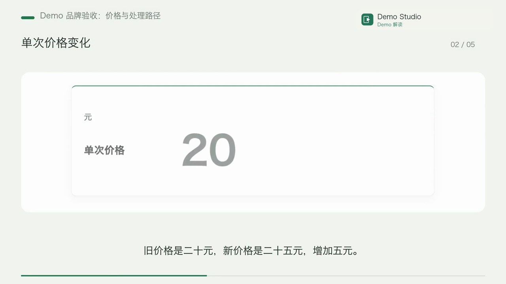
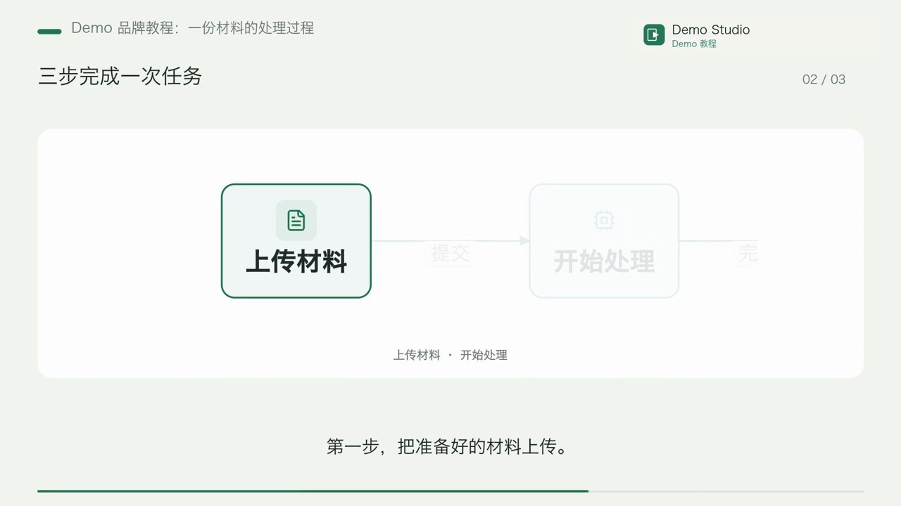
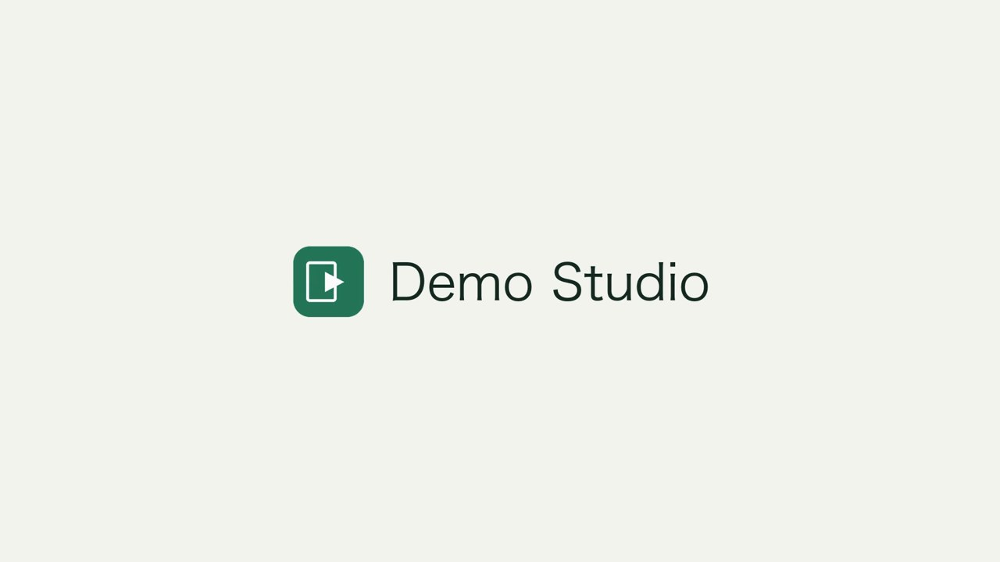
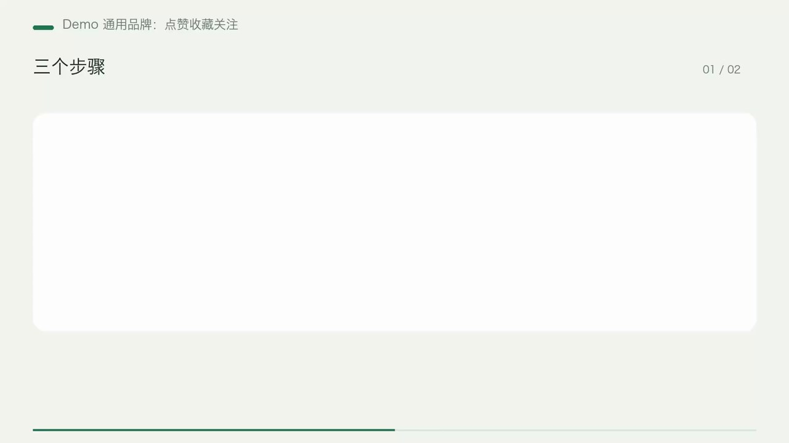
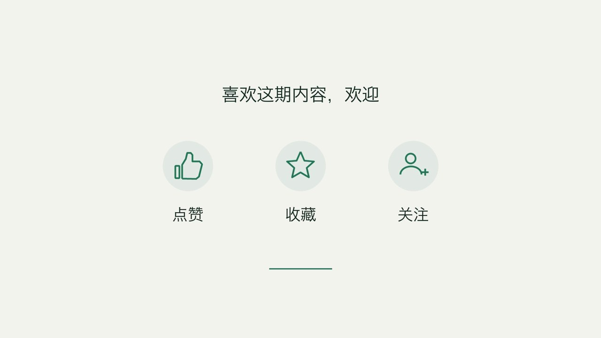

# Demo brand acceptance — 2026-10-26

The implemented scope is the reusable brand system and neutral Demo Studio.
Personal branding and exclusive music are deferred at the user's request.
The research console exposes a separate **视频品牌** tab immediately after
**运行日志**; it is outside **系统配置**. Demo is installed and active locally.

## Real productions

Both videos were submitted through `/api/jobs`, used authored narration, real TTS
and the `hybrid_cards` executor, and finished with the shared brand stage.

| Case | Job | Content | Final | Frames | Narration correlation |
|---|---|---:|---:|---:|---:|
| Price explanation | `47ded960-0bf7-4846-880a-44e3d14fc23b` | 50.833 s | 54.833 s | 1645 | 0.9999998784 |
| Three-step tutorial | `f83bea07-ab97-41d5-8c55-a150fa1f8eaa` | 29.933 s | 33.933 s | 1018 | 0.9999998784 |

Both finals are 1920×1080, 30fps H.264 with stereo AAC audio. Full video and audio
decodes passed using FFmpeg with `-xerror`. Correlation compares the complete
decoded content audio before and after branding, without shifting its timeline.
The sonic cue starts 0.2 s after content and runs for 3.6 s within the 4 s tail.
Measured cue RMS is about 0.07986; decoded peaks are 0.5572 and 0.4640 respectively.
The tutorial final chapter manifest includes `brand_outro` through 33.933 s.

Final SHA-256:

- Explanation: `28a74b24170aad9abd2356d54c6f116cfad941d8c021cea00ab94fee2b68df6b`
- Tutorial: `c507b70ddc6372d18fc016dc8160e290c9dbd00f355918d96933fd15936dc7b6`

MP4s, input snapshots, full logs, probes, waveform checks and raw acceptance JSON
remain in local runtime data and the user's chosen video-output volume.

## Functional checks

- Fresh installs default to no brand; per-video disable overrides matrix settings.
- Named profiles and assets freeze into each job and participate in its plan hash.
- Brand updates/default changes preserve idempotent replay and existing versions.
- Revisions can reuse their frozen logo after the live profile is removed.
- Both legacy `package` and modern `packaging` accept the brand layer.
- Missing assets, altered snapshots and invalid brand render reports fail cleanly.
- The worker exports the verified branded final, preserves the unbranded source,
  and selects the final chapter manifest.
- The Demo installer preserves edits and does not activate itself implicitly.
- Console management requires admin; write operations retain CSRF protection.
- Browser checks covered the new tab's location, saved state, logo preview and
  native sonic playback. UI controls use the existing application styles.
- Git ignore checks cover the Demo profile and its generated PNG/WAV. There are
  no tracked files under `g3/data/`; no personal brand pack was created.

## Regression and build

- Engine: `g3/tests` (excluding launcher subprocess tests), brand compositor,
  production plan, packaging library and music mix regressions: 278 passed.
- Research: content-column/render/recipe tests, brand proxy tests and video-script
  lifecycle suite: 173 passed.
- UI: branding, Settings navigation and storage card: 15 passed.
- UI TypeScript/Vite build and ESLint for the changed settings components passed.
- `git diff --check` passed.

These publication checks ran from an isolated export of the staged files, without
local brand profiles, environment files or unrelated working-tree changes.

## Reviewed images

Console screenshots remain local because they include account and environment details.

## Follow-up: short brand opening

Added an optional opening after the user's follow-up. Its initial Demo default was a
1 second logo/name card with a subtle zoom/fade and a two-note excerpt of its
sonic motif. Its cue ends at 0.75 s; narration starts after the opening. The
settings tab offers duration choices and an independent off option. Existing
snapshots without `intro_seconds` keep the prior opening-free behavior.

The final captions shift by 1000 ms and final chapters include `brand_intro`.
Original content inputs, captions and audio remain intact. Verified with 52
backend/media regression tests (including real opening-on/off MP4s), 12 UI tests,
TypeScript/Vite build, ESLint and browser inspection of the selected 1 s setting.

New real hybrid API task: `7b2e44cb-66e3-45a5-ad90-14342f141d7f`, completed at
24.600 s / 738 frames: 1 s opening + 19.6 s content + 4 s tail. API exports include
the shifted final captions and both brand chapters. The prior two source videos
were also re-composed separately into opening-enabled versions (55.833 s and
34.933 s), preserving the previously delivered files.

Full video/audio decode, opening audibility, the silent gap before narration,
shifted caption equivalence and complete content-audio correlation were checked
on all three outputs. Runtime inputs and raw measurement results remain local.

## Follow-up: direct opening and generic CTA

After reviewing the standalone opening, the user requested a smoother start and
a generic like/save/follow action row before the brand. Demo now starts with
content immediately, gently revealing the corner mark over 0.6 s. The standalone
opening remains optional. The new CTA uses trusted, code-drawn thumb, star and
person-plus icons, with staggered fades and a 12-pixel rise.

CTA occupies the first 1.5 s of the existing 4 s tail; the brand card takes the
remaining 2.5 s. Its sonic cue starts 0.2 s into the brand card, after CTA. Neither
the direct opening nor CTA changes the content or caption timeline. Missing CTA
and reveal settings preserve historical snapshots; the controls can be disabled
independently.

Real hybrid API job `82e5f089-2514-487b-9060-27d7f39946df` completed with 19.6 s
content and 23.6 s final / 708 frames. Full decode passed. Content-audio correlation
is 0.9999998995, CTA audio peak is zero, and the brand cue RMS is 0.10255. Final
captions equal their content source, and the exported chapters include `brand_cta`
followed by `brand_outro`. SHA-256:
`ed2e1fe19282a804a0bfcfd634f1308608d3bdf7345dcf55c5831219d9ed9162`.

Validation: 55 backend/media tests (including four real MP4 combinations of
opening/CTA on and off), 13 UI tests, TypeScript/Vite build, changed-component
ESLint, browser verification of the enabled controls, and `git diff --check`.

