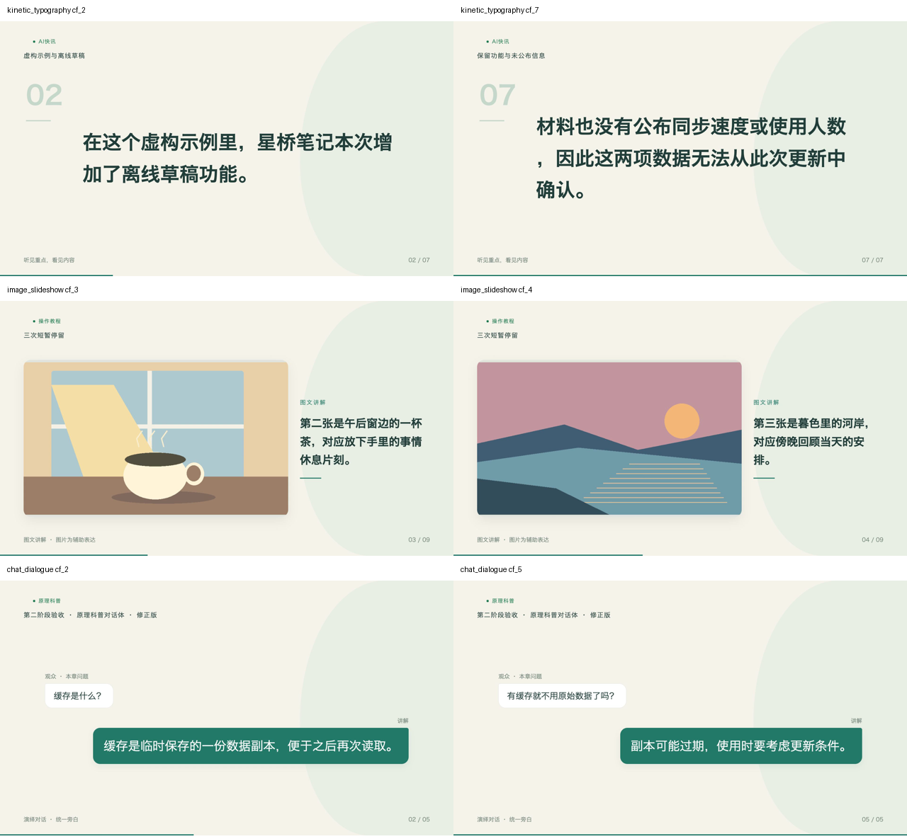

# 创作形式第二阶段验收（2026-10-23）

用户授权：在 AutoVideo 主流程接入动态排版、图片轮播、聊天对话体，关联创作资源库和三份制作配方，保留现有功能。本轮工程检查通过；主观观看效果仍由用户反馈。

## 交付与真实成片

| 用例 | 任务 ID | 成片秒数 | 结果 |
| --- | --- | ---: | --- |
| AI 快讯 → 动态排版，素材自动组织 | `8c8c600d-65c6-4310-83dc-80ca0f7f33b8` | 49.400 | PASS |
| 操作教程 → 图片轮播，三张上传插画 | `870c702e-6a1a-4971-b392-d08aa89a91fa` | 46.800 | 首版保留，后续修正图片编号对应 |
| 原理科普 → 逐字对话体 | `d065a643-cdbe-4af6-a9a5-85c589c1bd23` | 21.733 | 首版保留，后续修正问题与说话人延续 |
| 轮播素材修订，第二/第三张与讲稿对应 | `ca6b7c7c-5d97-484e-b822-4fdaf66e69a9` | 53.133 | PASS |
| 对话讲稿修订，问题和角色延续 | `b47da7c1-ca10-46b5-9148-99660278ff4b` | 21.767 | PASS，逐字校验通过 |
| 轮播改为云希声音、1.5 倍速度 | `f2998b79-89a8-4280-9dd9-9ef214a87c20` | 28.800 | PASS，原图片与画面属性不变 |
| 普通科普素材自动组织为问答画面 | `18d66772-e819-4435-aeeb-0b2131b533a6` | 25.133 | PASS，实际 3 次模型调用 |

七条视频均实际渲染为 1920×1080 / 30fps / H.264 + AAC，正文与包装成片均完整解码 PASS。正文配音相关系数均高于 0.9999，包装后校正时间偏移的音轨检查也通过。共核验 720 份清单记录及全部原版视频哈希，修订不覆盖原版。具体帧数、相关系数、SHA-256、模型调用与制品位置在 [media-verification.json](media-verification.json)。

15 次实际模型请求，本轮配置价格的保守费用上界合计 `$0.0234303`；这是估算，不是实际账单。图片使用用户指定参考目录的三张原创程序插画，并非本轮 AI 出图。初版对话 QA 中 `real_llm` 沿用旧检查器的粗粒度值，但实际调用数为 0；新版已按真实调用数记录。

## 回归与页面

- [最终运行回归](regression-final.txt)：`python3 -m pytest g4/tests g3/tests g2/tests g1/tests/test_video_ir_v0_2_runtime.py -q`，513 passed、1 skipped；包含需本机临时监听端口的启动器检查。之前沙箱内的两项端口权限失败保留在 `regression.txt`，最终在允许临时端口的环境复验通过。
- Python 编译、前端 TypeScript 检查、esbuild bundle、可信 renderer bundle 和 `git diff --check` 均通过。静态 `app.js` / `app.css` 已重建。
- 浏览器验证：资源库三种可制作形式和配方组合入口；“原理科普 + 对话体”保留关联；切换轮播显示上传入口与 Draw Things 未连接提示；AI 快讯默认动态排版及对应包装；刷新保留草稿设置；新版视频实际播放至 13 秒、readyState 4、1080p；讲稿和声音/倍速修订工具可用；原版链接保留。页面截图见 [新建页](create-forms.png)、[配方页](recipes.png)。
- 浏览器文件选择器自动化在原对话权限等待时中断，未再次触发；不能把它记作已完成网页上传。图片上传 API、格式拒绝、预览、顺序、哈希冻结、父任务副本修订和真实成片均已验证。
- [旧设计快照](design-snapshot.txt) 仍在 `AGENTS.md` 清单大小处失败；该不一致在本轮之前已存在，没有改写设计清单来绕过检查。

## 本机服务与边界

正常更新本机 8011 服务前核实进程命令、目录及空闲队列；初次更新前后原 153 条制作记录一致。本轮新增七条，最后更新前后均为 160 条，见 `service-update.json` / `service-update-final.json`。没有强制终止任务或删除失败/历史产物。

本机 Draw Things 当前未连接。自动插画接口与返回校验有离线测试，但本轮没有真实自动插画证据；用户可以直接上传图片使用轮播。未新增音乐生成、多角色声音或三种新形式的单场景 AI 重排；原有两种主形式的单场景编辑保持可用。`auto` 继续选择原有两种主形式，三种新形式由用户或配方指定后自动出片。

重新核验制品：在仓库根目录执行 `python3 g3/acceptance/creative-forms-20261023/verify_evidence.py`。它只读取已保存任务、校验哈希，不调用模型或重新渲染。
