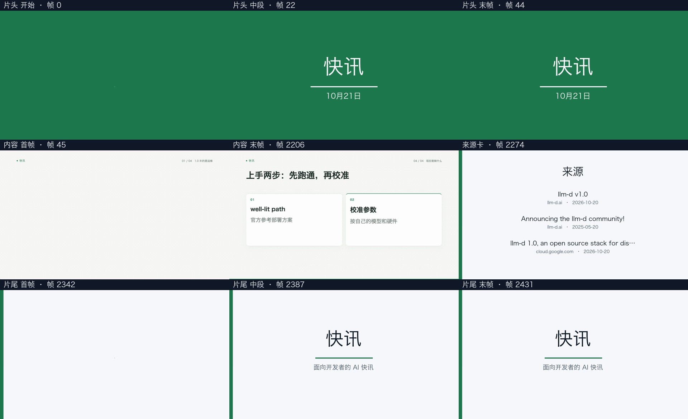

# 出片性能优化验收 · 2026-10-23

已实施内容模式配音与分镜并行、macOS 信息动效单路渲染，并于本机队列空闲时重载 AutoVideo。服务健康检查通过；激活记录与代码哈希见 [activation.json](activation.json)。研究系统、AutoVideo 页面、API 和 CLI 共用同一 G2 流程。

## 瓶颈与改动

优化前最近 20 次成功任务的阶段耗时合计：渲染占 47.1%，配音占 25.2%，分镜占 22.4%，打包占 3.9%，质量检查占 1.3%。样本均为内容模式的定稿旁白，使用 VoxCPM2；明细见 [history.json](history.json)。

- 内容模式的文字在配音前已经确定。配音与分镜同时开始，两者完成后才编译依赖实测语音时间线的 IR。LLM 请求与校验保持原样，只有一个线程调用模型，预算和重试上限沿用原规则。
- 指定时长模式仍按顺序执行，分镜使用时长拟合后的最终讲稿。可用 `AUTOVIDEO_G2_PARALLEL_PLANNING=0` 回退为串行。
- macOS 的 `information_motion` 默认使用本次实测更快的单路渲染。其余形式和平台保持原两路上限；按 CPU、内存进一步收敛。CLI 可用 `AUTOVIDEO_G2_RENDER_CONCURRENCY=2` 覆盖；无效数值明确失败。
- 阶段新增真实开始事件，支持两个阶段同时进行、先后任意完成。失败后保留已完成制品；取消、超时和服务停止会收尾全部进行中的阶段。旧格式日志仍兼容。
- 新任务提供 `generation-schedule.json` 与 `render-resources.json`，分别记录重叠耗时和实际渲染配置。任务数量仍由原单 worker 队列控制。

按这 20 次历史任务的阶段时长，配音与分镜并行可减少约 21% 的串行等待；叠加下述渲染改进，同类任务整体预计缩短约 20–30%。这是依据历史耗时的估算，实时模型响应、机器负载和场景复杂度会改变结果。

## 同一 IR 的真实渲染对照

机器为 12 个逻辑 CPU、48 GiB 内存。复用同一份已保存的真实 IR、PCM、字幕、组件源码和包装快照，无新模型调用或配音。完整内容为 35.833 秒、1075 帧；各次输出目录独立，历史任务和尝试均保留。

| 渲染并发 | 渲染耗时 | 相对原 2 路 | 内容与打包验收 |
| --- | ---: | ---: | --- |
| 1 | 68.249 秒 | 减少 14.55% | PASS / PASS |
| 2（原设置） | 79.869 秒 | 基线 | PASS / PASS |
| 4 | 100.591 秒 | 更慢 | PASS / PASS |
| 6 | 106.718 秒 | 更慢 | PASS / PASS |

增加浏览器页面并发在本机产生争用，未采用 4/6 路。4 路测试期间也运行了离线回归，因此该行不能用于精细比较；1 与 2 路的结果作为本次设置依据。

所有输出保持 1920×1080、30 fps、H.264、CRF 18、YUV420P 和 AAC。精确帧数、完整解码、实测 TTS 对齐、音频相关性、字幕/章节偏移与包装接缝检查通过；音频相关性均为 0.999955。FFmpeg SSIM 对比 1 路与 2 路为 0.998767，接触表已目视检查。编码分块会随并发变化，文件及解码像素哈希不要求逐字节相同。

- [原 2 路内容样片](../../data/generation-speed-20261023/information-c2/artifacts/G2_自动生成.mp4)
- [新 1 路打包样片](../../data/generation-speed-20261023/information-c1/artifacts/package/video.mp4)
- 完整指标、IR 哈希、视频路径与 SSIM 见 [results.json](results.json)。各输出目录内保存日志、QA、快照和制品清单。

复现（在 AutoVideo 根目录执行，输出目录须为新目录）：

```sh
g0/.venv/bin/python -u g3/acceptance/generation-speed-20261023/benchmark.py \
  --source-run g3/data/packaging-library-20261023/information-2 \
  --output g3/data/generation-speed-20261023/recheck-c1 --concurrency 1
```

## 本地配音、并行调度与整片验收

使用已定稿的 `b82cfa5e-f988-476d-bdb5-0e0d341ae01a` 讲稿，重新运行真实离线 VoxCPM2 配音、编译、Remotion 渲染与包装。模型部分回放原任务的四份响应：每份响应须通过当前 schema、原有内容校验，且新构造的请求消息与原请求逐字相同；网络入口明确禁用，语音模型启用离线模式。开启 `--replay-latency` 模拟原先记录的 58 秒模型等待，未发起新外部调用。

- 配音 80.322 秒、分镜回放 58.003 秒，两个阶段在同一时刻开始，合计墙钟时间 80.322 秒，重叠 58.003 秒。
- 默认 `auto` 实际选择单路渲染，渲染 134.69 秒。
- 完整回放流程 239.590 秒；内容 72.067 秒/2162 帧，打包后 81.067 秒。
- 4 章、9 段、405 字的逐字讲稿、字幕和章节标题检查 PASS。内容和打包完整解码、音频与接缝检查 PASS。
- 新模型调用为 0，新的本地配音为真实运行。该回放证明调度和媒体交付，不代表实时外部模型延迟的重新测量。原任务的内嵌来源卡已按组件库迁出到包装阶段，因此整片与原历史任务也不构成严格 A/B 对照。

[本地回放成片](../../data/generation-speed-20261023/full-local-replay-1/artifacts/package/video.mp4)；详细阶段时间与质量指标见 [results.json](results.json)。

```sh
g0/.venv/bin/python -u g3/acceptance/generation-speed-20261023/full_run.py \
  --source-job g3/data/jobs/b82cfa5e-f988-476d-bdb5-0e0d341ae01a \
  --output g3/data/generation-speed-20261023/recheck-local-replay --replay-latency
```

自动审批曾拒绝将这份已保存原稿重新发送给外部模型，原因是本次性能优化未单独授权该次数据外传。被拒绝的命令未启动，验收改为上述不联网回放，没有新 API 费用。

## 回归

`python3 -m pytest g3/tests g2/tests g4/tests g1/tests/test_video_ir_v0_2_runtime.py -q`：464 passed，1 skipped。覆盖阶段真实并发、定时长改写后再规划、任一并行阶段失败时保留另一阶段证据、进度乱序完成、失败后其他阶段终止、旧日志兼容及渲染参数边界。

前端使用 vendored esbuild 成功重建；两个仓库的 `git diff --check` 通过。本次只修改 AutoVideo，研究系统已有的未提交改动保留。



## 后续真实任务复测（用户授权后）

2026-10-23，用户明确授权将《续航手机最抢眼，五件新品变化速览》定稿 v1 重新提交到当前配置的分镜服务，已完成真实模型、配音、渲染和包装。总出片执行从 16 分 10 秒缩短到 10 分 45 秒，减少 5 分 25 秒（33.49%）。

两次使用同一份定稿、同一音色和同一请求模型，实测 PCM 音频文件完全相同；本次额外采用组件库片头及独立来源卡。内容与包装验收均通过，新成片已回传研究系统，旧版保留。详细对比和“有待核实”的原因见 [真实重跑记录](topic-digest-rerun/README.md)。这项真实任务复测补充了上面的本地回放验收；较早回放记录中的“未重测外部模型”仅描述当时的验证范围。
