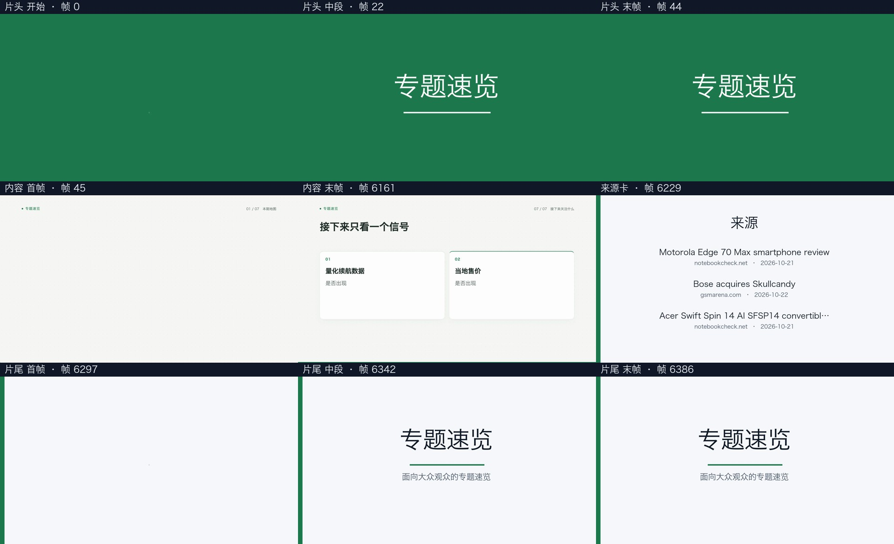

# 《续航手机最抢眼，五件新品变化速览》真实重跑与耗时对比

按用户明确授权，于 2026-10-23 通过研究系统原有出片执行器重跑定稿 v1。旧版保留。新任务完成，成片已复制回研究系统；文件大小及 SHA-256 验证通过。

总出片执行从 **16 分 10 秒** 变为 **10 分 45 秒**，减少 **5 分 25 秒（33.49%）**。这里按 AutoVideo 开始执行到完成计时，包含规划、配音、渲染、内容验收、包装与包装验收。研究系统从创建记录到下载完成另计：旧版 16 分 12 秒，新版 10 分 46 秒。

| 阶段 | 旧版 | 本次重跑 |
| --- | ---: | ---: |
| 总出片执行 | 16 分 10 秒 | 10 分 45 秒 |
| 配音 | 3 分 52 秒 | 3 分 44 秒 |
| 分镜 | 3 分 54 秒 | 3 分 41 秒 |
| 配音与分镜的合计等待 | 7 分 46 秒 | 3 分 44 秒 |
| 画面渲染 | 7 分 31 秒 | 6 分 09 秒 |
| 内容验收 | 0 分 12 秒 | 0 分 11 秒 |
| 包装及包装验收 | 0 分 40 秒 | 0 分 42 秒 |

本次配音与分镜重叠 220.728 秒，因此各阶段耗时不能直接相加。渲染使用实际 `auto` 单路配置；旧版为两路。输出仍为 1920×1080、30fps、H.264 CRF 18、AAC。

## 对比条件与验收

- 同一份已定稿 v1、同一 `voxcpm_anchor` 音色，讲稿哈希相同，实测 PCM 音频文件 SHA-256 完全相同；内容时长均为 203.900 秒。
- 请求模型均为 `deepseek-v4.1-flash`，通过原有配置的 `https://amr-link.open-design.ai/v1` 服务；本次真实模型请求 8 次，旧版 7 次。分镜内容重新生成，场景数从 29 变为 26。
- 请求差异仅为 `package, packaging, sources`。本次应用当前组件库，增加片头和独立来源卡；成片时长从 206.900 秒变为 212.900 秒。
- 逐字讲稿、字幕、章节标题检查 PASS；内容及打包完整解码、帧数、音频相关性、字幕/章节偏移与接缝检查 PASS。成片下载哈希已验证。音频相关性为 0.999950。
- 这是完整真实工作流对比；模型响应、生成场景和包装配置存在变化，因此总时间差不能全部归因于某一个代码改动。同一 IR 的渲染对照见上级验收记录。

## “有待核实”的原因

第 3 节“旗舰降噪耳机”的第 1、2 段，在写稿时都被移除了一个未进入可信来源清单的引用。它们的 `evidence` 是 `NEEDS_REVIEW`，当前引用列表为空。

报告确实列有 GSMArena 的耳机开箱链接，但原报告的引用检查显示：6 个引用中有 5 个匹配到检索结果，耳机链接未匹配到当时的 45 条检索返回记录，因而被排除。该检查的 `reachability` 为空，没有给出网页可达性或事实正确性的判定。

历史步骤日志明确记录了“自动定稿 v1（有待核实）”。这解释了“已定稿”和“有待核实”同时出现。重跑仅重新出片，不会替这两段补充来源或移除标记；原定稿内容、引用和审校记录均保留。

## 成片和证据

- [研究系统文稿与成片](http://127.0.0.1:8775/video/e118dc7db5f34c3ba90af0285b4688f5)
- [新成片](/Users/milin/2026/软件开发/视频workflow/AI_research/Base_CodingCLi/state/video_renders/731409486486403cb6ca46f23f004b64/video.mp4)
- 旧 AutoVideo 任务：`f92604ca-1750-42c5-b664-7015da1e13e3`；新任务：`875a6e0c-3121-478a-89d1-27fa836324fe`。
- 新研究系统出片记录：`731409486486403cb6ca46f23f004b64`。
- 数值和检查细项见 [comparison.json](comparison.json)；原始基线见 [baseline.json](baseline.json)；来源提示见 [credibility.json](credibility.json)。
- 自动审批最初要求额外确认原稿外传；用户随后明确授权将本篇定稿发送到上述服务，本次执行在该授权后进行。

