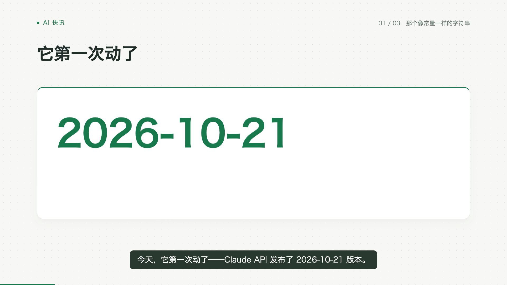
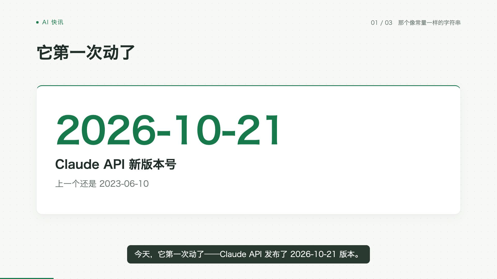
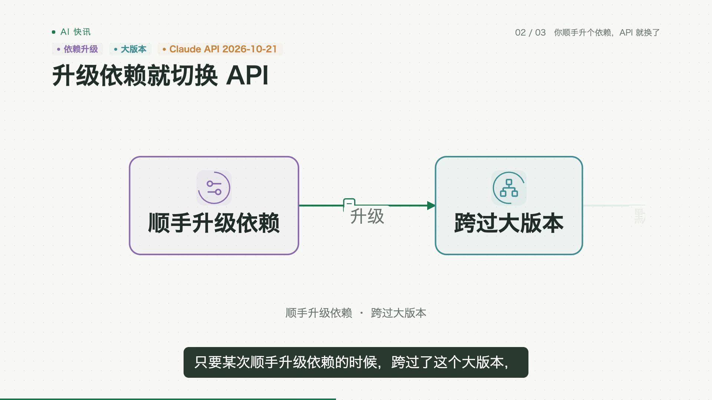
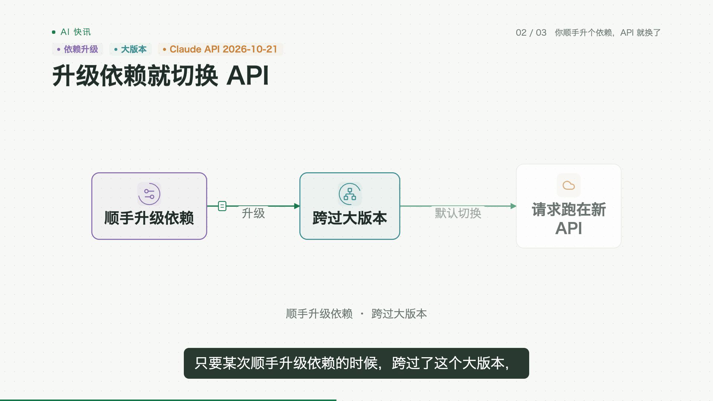
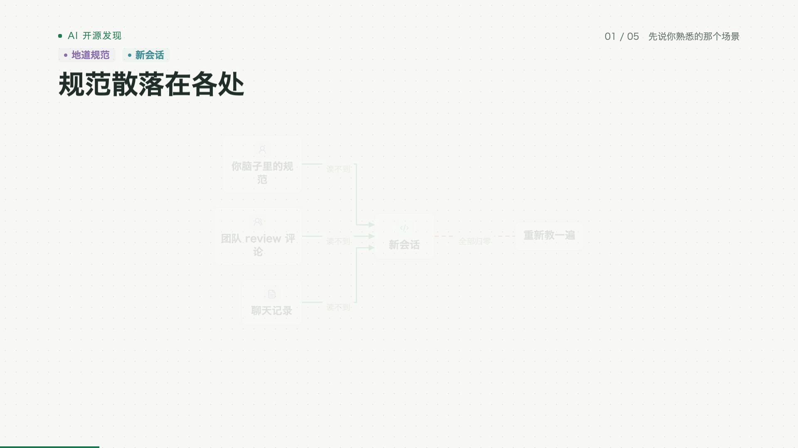
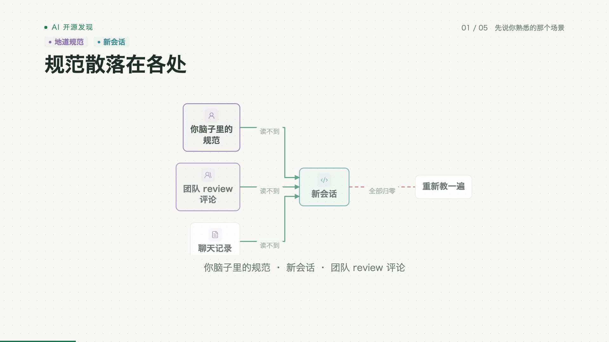
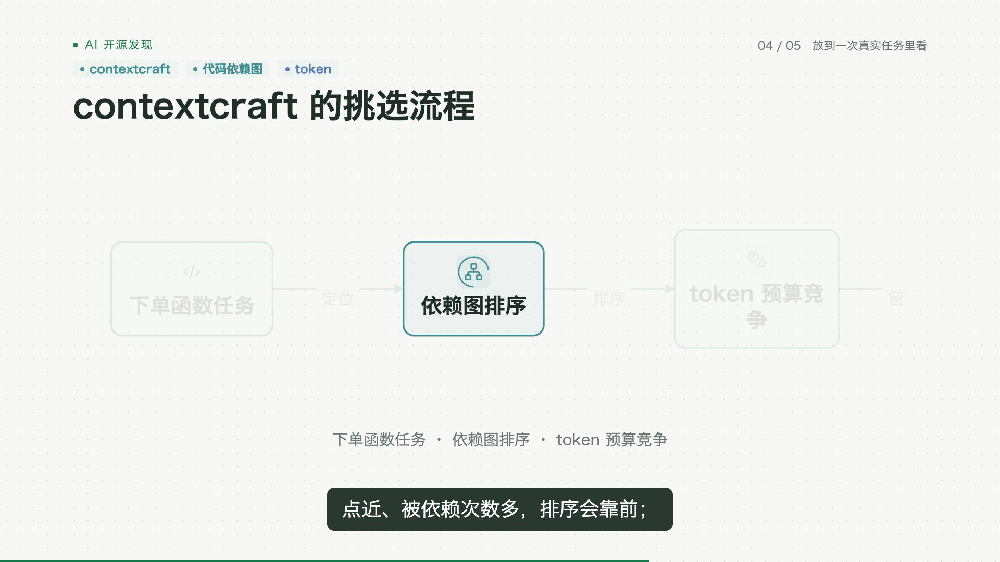
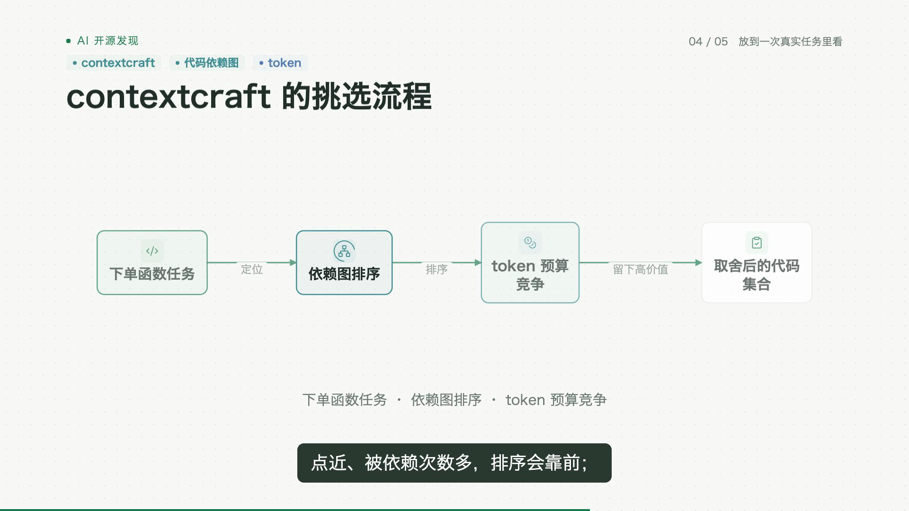

# 真实矩阵稿的画面优化

2026-11-01。沿用已有矩阵稿、保存的真实模型分镜、原声和字幕，检查上一轮能力在日常内容里的表现，并修正实片暴露的问题。没有新增模型或 TTS 调用，没有人工改分镜或 beat，也没有新增生产组件、依赖或设置项。

## 本轮改动

1. **流程图开场能读清。** 未讲到的节点和连线作为可读上下文保留；当前节点的强调在旁白锚点前完成，数据包动作仍按原锚点播放。
2. **减少无效推近。** 短流程的全景利用可用空间；布局字号达到 30px 的流程保持完整取景，讲解重点仍随颜色和动作变化。较密的小字流程保留局部镜头。普通图表和截图的取景规则沿用原实现。
3. **修正中文孤字折行。** 节点标签不再把“规范”“评论”拆成末尾孤字，原字符串、英文标记和命令保持原样。
4. **数字带着含义出现。** 大数字的名称、单位和说明保持可见，数值本身继续跟随原旁白重点，避免单独出现一个日期或数字。

这些是现有混合讲解组件的默认表现。既有 mixed_explainer、mixed_comparison、mixed_tutorial 配方以及研究端共同出片入口直接使用；没有增加需要用户开启的选项，也没有更改显式选择的专用形式。

## 实际样本

| 类型 | 现有矩阵稿 | 场景 | 内容时长 |
| --- | --- | --- | --- |
| 快讯 | Claude API 的版本号三年没动，今天动了——你顺手升个依赖就会切过去 | 11 | 120.90 秒 |
| 工具讲解 | AI 写的 Rust 能编译，一跑 clippy 就露馅：这个千星项目把「地道」变成了可执行的检查 | 21 | 249.10 秒 |
| 原理讲解 | 代码库塞不进上下文？这个项目用 PageRank 加背包问题替 agent 挑文件 | 15 | 217.27 秒 |

共 47 个场景、约 9 分 47 秒。样本来自已有 AI 快讯／开源矩阵任务，原文作为确定输入；本轮不重新核查其历史内容或改写结论。

运行目录为 `g3/data/acceptance-matrix-visual-20261101/`，完整视频分别位于 `news/release/video.mp4`、`tutorial/release/video.mp4`、`science/release/video.mp4`。原任务与原片未改动。

## 前后对照

历史原片与当前实现的相同时间点对照如下。对照也包含本轮之前已有的比较同步改进；本轮新增变化以开场流程、完整取景、折行和数字上下文为主。

| 原片 | 当前画面 |
| --- | --- |
|  |  |
|  |  |
|  |  |
|  |  |

首轮重放的全片解码和音轨核验已通过。抽帧进一步发现可读流程的推近会截断后续节点，因此增加保持全景规则；首轮 `after/`、流程探针与最终 `release/` 分别保留，未覆盖中间尝试。

最终三条均为 1920×1080、30fps、H.264/AAC，使用 `ffmpeg -xerror` 完整解码通过，总计 17,618 帧。原稿、源音频和素材保持一致；最终取景调整前后的 IR 完全一致。

| 最终成片 | 帧数 | 与原片解码音轨相关系数 | 记录 |
| --- | --- | --- | --- |
| 快讯 | 3,627 | 1.0 | [news-verification.json](news-verification.json) |
| 工具讲解 | 7,473 | 1.0 | [tutorial-verification.json](tutorial-verification.json) |
| 原理讲解 | 6,518 | 约 1.0 | [science-verification.json](science-verification.json) |

已检查每类 8 个相同时间点的前后画面，以及快讯 57 秒、工具讲解 31 秒、原理讲解 141 秒的全尺寸关键帧，确认数字上下文、关系可读性、折行和完整流程取景。未将抽帧检查表述为全片逐秒人工观看。总摘要、视频位置、源码及视频 SHA-256 见 [verification.json](verification.json)。

## 回归与默认接入

- 引擎回归：989 passed、1 skipped，61.40 秒。见最终 [engine-tests.log](engine-tests.log)。
- 包含 Root、流程图、镜头、代码和截图组件的 TypeScript 严格检查通过，使用本目录 [tsconfig.json](tsconfig.json)。
- 新回归覆盖小流程的全景利用、重点变化时保留完整流程、默认图表镜头不变，以及中文标签折行不丢字、不拆英文标记。
- 每个任务的渲染器沿用可信源码复制列表。本轮核对最终渲染源码 SHA-256，确认整片使用的是当前源码。
- 研究端仍从原共同入口提交混合分镜。没有新请求字段或上游编辑；真实媒体验证采用保存的正常任务重放，没有将其记作新的模型任务或逐矩阵自动调度验收。

命令在 `autovideo/` 执行：

```sh
python3 -m pytest tests g4/tests g3/tests g2/tests g1/tests/test_video_ir_v0_2_runtime.py -q
node g0/vendor/remotion-audiogram/node_modules/typescript/bin/tsc \
  -p g3/acceptance/matrix-visual-20261101/tsconfig.json
```

## 重放与核验

[replay_matrix.py](replay_matrix.py) 读取原任务计划，使用当前共用编译器和 Remotion，复用原声；不会调用模型或 TTS。[verify_matrix.py](verify_matrix.py) 检查完整媒体解码、帧数、尺寸、原声、素材及旁白，抽取相同时间点的关键帧。输出目录需为新目录。

```sh
python3 g3/acceptance/matrix-visual-20261101/replay_matrix.py \
  --source-attempt ORIGINAL_G2_RUN --output NEW_OUTPUT
python3 g3/acceptance/matrix-visual-20261101/verify_matrix.py \
  --root g3/data/acceptance-matrix-visual-20261101 --variant release
```

完整运行目录保留每次的 `render.log`、`decode.log`、原始计划、IR、实际渲染 props、源码哈希、音频哈希、关键帧和视频；可审阅的摘要与少量关键帧保存在本目录。旧版与失败尝试保留，不重写既有作品。
