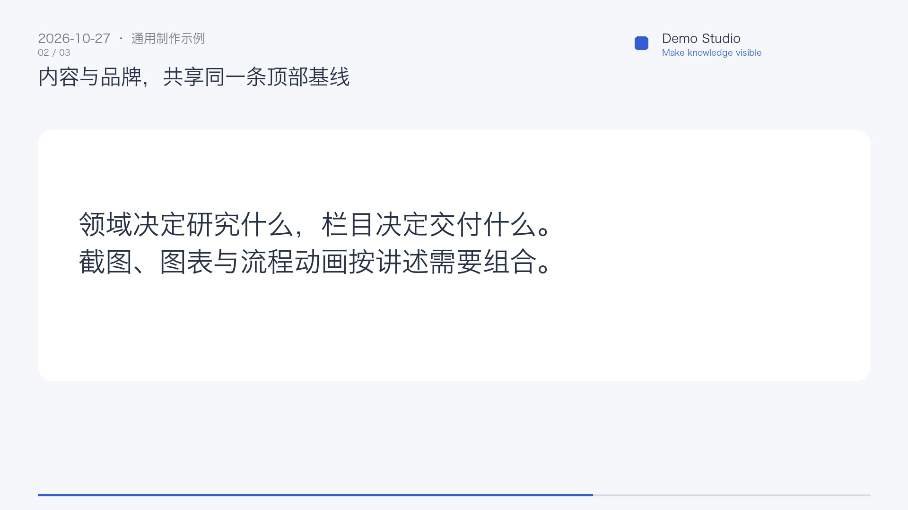

# 顶部版式与品牌声音验收

新任务使用冻结的共享顶部安全区：左侧为标题、日期及章节信息，右侧为品牌与可选 Slogan；左右边距、两行文字基线一致，二者之间留出间隔。旧任务复用旧版式。正文配色可单独开启，快速卡片与混合卡片沿用冻结品牌配色。

示例帧由快速卡片和品牌图层的真实绘制函数生成，使用中性 Demo 字样与几何标记。仓库只包含通用绘制、短音效与用户上传声标的合成能力；已安装个人品牌、Logo、原创片尾旋律及实际成片留在本地。

本地实际视频验证：1920×1080、30 fps、92.8 秒，完整 MP4 解码通过。字幕与原稿一致，正文旁白相关系数 0.99997；CTA 三个短音与图标进入同步，后接本地声标，混音峰值 0.626，无削波。原成片及历史发布记录保持原样。

验证记录：品牌/制作计划定向测试 52 项通过；品牌和设置前端测试 15 项通过；引擎完整回归 896 项通过、1 项跳过；冻结设计包 45 个文件哈希匹配，原设计测试 23 项通过。原设计清单与原测试未改动，校验副本不包含运行时目录、依赖和本地资产。

提交前从实际暂存区导出的独立快照另通过研究端 3208 项 Python 回归（6 项跳过）、579 项前端测试、配置校验、TypeScript、ESLint 和生产构建。个人品牌标识、素材哈希及音视频/运行数据路径检查通过，均未进入暂存区。
