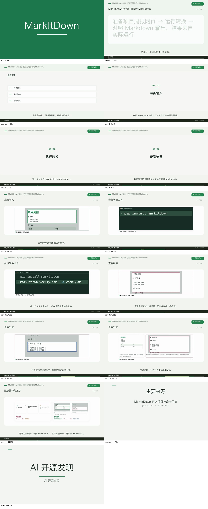

# 真实工具教程与既有包装统一验收

2026-11-01。以同一份项目周报完成 MarkItDown 实操：准备输入 → 执行转换 → 查看结果。已把栏目问候、片头片尾、步骤转场、代码承接、截图聚焦和输入输出对照接入同一条现有出片链路。

最终视频：`../../data/acceptance-tool-tutorial-20261101/unified-run/video.mp4`。1920×1080、30fps、3682 帧、122.73 秒；正文 115.73 秒。完整运行目录与历史尝试保留在忽略目录 `g3/data/acceptance-tool-tutorial-20261101/`。

## 实际工具操作

使用临时隔离环境中的 MarkItDown 0.1.9，实际执行 `markitdown weekly.html -o weekly.md`。用法来自 [Microsoft MarkItDown 官方项目](https://github.com/microsoft/markitdown)。输入为本次自编的本地 HTML 周报，输出保留了标题、列表和任务表格；转换未调用模型。输入、输出、真实浏览器截图及哈希保存在 [demo](demo/conversion.json)。输出截图是对实际 Markdown 原文的排版展示。

MarkItDown 只用于制作本次教程示例，没有成为 AutoVideo 的生产依赖。截图复用现有 Remotion 浏览器能力，未引入录屏框架或新服务。

## 同片集成的效果

- 栏目问候直接复用研究端 `episodes.greeting` 和 `writer._programme_frame`；“大家好，欢迎收看AI 开源发现。”在旁白中只出现一次。
- 既有片头、栏目角标、片尾和来源页共同包装；本片沿用教程配方的无背景音乐、无转场音设置。
- 既有导航改用“操作步骤／下一步／步骤回顾”；三张步骤转场复用原导航合成器，没有增加视频时长。
- 实际输入、输出截图经原有图片登记接口提交；旁白讲标题和列表时聚焦对应区域，讲表格时切换重点。
- 安装与转换使用原生 code_demo，保留上一步命令；调整字号选择后，`markitdown weekly.html -o weekly.md`完整显示在一行。
- 同一份输入与实际输出在既有拼贴画面中对照，结尾复用原故事回顾能力。



## 已接入现有教程配方

`mixed_tutorial` 升为 v2（资源目录 v7），继续使用原 API、worker、混合分镜和可信渲染器。

1. 配方已有的 `creative_intent` 现在进入每章原本的一次分镜请求，强调同一输入、实际操作和输出承接。没有增加模型阶段。
2. 教程没有显式 `episode` 时，复用已经规划的章节角色自动生成步骤，排除明确的开场和收尾；不再需要另配一份步骤索引。显式节目条目继续优先。
3. 修复实片重放发现的继承遗漏：画面／声音修订现在保留父任务的步骤映射。普通文稿编辑仍允许重新组织章节。

原正常任务保留了当时显式传入的三步配置；未改写历史请求。随后另用生产 `episode_navigation.apply` 对**去除 episode 的请求**执行实际合成，自动得到相同三步、相同时间；输出正文 MP4 的 SHA-256 与最终正文一致，见 [默认步骤验证](evidence/default-navigation-verification.json)。

本机 `127.0.0.1:8011` 已在空闲时加载新代码，API 返回教程配方 v2；重启前后的 312 条历史任务 ID、状态和源文哈希一致。见 [加载记录](evidence/service-reload.json)。样片使用隔离验收数据库，未加入主服务历史列表。

## 真实任务与验证

| 项目 | 结果 |
| --- | --- |
| 正常 API／worker 父任务 | `6908817b-10ce-415e-ab74-ad26f4ab9cd7`；5 章各一次真实分镜调用，本机 TTS，媒体 QA PASS |
| 最终 API／worker 修订 | `2df80b03-d640-4840-b6d7-10420ca9e0ea`；0 新模型、0 新 TTS 调用，沿用原稿、场景 props 和原声 |
| 自动步骤 | 准备输入 → 执行转换 → 查看结果；默认推导与显式配置的成片相同 |
| 视频与音频 | 正文和包装片完整解码通过；正文解码音轨与父任务相关系数 1.0；包装媒体 QA PASS |
| 引擎回归 | 994 passed、1 skipped，51.67 秒 |
| 研究端相关回归 | 203 passed，27.28 秒 |
| 渲染器 | 包含 Root 的 TypeScript 严格检查通过 |

引擎回归命令：`python3 -m pytest tests g4/tests g3/tests g2/tests g1/tests/test_video_ir_v0_2_runtime.py -q`。

研究端回归命令：`python3 -m pytest tests/test_video_goal_first.py tests/test_video_polish.py tests/test_episode_titles.py tests/test_episode_mode.py tests/test_video_scripts.py tests/test_video_visuals.py -q`。

渲染器检查：`node g0/vendor/remotion-audiogram/node_modules/typescript/bin/tsc -p g3/acceptance/matrix-visual-20261101/tsconfig.json`。

证据见 [成片核验](evidence/verification.json)、[媒体 QA](evidence/package-qa.json)、[引擎测试](evidence/engine-tests-release.log)、[研究端测试](evidence/research-tests.log)。抽查覆盖片头、问候、导读、三次步骤切换、安装、命令、输出标题与表格、输入输出对照、回顾、来源和片尾，共 15 个时间点，并检查命令、步骤卡及对照页全尺寸画面；未将关键帧抽查描述为全片人工审看。

原始 normal-run、正常父任务、缺失导航的中间修订 final-run，以及最终 unified-run 均保留。修订不改变父任务内容或覆盖旧成片。

## 复用脚本

从 autovideo 目录运行，输出目录必须使用新的路径：

```sh
python3 g3/acceptance/tool-tutorial-20261101/prepare_demo.py \
  --tool-python /path/to/markitdown-venv/bin/python --output /tmp/tool-demo-new
node g3/acceptance/tool-tutorial-20261101/capture_demo.cjs /tmp/tool-demo-new
python3 g3/acceptance/tool-tutorial-20261101/workflow_tool.py \
  --demo /tmp/tool-demo-new --output /tmp/tool-run-new
```

准备阶段只登记素材和生成请求。`workflow_tool.py --output /tmp/tool-run-new --run` 才执行正常模型／语音生成；配置使用项目现有模型服务。对已有父任务调用 `--replay-from <父任务目录> --output <新目录>` 走已有声音修订接口，以相同声音／速度复用原音频。`verify_tool.py --parent <父任务目录> --final <修订目录>` 复核媒体、继承、默认步骤、源代码哈希与原声。
