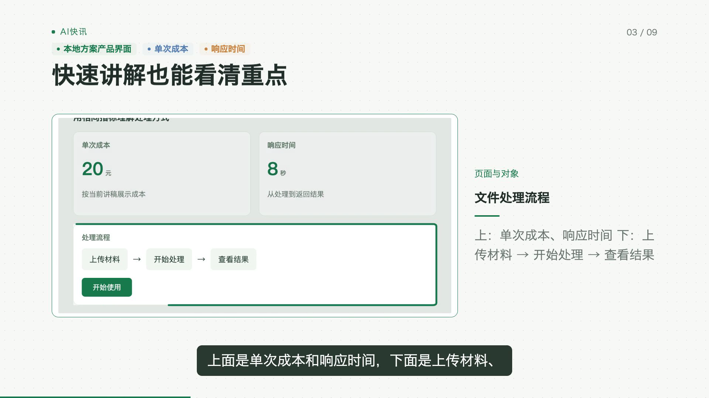
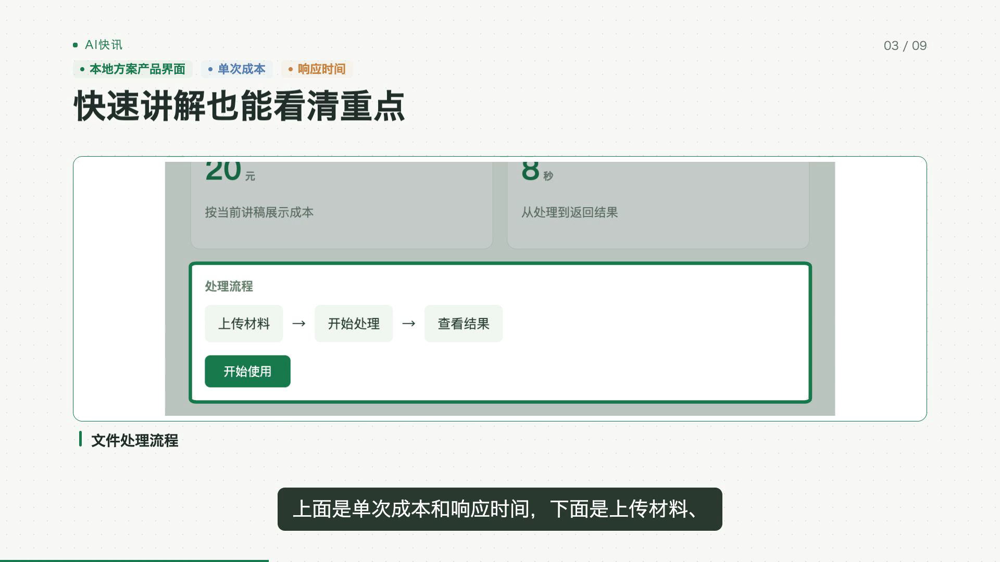
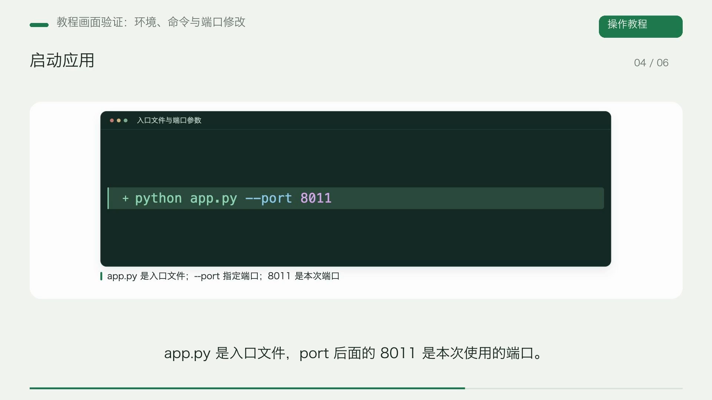
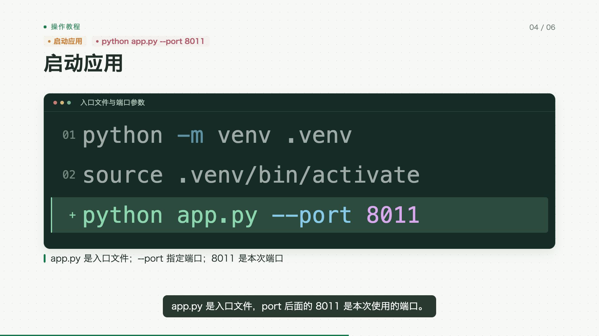
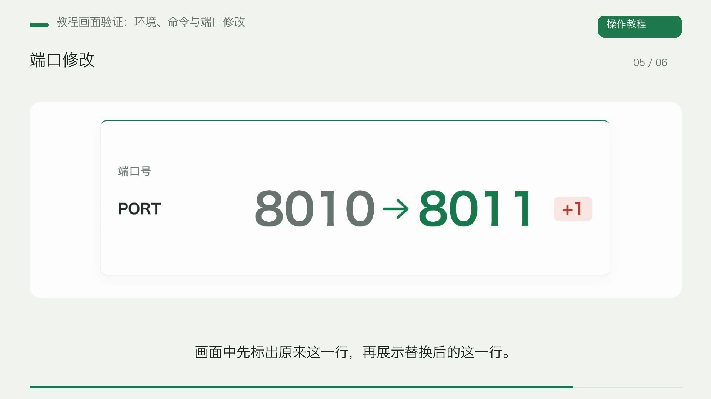
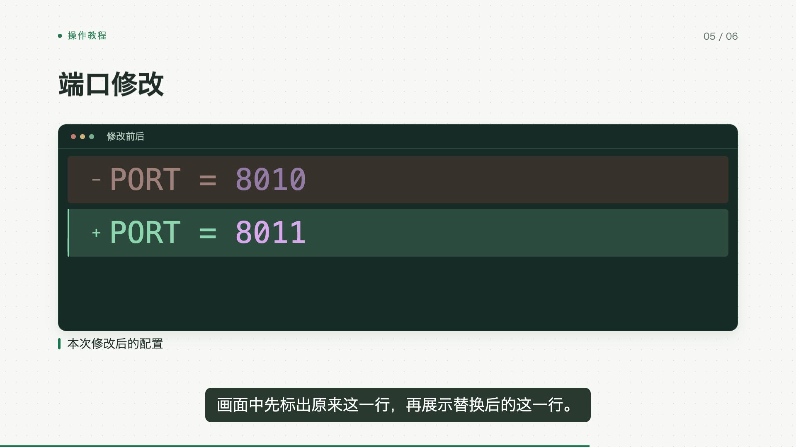

# 视频视觉优化验收

2026-11-01。交付目标：密集截图更好读，代码和配置改动直观可见，重点跟随旁白，相邻教程步骤保留上下文。实现复用现有混合分镜、中文配音、字幕对齐与可信渲染器，新增一个轻量 `code_demo` 组件，没有新增生产依赖。

## 实片与前后对照

完整视频和运行数据位于工作区忽略目录，未将大型生成数据加入版本管理：

- 最终教程：`g3/data/acceptance-visual-improvement-20261101/tutorial-release/video.mp4`。
- 截图前后：同目录下 `material-before/video.mp4`、`material-after/video.mp4`。
- 正常 API/worker 首次任务及其原始成片：`tutorial-run1/`。最终版本重放了该任务保存的真实模型计划和原声音频，编译器自动加入步骤承接和配置差异，未手改场景或 beat。

截图对照使用同一张图、同一旁白、同一段时间，前后均为 425 帧（14.17 秒）。密集截图获得更大的横向空间，重点区域的标记在旁白锚点前完成，旁白侧栏缩为对象标签。

| 改进前 | 改进后 |
| --- | --- |
|  |  |

教程第三步保留前两条命令，同时突出正在讲的启动命令。配置赋值修改展示原代码与替换结果。

| 初次正常任务 | 最终重放 |
| --- | --- |
|  |  |
|  |  |

以上教程对照的外层包装分别来自快速混合执行和共用 Remotion 重放；对照关注内容区、代码与同步，未把包装差异算作本轮改进。

## 正常任务与媒体验证

- Job：`5c02b20a-388b-4d72-9632-7556850c2178`，通过正常 `POST /api/jobs`、worker 与隔离任务库完成。
- 自编教程六段，原样讲稿输入；真实模型 `deepseek-v4.1-flash`，本地 Kokoro 配音，原有一次规划调用自动选中三页代码。用户已授权该次外部模型验收。
- 初次正常任务：媒体 QA PASS，1920×1080 / 30fps / H.264，2836 帧，94.53 秒；视频和音频完整解码通过。摘要见 [normal-job.json](normal-job.json)。
- 最终本地重放：2836 帧，全片解码 PASS；保存的旁白结构与源音频 SHA-256 不变。与正常任务解码音轨相关系数为 `0.9999747831`（两次 AAC 编码不要求字节一致），见 [tutorial-verification.json](tutorial-verification.json)。
- 截图前后：视频与音频完整解码 PASS，解码后音轨 SHA-256 一致，见 [material-verification.json](material-verification.json)。
- 本地重放没有新增模型或 TTS 调用，也没有人工修改场景／动作；期间的旧版和失败尝试保留在运行目录。
- 人工检查了截图前后关键帧，以及教程 20、40、55、70、90 秒的命令、承接、差异和回顾画面；最终又检查了行号修正后的 55、70 秒画面。

## 回归

| 检查 | 结果 | 记录 |
| --- | --- | --- |
| 引擎合同与离线回归 | 986 passed，1 skipped，52.92 秒 | [engine-tests.log](engine-tests.log) |
| 研究端共同出片、制作配置和自动批次 | 87 passed，1 warning，14.05 秒 | [research-tests.log](research-tests.log) |
| 渲染器与关联模块 TypeScript 严格检查 | PASS | [typescript.log](typescript.log) |
| git diff --check | PASS | [receipt.json](receipt.json) |

引擎命令（在 `autovideo/`）：

```sh
python3 -m pytest tests g4/tests g3/tests g2/tests g1/tests/test_video_ir_v0_2_runtime.py -q
```

核心行为测试在 `g2/tests/test_code_demo.py` 和 `g2/tests/test_material_shots.py`，覆盖原文、跨段语音锚点、词级重新对齐、布局反馈、字段修订与跨步骤上下文。最终渲染组件改动另经实片检查，测试没有代替媒体验收。

## 重放入口

- [workflow_tutorial.py](workflow_tutorial.py)：正常 API/worker 教程验收，会调用配置中的真实模型与本地 TTS。本次已完成一次。
- [replay_tutorial.py](replay_tutorial.py)：读取上述任务保存的模型计划、讲稿与音频，使用当前共用编译器／渲染器重放，不调用模型和 TTS。
- [verify_tutorial.py](verify_tutorial.py)：全片解码、帧数、旁白与音频核验，并抽取关键帧。
- [replay_material.py](replay_material.py)：读取既有真实截图任务，复用原图原声重放相同场景。

示例（在 `autovideo/`，输出需使用新的目录）：

```sh
python3 g3/acceptance/visual-improvement-20261101/replay_tutorial.py \
  --source g3/data/acceptance-visual-improvement-20261101/tutorial-run1 \
  --output g3/data/acceptance-visual-improvement-20261101/tutorial-replay-new
python3 g3/acceptance/visual-improvement-20261101/verify_tutorial.py \
  --source g3/data/acceptance-visual-improvement-20261101/tutorial-run1 \
  --replay g3/data/acceptance-visual-improvement-20261101/tutorial-replay-new
```

## 接入与边界

已启用混合分镜的普通任务与矩阵任务使用同一组件目录，无需新请求字段。每个新任务复制当前可信渲染器，已有成片保留。已覆盖正常快速混合任务及当前共用渲染器，研究端入口由离线回归覆盖；未为每个矩阵分别追加付费模型验收。

每页代码 1–6 行，长内容通过既有布局反馈拆分。连续承接面向同章相邻代码页，前文过长时减少保留行。录屏登记、库存素材和新的过程仿真仍为按实片需要决定的后续候选，未记为已交付。范围与调研采用方式见 [开发计划](../../INTEGRATION_DEVELOPMENT_PLAN.md)。
