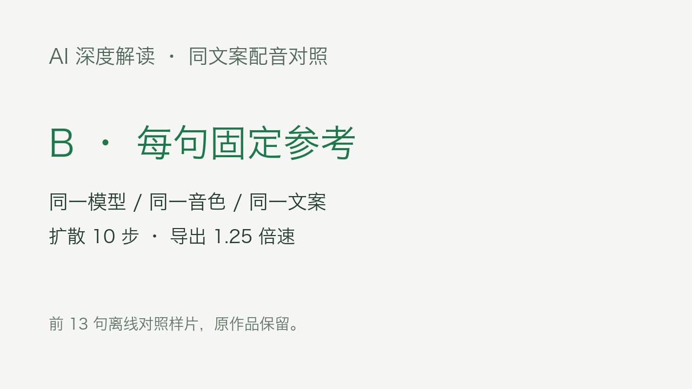

# VoxCPM 默认使用固定参考音

2026-10-27。针对深度片 `a760d4a7244e4a7c81e621053aec717b` 前约 22 秒声音较粗糙、21.873 秒回到原参考后变化的问题，默认配音不再把生成的句子作为下一句的声音提示。

## 已接入生产入口

`g2/voices.py` 的 `VOXCPM_DEFAULT_CHAIN` 统一为 `anchor`，正常生产的 `run_g2.synthesize_and_align` 与直接生成入口 `voxcpm_voice.generate` 都使用它。每句的参考音和续读提示均来自原始参考 WAV；前一句生成的音频不进入下一句的模型输入，切断响度和声音质感逐句累积的路径。

原音色、讲稿、10 步扩散、停顿规则与导出倍速保持。所有经公共链路新生成的 VoxCPM 配音默认采用这一方式，无需新增矩阵配置或人工选项。`guarded`、`chain` 仍可显式指定作对照；已有 `guarded` 只监测语速，不作为音质稳定的默认方案。

原缓存按设置和实现指纹区分，新方式不会命中旧的续音缓存；不删除原缓存。新生成子进程读取当前代码，无需重启网关、研究端或 AutoVideo。已生成的旧稿件音频、原片和正在运行的旧进程保持。

## 真实同文案对照

从原片取开头 13 句及其原始逐句 WAV，使用相同模型、参考音、文本和 10 步设置重新配音。新请求省略 `chain`，验证新默认实际生效；13 句生成回执全部为 `prompt=anchor`。本机模型生成耗时 189.736 秒，没有新的云端配音调用。

沿原停顿规则拼接并以相同 1.25 倍速导出，分别制成静态标签卡的 A/B MP4。这是用于比较声音的真实短片，不是原深度视频的替换版本。

| 项目 | A：原逐句续音 | B：每句固定参考 |
| --- | --- | --- |
| 13 句全句 RMS 范围 | 6.35 dB | 2.83 dB |
| 13 句全句 RMS 标准差 | 1.92 dB | 0.78 dB |
| 同文案第 6 句的 5—10 kHz 能量占比 | 10.84% | 3.66% |
| 原始逐句满幅削波采样 | 0 | 0 |
| 对照片长度 | 48.967 秒 | 52.067 秒 |
| MP4 音轨与拼接 WAV 的相关性 | 0.999908 | 0.999934 |
| 完整音视频解码 | PASS | PASS |

等响度换算后，第 6 句低人声能量窗的高频残留指示量降低约 2.65 dB。该指标包含辅音和呼吸，不是正式信噪比；本次没有主观听音判断，不宣称所有合成瑕疵已经消失。数据支持减轻续音漂移，且默认模型输入已不再递归使用生成的句子。

短片变长是固定参考生成的实际语速差异；导出倍速仍为 1.25，新任务仍按实测配音安排时间线。

## 回归与证据

新增测试实际截取模型调用参数，确认默认模式三句话均使用原始参考；显式旧模式仍按原设置运行。生产入口测试确认省略配置时传入 `anchor`，显式覆盖保持。最终完整回归 **907 passed、1 skipped**，耗时 46.08 秒。

首次完整运行有两项本地启动器测试因沙箱禁止绑定临时端口而失败；同两项在允许临时端口的环境补跑通过，最终完整回归也在该环境全部通过。未为测试启动、重启或停止生产服务。

本目录 [verification.json](verification.json) 保存真实生成、对照指标与两份媒体检查。下图直接采自 B 短片：

本机原始证据位于 `g3/data/voice-stability-20261027/`：`input.json`、`generation.log`、`anchor/voice-report.json`、逐句 WAV、`segment-comparison.json`、A/B MP4、完整解码日志和 `regression-final.txt`。用户试听目录为 `/Volumes/个人资料/2026/视频生成工作流/AI创作/矩阵产品化/AI/20261027-固定参考配音对照/`。原片保持，提交内容包含本轮修复、回归测试与验收摘要。
