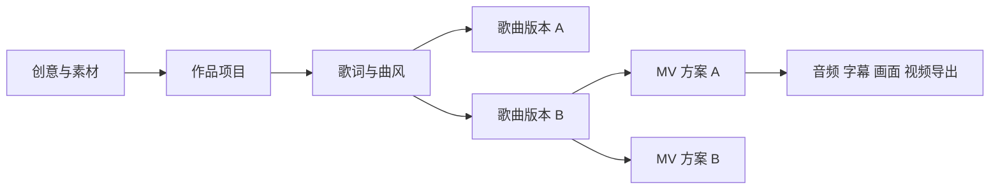

# 独立音乐创作工作台

> 2026-11-10 已归档，等待用户确认。本文保留产品讨论与设计；未来功能尚未实现，也不是继续执行的授权。最新状态见 [归档交接](ARCHIVE.md)。

## 已确定的产品决策

1. 音乐项目独立于现有研究视频 workflow，按作品推进，不设周期任务。
2. 核心环节为创意挖掘、歌曲创作、视频生成；优先打磨创意。
3. 创作可以跨 AI、生活、职场、消费、情绪、故事与知识，不将 AI 吐槽固化成唯一题材。
4. 目标是形成持续产出有吸引力视频的能力。额度、生成次数和作品数量不能代替观看与传播表现。
5. 保留创作失败与不同版本。用户已满意的歌曲可以直接进入 MV，不强迫重走流程。
6. 打磨成熟后再考虑接入剪映。这里按用户原文保留“剪映”目的地，不擅自将其改为“研映”。

## 创意挖掘

入口包括随手记录经历、观众留言、用户主动发起的主题探索、参考作品的表达启发。不会自动抓取个人聊天与账号信息，也不会自行安装周期采集。

一次挖掘先围绕具体素材发展几个不同人物立场，再把有潜力的方向写成可判断的创意卡：一句话故事、受众、情绪变化、人物视角、副歌钩子、可视化场景和结尾。

后续交互动作：换视角、找具体场景、增强副歌记忆点、发展系列、探索不同情绪。生成结果应是可独立编辑的候选卡，不是只替换标题的重复作品。

## 对象关系

- 作品有独立 ID、修订号、创作字段与所处阶段。
- 一份创意有多个歌曲版本；歌曲版本保留生成时的歌词和风格快照。
- MV 绑定具体歌曲 ID，不随“当前采用版本”改变而自动换歌。
- v0.1 MV 只有语义分镜草案，没有音频时间码和渲染状态。
- 项目 JSON 以 `schema_version` 标识；导出只包含创作数据，不含账户凭据。

## 歌曲与 MV

短期允许浏览器完成外部歌曲生成，再登记歌曲链接、时长和试听反馈。订阅权益、API 额度、模型可用性分别确认，不把网页订阅默认视为批量 API 服务。

后续先导入用户选中的音频，以实际音频建立歌词时间轴。画面表达可以是动态歌词、界面情景、角色故事或插画拼贴；同一歌曲可以产生不同视频方案。

生成和渲染的后台任务是用户动作触发的执行队列，与周期调度有明确区别。后台任务可以有进度、恢复和历史，不需要固定时间自动创作。

## 未来衔接

优先考虑通用媒体交付包：成片 MP4、歌曲音频、SRT 字幕、画面素材、分镜和时间轴 JSON。各文件的实际完成情况清楚标记。

剪映专用适配作为独立模块，在确认目标版本、可用导入方式和真实工程验证后实现。当前不承诺可以一键生成或合并剪映工程。

与研映及 AutoVideo 的可能复用也通过适配器处理，禁止从本项目直接读写其业务表或改变其常驻任务。

## 发布反馈

后续可按作品记录发布链接、相同发布时长窗口的播放、观看时长、评论中的记忆点和下一期需求。把反馈重新变成创意素材。先手动导入，平台适配后续接入；不预设音乐形式一定比知识视频表现更好。
